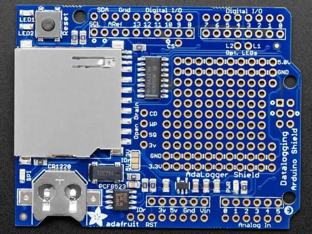

<!-- Copyright 2015-2026 Zephyr Project members and individual contributors. -->
<!-- SPDX-License-Identifier: Apache-2.0 -->
<!-- 中文翻译；编号、导航与译注为本地新增。 -->

<a id="adafruit-data-logger-shield"></a>

<a id="id1"></a>

# 第11章\_Adafruit数据记录扩展板（Data Logger Shield）

原文：[官方页面](https://docs.zephyrproject.org/latest/boards/shields/adafruit_data_logger/doc/index.html)。读取日期：2026-10-16；来源摘要见[来源记录](../SOURCES.md)。

<a id="overview"></a>

## 概述（Overview）

Adafruit Data Logger B版具有带电池备份的NXP PCF8523实时时钟／日历、SD卡接口、2个用户LED及原型制作区。（[Adafruit数据记录扩展板（Data Logger Shield）](https://learn.adafruit.com/adafruit-data-logger-shield/)；[NXP PCF8523 带电池备份的实时时钟／日历](https://www.nxp.com/docs/en/data-sheet/PCF8523.pdf)）

<a id="id8"></a>



Adafruit数据记录扩展板（Data Logger Shield），图片来源：Adafruit

注意（Note）

不支持旧的Adafruit Data Logger A版。

<a id="pin-assignments"></a>

### 引脚分配（Pin Assignments）

<table>
<tr>
<th>扩展板连接器引脚</th>
<th>功能（Function）</th>
</tr>
<tr>
<td><code>D3</code></td>
<td><a id="id2"></a><br><br>绿色用户LED1 <a href="#id5">注1</a></td>
</tr>
<tr>
<td><code>D4</code></td>
<td><a id="id3"></a><br><br>红色用户LED2 <a href="#id5">注1</a></td>
</tr>
<tr>
<td><code>D7</code></td>
<td><a id="id4"></a><br><br>PCF8523 RTC中断INT1 <a href="#id6">注2</a></td>
</tr>
<tr>
<td>D10</td>
<td>SD卡SPI片选CS</td>
</tr>
<tr>
<td>D11</td>
<td>SD卡SPI MOSI</td>
</tr>
<tr>
<td>D12</td>
<td>SD卡SPI MISO</td>
</tr>
<tr>
<td>D13</td>
<td>SD卡SPI时钟SCK</td>
</tr>
<tr>
<td>串行数据线（SDA）</td>
<td>PCF8523 RTC的I2C数据SDA</td>
</tr>
<tr>
<td>串行时钟线（SCL）</td>
<td>PCF8523 RTC的I2C时钟SCL</td>
</tr>
</table>

<a id="id5"></a>

〔1〕 ([1](#id2),[2](#id3)) 用户LED默认未连接D3及D4。使用LED1须用跳线连接L1与数字I/O 3，使用LED2须连接L2与数字I/O 4。

<a id="id6"></a>

〔[2](#id4)〕 PCF8523 RTC的INT1默认未连接D7。要使用闹钟回调或每秒脉冲回调等RTC中断功能，须用跳线连接SQ与数字I/O 7。INT1为开漏输出，但扩展板定义已启用GPIO内部上拉，无需外接上拉电阻。

<a id="requirements"></a>

## 前置要求（Requirements）

该扩展板只能用于提供Arduino连接器配置，并定义SPI及GPIO接口节点别名的开发板，详情见“[扩展板（Shields）](https://docs.zephyrproject.org/latest/hardware/porting/shields.html#shields)”。

<a id="programming"></a>

## 编程（Programming）

调用west build时设置--shield adafruit_data_logger，例如：

```text
# From the root of the zephyr repository
west build -b frdm_k64f --shield adafruit_data_logger tests/drivers/rtc/rtc_api
```

## 译注

仅支持Data Logger B版。用户LED与RTC中断需要额外连线，不能假定出厂已接到Arduino引脚。

## 原文外链核对

2026-10-16核对并重试以下原文外链时未能确认可访问性，保留原始目标，不将访问失败解释为原文内容有误。

- [PCF8523.pdf](https://www.nxp.com/docs/en/data-sheet/PCF8523.pdf)：HTTP Error 404: Not Found。

---

[上一章](P010_Adafruit_AW9523_GPIO_Expander_and_LED_Driver.md) · [返回大纲](大纲.md) · [全站翻译进度](../PROGRESS.md) · [下一章](P012_Adafruit_DPS310_Shield.md)
