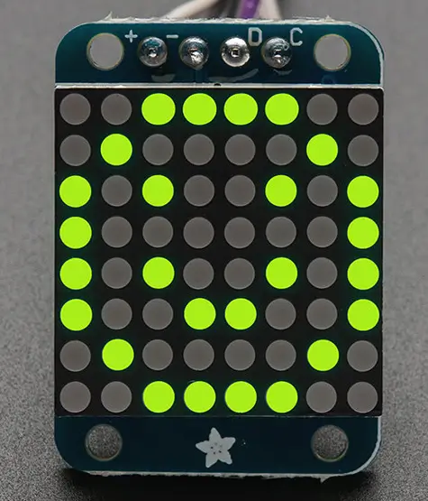

<!-- Copyright 2015-2026 Zephyr Project members and individual contributors. -->
<!-- SPDX-License-Identifier: Apache-2.0 -->
<!-- 中文翻译；编号、导航与译注为本地新增。 -->

<a id="adafruit-ht16k33-led-matrix-shield"></a>

<a id="adafruit-ht16k33"></a>

# 第18章\_Adafruit HT16K33 LED矩阵扩展板（LED Matrix Shield）

原文：[官方页面](https://docs.zephyrproject.org/latest/boards/shields/adafruit_ht16k33/doc/index.html)。读取日期：2026-10-16；来源摘要见[来源记录](../SOURCES.md)。

<a id="overview"></a>

## 概述（Overview）

Adafruit小型1.2英寸8×8 LED矩阵及I2C背板采用合泰Holtek HT16K33 LED控制驱动器，配有8×8 LED矩阵及2个STEMMA QT连接器。（[Adafruit 1.2英寸8×8 LED点阵及I2C背板](https://www.adafruit.com/product/1632)；[Holtek HT16K33 LED控制器驱动](https://www.holtek.com/page/vg/HT16K33A)）

此定义也可用于其他采用HT16K33的扩展板。控制器最多提供128个LED，不同扩展板的LED编号与实际灯位置映射可能不同，见关于[其他LED背板的讨论](https://learn.adafruit.com/adafruit-led-backpack)。

<a id="id1"></a>



Adafruit 8×8 LED矩阵扩展板，图片来源：Adafruit

<a id="requirements"></a>

## 前置要求（Requirements）

该扩展板可用于提供I2C连接器的开发板，例如STEMMA QT或Qwiic；目标板必须定义zephyr_i2c节点标签，详情见“[扩展板（Shields）](https://docs.zephyrproject.org/latest/hardware/porting/shields.html#shields)”。

<a id="pin-assignments"></a>

### 引脚分配（Pin Assignments）

<table>
<tr>
<th>扩展板引脚（Shield Pin）</th>
<th>功能（Function）</th>
</tr>
<tr>
<td>串行数据线（SDA）</td>
<td>HT16K33 I2C数据线（SDA）</td>
</tr>
<tr>
<td>串行时钟线（SCL）</td>
<td>HT16K33 I2C时钟线（SCL）</td>
</tr>
</table>

设备树设置见[holtek,ht16k33](../led_issi_nordic_nxp_binding_reference/P004_holtek_ht16k33.md#std-dtcompatible-holtek-ht16k33)绑定文档。

<a id="programming"></a>

## 编程（Programming）

调用west build时设置--shield adafruit_ht16k33，例如运行带按键扫描的HT16K33 LED驱动示例：（[HT16K33 LED驱动与按键扫描](../driver_samples/P030_HT16K33_LED与按键扫描示例.md#ht16k33)）

```text
# From the root of the zephyr repository
west build -b adafruit_qt_py_rp2040 --shield adafruit_ht16k33 samples/drivers/ht16k33
```

---

[上一章](P017_Adafruit_FeatherWing_MAX3421E_Shield.md) · [返回大纲](大纲.md) · [全站翻译进度](../PROGRESS.md) · [下一章](P019_Adafruit_HTS221_Shield.md)
