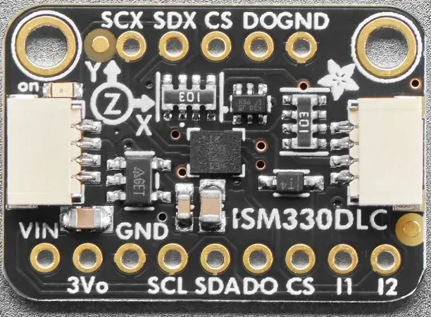

<!-- Copyright 2015-2026 Zephyr Project members and individual contributors. -->
<!-- SPDX-License-Identifier: Apache-2.0 -->
<!-- 中文翻译；编号、导航与译注为本地新增。 -->

<a id="adafruit-ism330dhcx-shield"></a>

<a id="adafruit-ism330dhcx"></a>

# 第24章\_Adafruit ISM330DHCX扩展板（Shield）

原文：[官方页面](https://docs.zephyrproject.org/latest/boards/shields/adafruit_ism330dhcx/doc/index.html)。读取日期：2026-10-16；来源摘要见[来源记录](../SOURCES.md)。

<a id="overview"></a>

## 概述（Overview）

Adafruit ISM330DHCX六自由度惯性测量单元（6 DoF IMU）扩展板采用意法半导体ISM330DHCX，带2个STEMMA QT连接器。（[Adafruit ISM330DHCX 六自由度惯性测量传感器 扩展板](https://learn.adafruit.com/lsm6dsox-and-ism330dhc-6-dof-imu/)；[ST ISM330DHCX 六自由度惯性测量单元](https://www.st.com/en/mems-and-sensors/ism330dhcx.html)）

<a id="id1"></a>



Adafruit ISM330DHCX扩展板（Shield），图片来源：Adafruit

<a id="requirements"></a>

## 前置要求（Requirements）

该扩展板可用于提供I2C连接器的开发板，例如STEMMA QT或Qwiic；目标板必须定义zephyr_i2c节点标签，详情见“[扩展板（Shields）](https://docs.zephyrproject.org/latest/hardware/porting/shields.html#shields)”。

<a id="pin-assignments"></a>

### 引脚分配（Pin Assignments）

<table>
<tr>
<th>扩展板引脚（Shield Pin）</th>
<th>功能（Function）</th>
</tr>
<tr>
<td>串行数据线（SDA）</td>
<td>ISM330DHCX I2C数据线（SDA）</td>
</tr>
<tr>
<td>串行时钟线（SCL）</td>
<td>ISM330DHCX I2C时钟线（SCL）</td>
</tr>
<tr>
<td>DO</td>
<td>ISM330DHCX I2C地址选择，默认下拉</td>
</tr>
<tr>
<td>片选（CS）</td>
<td>ISM330DHCX：置高电平强制使用I2C模式</td>
</tr>
<tr>
<td>I1</td>
<td>ISM330DHCX中断输出</td>
</tr>
<tr>
<td>I2</td>
<td>ISM330DHCX第二中断输出</td>
</tr>
</table>

若要使用中断，须另接一根线，将扩展板连接到微控制器板GPIO；如何修改设备树见[st,ism330dhcx](../compatible_binding_reference/P076_st_ism330dhcx.md#std-dtcompatible-st-ism330dhcx)绑定文档。

<a id="programming"></a>

## 编程（Programming）

调用west build时设置--shield adafruit_ism330dhcx，例如运行通用三轴加速度计轮询示例：（[通用三轴加速度计轮询（Generic 3-Axis Accelerometer Polling）](../sensors/P009_三轴加速度计轮询示例.md#accel_polling)）

```text
# From the root of the zephyr repository
west build -b adafruit_qt_py_rp2040 --shield adafruit_ism330dhcx samples/sensor/accel_polling
```

## 原文外链核对

2026-10-16核对并重试以下原文外链时未能确认可访问性，保留原始目标，不将访问失败解释为原文内容有误。

- [ism330dhcx.html](https://www.st.com/en/mems-and-sensors/ism330dhcx.html)：HTTP Error 567: Unknown Status。

---

[上一章](P023_Adafruit_INA3221_Shield.md) · [返回大纲](大纲.md) · [全站翻译进度](../PROGRESS.md) · [下一章](P025_Adafruit_LIS2MDL_Shield.md)
