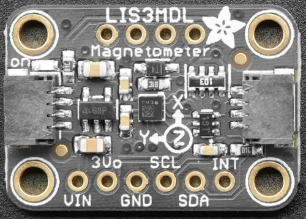

<!-- Copyright 2015-2026 Zephyr Project members and individual contributors. -->
<!-- SPDX-License-Identifier: Apache-2.0 -->
<!-- 中文翻译；编号、导航与译注为本地新增。 -->

<a id="adafruit-lis3mdl-shield"></a>

<a id="adafruit-lis3mdl"></a>

# 第27章\_Adafruit LIS3MDL扩展板（Shield）

原文：[官方页面](https://docs.zephyrproject.org/latest/boards/shields/adafruit_lis3mdl/doc/index.html)。读取日期：2026-10-16；来源摘要见[来源记录](../SOURCES.md)。

<a id="overview"></a>

## 概述（Overview）

Adafruit LIS3MDL三轴磁力计扩展板采用意法半导体LIS3MDL，带2个STEMMA QT连接器。（[Adafruit LIS3MDL 三轴磁力计传感器 扩展板](https://learn.adafruit.com/lis3mdl-triple-axis-magnetometer)；[ST LIS3MDL 三轴磁力计](https://www.st.com/en/mems-and-sensors/lis3mdl.html)）

<a id="id1"></a>



Adafruit LIS3MDL扩展板（Shield），图片来源：Adafruit

<a id="requirements"></a>

## 前置要求（Requirements）

该扩展板可用于提供I2C连接器的开发板，例如STEMMA QT或Qwiic；目标板必须定义zephyr_i2c节点标签，详情见“[扩展板（Shields）](https://docs.zephyrproject.org/latest/hardware/porting/shields.html#shields)”。

<a id="pin-assignments"></a>

### 引脚分配（Pin Assignments）

<table>
<tr>
<th>扩展板引脚（Shield Pin）</th>
<th>功能（Function）</th>
</tr>
<tr>
<td>串行数据线（SDA）</td>
<td>LIS3MDL I2C数据线（SDA）</td>
</tr>
<tr>
<td>串行时钟线（SCL）</td>
<td>LIS3MDL I2C时钟线（SCL）</td>
</tr>
<tr>
<td>中断（INT）</td>
<td>LIS3MDL中断输出</td>
</tr>
<tr>
<td>DO/AD1</td>
<td>LIS3MDL I2C地址选择引脚</td>
</tr>
<tr>
<td>片选（CS）</td>
<td>LIS3MDL：置高电平强制使用I2C模式</td>
</tr>
<tr>
<td>DRDY</td>
<td>LIS3MDL数据就绪输出</td>
</tr>
</table>

若要使用DRDY输出，须另接一根线，将扩展板连接到微控制器板GPIO；如何修改设备树见[st,lis3mdl-magn](../sensor_st_lis_lps_binding_reference/P017_st_lis3mdl-magn.md#std-dtcompatible-st-lis3mdl-magn)绑定文档。

<a id="programming"></a>

## 编程（Programming）

调用west build时设置--shield adafruit_lis3mdl，例如运行磁力计传感器示例：（[磁力计传感器（Magnetometer Sensor）](../sensors/P020_磁力计轮询示例.md#magn_polling)）

```text
# From the root of the zephyr repository
west build -b adafruit_feather_rp2040 --shield adafruit_lis3mdl samples/sensor/magn_polling
west flash
```

## 原文外链核对

2026-10-16核对并重试以下原文外链时未能确认可访问性，保留原始目标，不将访问失败解释为原文内容有误。

- [lis3mdl.html](https://www.st.com/en/mems-and-sensors/lis3mdl.html)：HTTP Error 567: Unknown Status。

---

[上一章](P026_Adafruit_LIS3DH_Shield.md) · [返回大纲](大纲.md) · [全站翻译进度](../PROGRESS.md) · [下一章](P028_Adafruit_LPS22_Shield.md)
