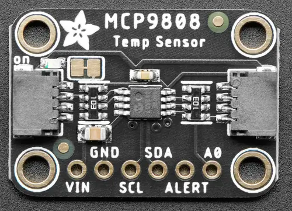

<!-- Copyright 2015-2026 Zephyr Project members and individual contributors. -->
<!-- SPDX-License-Identifier: Apache-2.0 -->
<!-- 中文翻译；编号、导航与译注为本地新增。 -->

<a id="adafruit-mcp9808-shield"></a>

<a id="adafruit-mcp9808"></a>

# 第32章\_Adafruit MCP9808扩展板（Shield）

原文：[官方页面](https://docs.zephyrproject.org/latest/boards/shields/adafruit_mcp9808/doc/index.html)。读取日期：2026-10-16；来源摘要见[来源记录](../SOURCES.md)。

<a id="overview"></a>

## 概述（Overview）

Adafruit MCP9808高精度I2C温度传感器扩展板采用Microchip MCP9808，带2个STEMMA QT连接器。（[Adafruit MCP9808 高精度I2C温度传感器 扩展板](https://learn.adafruit.com/adafruit-mcp9808-precision-i2c-temperature-sensor-guide)；[Microchip MCP9808 温度传感器](https://www.microchip.com/en-us/product/mcp9808)）

<a id="id1"></a>



Adafruit MCP9808扩展板（Shield），图片来源：Adafruit

<a id="requirements"></a>

## 前置要求（Requirements）

该扩展板可用于提供I2C连接器的开发板，例如STEMMA QT或Qwiic；目标板必须定义zephyr_i2c节点标签，详情见“[扩展板（Shields）](https://docs.zephyrproject.org/latest/hardware/porting/shields.html#shields)”。

<a id="pin-assignments"></a>

### 引脚分配（Pin Assignments）

<table>
<tr>
<th>扩展板引脚（Shield Pin）</th>
<th>功能（Function）</th>
</tr>
<tr>
<td>串行数据线（SDA）</td>
<td>MCP9808 I2C数据线（SDA）</td>
</tr>
<tr>
<td>串行时钟线（SCL）</td>
<td>MCP9808 I2C时钟线（SCL）</td>
</tr>
<tr>
<td>A0</td>
<td>MCP9808 I2C地址</td>
</tr>
<tr>
<td>ALERT</td>
<td>MCP9808中断输出</td>
</tr>
</table>

若要使用中断，须另接一根线，将扩展板连接到微控制器板GPIO；如何修改设备树见[jedec,jc-42.4-temp](../sensor_liteon_maxim_temperature_binding_reference/P004_jedec_jc-42.4-temp.md#std-dtcompatible-jedec-jc-42.4-temp)绑定文档。

<a id="programming"></a>

## 编程（Programming）

调用west build时设置--shield adafruit_mcp9808，例如运行[符合JEDEC JC 42.4的温度传感器](../sensors/P030_JEDEC温度传感器示例.md#jc42)测量示例：

```text
# From the root of the zephyr repository
west build -b adafruit_qt_py_rp2040 --shield adafruit_mcp9808 samples/sensor/jc42
```

## 原文外链核对

2026-10-16核对并重试以下原文外链时未能确认可访问性，保留原始目标，不将访问失败解释为原文内容有误。

- [mcp9808](https://www.microchip.com/en-us/product/mcp9808)：HTTP Error 403: Forbidden。

---

[上一章](P031_Adafruit_MCP4728_Quad_DAC_Shield.md) · [返回大纲](大纲.md) · [全站翻译进度](../PROGRESS.md) · [下一章](P033_Adafruit_5x5_NeoPixel_Grid_BFF.md)
