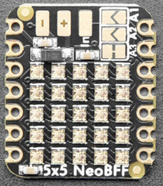

<!-- Copyright 2015-2026 Zephyr Project members and individual contributors. -->
<!-- SPDX-License-Identifier: Apache-2.0 -->
<!-- 中文翻译；编号、导航与译注为本地新增。 -->

<a id="adafruit-5x5-neopixel-grid-bff"></a>

<a id="adafruit-neopixel-grid-bff"></a>

# 第33章\_Adafruit 5×5 NeoPixel网格BFF扩展板

原文：[官方页面](https://docs.zephyrproject.org/latest/boards/shields/adafruit_neopixel_grid_bff/doc/index.html)。读取日期：2026-10-16；来源摘要见[来源记录](../SOURCES.md)。

<a id="overview"></a>

## 概述（Overview）

Adafruit 5×5 NeoPixel Grid BFF由5×5个WS2812B RGB LED构成，Adafruit将其称为NeoPixel。BFF系列扩展板兼容任意Adafruit Qt Py或Seeed Studio Xiao开发板。（[Adafruit 5×5 NeoPixel网格BFF扩展板](https://learn.adafruit.com/adafruit-5x5-neopixel-grid-bff/)）

<a id="id4"></a>



Adafruit 5×5 NeoPixel网格BFF扩展板，图片来源：Adafruit

<a id="pin-assignments"></a>

### 引脚分配（Pin Assignments）

<table>
<tr>
<th>扩展板连接器引脚</th>
<th>功能（Function）</th>
</tr>
<tr>
<td>A3</td>
<td><a id="id1"></a><br><br>WS2812B驱动引脚<a href="#id2">注1</a></td>
</tr>
</table>

<a id="id2"></a>

〔[1](#id1)〕 这是Adafruit出厂默认引脚，可通过板载焊桥更改；更改后必须同步更新设备树，否则扩展板定义将不能工作。

<a id="programming"></a>

## 编程（Programming）

<a id="led-strip-example"></a>

### LED灯带示例（LED Strip）

调用west build时设置--shield adafruit_neopixel_grid_bff，例如：

```text
# From the root of the zephyr repository
west build -b adafruit_qt_py_rp2040 --shield adafruit_neopixel_grid_bff samples/drivers/led/led_strip
```

<a id="led-display-matrix-example"></a>

### LED显示矩阵示例（LED Display Matrix）

警告（Warning）

此示例将全部LED设为最大亮度，同时点亮可能导致PCB过热或从板载稳压器取用过大电流。因此Adafruit在BFF背面提供独立供电焊盘；外部电源并非必需，但若全部LED持续全亮，强烈建议使用。

调用west build时设置--shield adafruit_neopixel_grid_bff_display，例如：

```text
# From the root of the zephyr repository
west build -b adafruit_qt_py_rp2040 --shield adafruit_neopixel_grid_bff_display samples/drivers/display
```

## 译注

全亮时的电流与温升说明属于官方硬件使用条件，完整保留。

---

[上一章](P032_Adafruit_MCP9808_Shield.md) · [返回大纲](大纲.md) · [全站翻译进度](../PROGRESS.md) · [下一章](P034_Adafruit_16-channel_PWM_Servo_Shield.md)
