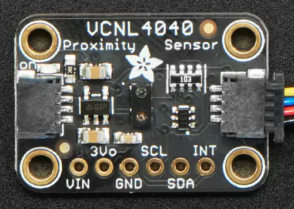

<!-- Copyright 2015-2026 Zephyr Project members and individual contributors. -->
<!-- SPDX-License-Identifier: Apache-2.0 -->
<!-- 中文翻译；编号、导航与译注为本地新增。 -->

<a id="adafruit-vcnl4040-shield"></a>

<a id="adafruit-vcnl4040"></a>

# 第38章\_Adafruit VCNL4040扩展板（Shield）

原文：[官方页面](https://docs.zephyrproject.org/latest/boards/shields/adafruit_vcnl4040/doc/index.html)。读取日期：2026-10-16；来源摘要见[来源记录](../SOURCES.md)。

<a id="overview"></a>

## 概述（Overview）

Adafruit VCNL4040接近及照度传感器扩展板采用Vishay VCNL4040，带2个STEMMA QT连接器。（[Adafruit VCNL4040 接近及照度传感器 扩展板](https://learn.adafruit.com/adafruit-vcnl4040-proximity-sensor)；[Vishay VCNL4040 接近及照度传感器](https://www.vishay.com/en/product/84274/)）

<a id="id1"></a>



Adafruit VCNL4040扩展板（Shield），图片来源：Adafruit

<a id="requirements"></a>

## 前置要求（Requirements）

该扩展板可用于提供I2C连接器的开发板，例如STEMMA QT或Qwiic；目标板必须定义zephyr_i2c节点标签，详情见“[扩展板（Shields）](https://docs.zephyrproject.org/latest/hardware/porting/shields.html#shields)”。

<a id="pin-assignments"></a>

### 引脚分配（Pin Assignments）

<table>
<tr>
<th>扩展板引脚（Shield Pin）</th>
<th>功能（Function）</th>
</tr>
<tr>
<td>串行数据线（SDA）</td>
<td>VCNL4040 I2C数据线（SDA）</td>
</tr>
<tr>
<td>串行时钟线（SCL）</td>
<td>VCNL4040 I2C时钟线（SCL）</td>
</tr>
<tr>
<td>中断（INT）</td>
<td>VCNL4040中断输出</td>
</tr>
</table>

若要使用中断，须另接一根线，将扩展板连接到微控制器板GPIO；如何修改设备树见[vishay,vcnl4040](../sensor_ti_vishay_wurth_sensing_binding_reference/P013_vishay_vcnl4040.md#std-dtcompatible-vishay-vcnl4040)绑定文档。

<a id="programming"></a>

## 编程（Programming）

调用west build时设置--shield adafruit_vcnl4040，例如运行VCNL4040接近及环境光传感器示例：（[VCNL4040 接近及环境光传感器](../sensors/P060_VCNL4040接近与环境光传感器示例.md#vcnl4040)）

```text
# From the root of the zephyr repository
west build -b adafruit_qt_py_rp2040 --shield adafruit_vcnl4040 samples/sensor/vcnl4040/
```

---

[上一章](P037_Adafruit_TSL2591_Shield.md) · [返回大纲](大纲.md) · [全站翻译进度](../PROGRESS.md) · [下一章](P039_Adafruit_VEML7700_Shield.md)
