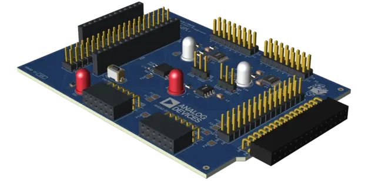

<!-- Copyright 2015-2026 Zephyr Project members and individual contributors. -->
<!-- SPDX-License-Identifier: Apache-2.0 -->
<!-- 中文翻译；编号、导航与译注为本地新增。 -->

<a id="analog-devices-low-speed-mixed-signal-playground"></a>

<a id="adi-lsmspg"></a>

# 第41章\_Analog Devices低速混合信号实验平台（Low-Speed Mixed-Signal Playground）

原文：[官方页面](https://docs.zephyrproject.org/latest/boards/shields/adi_lsmspg/doc/index.html)。读取日期：2026-10-16；来源摘要见[来源记录](../SOURCES.md)。

<a id="overview"></a>

## 概述（Overview）

Analog Devices低速混合信号实验平台采用AD5592R及AD5593R ADC／DAC器件，连接到小型模拟电路进行采样，便于探索模拟电路概念。（[Analog Devices低速混合信号实验平台（Low-Speed Mixed-Signal Playground）](https://www.analog.com/adalm-lsmspg)）

<a id="id2"></a>



Analog Devices低速混合信号实验扩展板（Low-Speed Mixed-Signal Playground Shield）

<a id="pin-assignments"></a>

### 引脚分配（Pin Assignments）

<table>
<tr>
<th>扩展板连接器引脚</th>
<th>功能（Function）</th>
</tr>
<tr>
<td>串行数据线（SDA）</td>
<td>AD5593R数据SDA</td>
</tr>
<tr>
<td>串行时钟线（SCL）</td>
<td>AD5593R时钟SCL</td>
</tr>
<tr>
<td>串行时钟（SCK）</td>
<td>AD5592R时钟SCK</td>
</tr>
<tr>
<td>主机输入从机输出（MISO）</td>
<td>AD5592R主入从出MISO</td>
</tr>
<tr>
<td>主机输出从机输入（MOSI）</td>
<td>AD5592R主出从入MOSI</td>
</tr>
<tr>
<td>D16</td>
<td>AD5592R片选CS</td>
</tr>
</table>

<a id="requirements"></a>

## 前置要求（Requirements）

该扩展板只能用于提供Feather连接器配置，并定义SPI、I2C及GPIO接口节点别名的开发板，详情见“[扩展板（Shields）](https://docs.zephyrproject.org/latest/hardware/porting/shields.html#shields)”。

<a id="programming"></a>

## 编程（Programming）

调用west build时设置--shield adi_lsmspg，例如：

```text
# From the root of the zephyr repository
west build -b adafruit_feather_rp2040/rp2040 --shield adi_lsmspg tests/drivers/dac
```

---

[上一章](P040_Adafruit_WINC1500_Wifi_Shield.md) · [返回大纲](大纲.md) · [全站翻译进度](../PROGRESS.md) · [下一章](P042_Panasonic_Grid-EYE_Shields.md)
