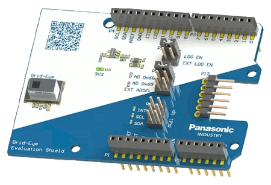
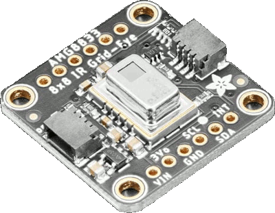
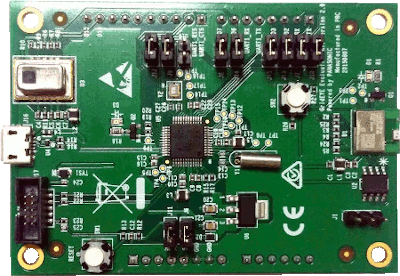

<!-- Copyright 2015-2026 Zephyr Project members and individual contributors. -->
<!-- SPDX-License-Identifier: Apache-2.0 -->
<!-- 中文翻译；编号、导航与译注为本地新增。 -->

<a id="panasonic-grid-eye-shields"></a>

<a id="amg88xx-shields"></a>

# 第42章\_松下Panasonic Grid-EYE扩展板（Shields）

原文：[官方页面](https://docs.zephyrproject.org/latest/boards/shields/amg88xx/doc/index.html)。读取日期：2026-10-16；来源摘要见[来源记录](../SOURCES.md)。

<a id="overview"></a>

## 概述（Overview）

Panasonic Grid-EYE是由64个独立热电堆元件排列成8×8矩阵的红外传感器。

传感器采用紧凑表面贴装封装，便于集成到测温应用。

Grid-EYE有多种型号，视场角、放大倍数及工作电压不同。例如AMG8833的视场角为60度，采用高增益放大及3.3 V电源。

<a id="id5"></a>

AMG88xx各型号详见“红外热电堆阵列传感器Grid-EYE”[注1](#id4)。（[Grid-EYE红外热电堆阵列传感器](https://industry.panasonic.eu/products/components/sensors/ir-thermophile-array-sensor-grid-eye)）

传感器评估及快速原型开发可用以下扩展板：


- <a id="id7"></a>

  Panasonic Grid-EYE评估扩展板[注2](#id6)（[Panasonic Grid-EYE评估扩展板（Evaluation Shield）](https://industry.panasonic.eu/products/components/sensors/ir-thermophile-array-sensor-grid-eye/grid-eye-evaluation-kit)）

> [](images/amg88xx_grid_eye_eval_shield.png)


- <a id="id12"></a>

  Adafruit AMG8833 8×8热成像传感器[注4](#id11)（[Adafruit AMG8833 8x8 热成像传感器](https://learn.adafruit.com/adafruit-amg8833-8x8-thermal-camera-sensor/overview)）

> [](images/AMG8833_adafruit_ir_thermal_camera_sensor.png)

前者符合Arduino扩展板标准，后者仅为引出板；两者均使用amg88xx_grid_eye_eval_shield扩展板名称。

Panasonic Grid-EYE曾提供较旧的评估套件，也可作为Arduino扩展板。


- Panasonic Grid-EYE评估套件（Evaluation Kit）

> [](images/amg88xx_eval_kit.png)

此旧评估套件已不再供应，在线文档也已下线；该板应使用amg88xx_eval_kit扩展板名称。

<a id="requirements"></a>

## 前置要求（Requirements）

这些扩展板仅可用于带Arduino连接器，且在设备树中正确定义I2C及GPIO节点别名的开发板。

<a id="id10"></a>

例如Panasonic PAN1780／PAN1770、PAN1781及PAN1782评估板符合要求，见Panasonic无线连接开发中心[注3](#id9)。（[松下无线连接开发中心（Panasonic Wireless Connectivity Development Hub）](https://pideu.panasonic.de/development-hub/)）

<a id="jumper-configuration"></a>

## 跳线配置（Jumper Configuration）

<a id="panasonic-grid-eye-evaluation-shield"></a>

### Panasonic Grid-EYE评估扩展板（Evaluation Shield）

Grid-EYE由LDO供电，务必在P10的LDO_EN处安装跳线。

P11跳线用于选择I2C地址。

使用amg88xx_grid_eye_eval_shield时，跳线配置应为：


- P10：使能LDO，LDO_EN
- P11：地址AD为0x68

<a id="panasonic-grid-eye-evaluation-kit"></a>

### Panasonic Grid-EYE评估套件（Evaluation Kit）

AMG88xx旧评估套件须移除除J11及J14之外的全部跳线。

<a id="pin-assignment"></a>

## 引脚分配（Pin Assignment）

<a id="id1"></a>

### Panasonic Grid-EYE评估扩展板（Evaluation Shield）

下表给出Grid-EYE评估扩展板的完整引脚分配。

<table>
<tr>
<th>扩展板连接器引脚</th>
<th>功能（Function）</th>
</tr>
<tr>
<td>D2</td>
<td>中断（Interrupt）</td>
</tr>
<tr>
<td>D14</td>
<td>I2C串行数据（SDA）</td>
</tr>
<tr>
<td>D15</td>
<td>I2C串行时钟（SCL）</td>
</tr>
<tr>
<td>电源排针第5脚</td>
<td>5 V电源</td>
</tr>
<tr>
<td>电源排针第6脚</td>
<td>地（GND）</td>
</tr>
<tr>
<td>电源排针第7脚</td>
<td>地（GND）</td>
</tr>
</table>

<a id="id8"></a>

更多细节见Panasonic Grid-EYE评估扩展板[注2](#id6)。（[Panasonic Grid-EYE评估扩展板（Evaluation Shield）](https://industry.panasonic.eu/products/components/sensors/ir-thermophile-array-sensor-grid-eye/grid-eye-evaluation-kit)）

<a id="id13"></a>

Adafruit AMG8833 8×8热成像传感器引出板[注4](#id11)也可使用amg88xx_grid_eye_eval_shield名称。（[Adafruit AMG8833 8x8 热成像传感器](https://learn.adafruit.com/adafruit-amg8833-8x8-thermal-camera-sensor/overview)）

<a id="id15"></a>

按Adafruit AMG8833 8×8热成像传感器引脚说明[注5](#id14)及上表接线。（[Adafruit AMG8833 8x8 热成像传感器引脚定义](https://learn.adafruit.com/adafruit-amg8833-8x8-thermal-camera-sensor/pinouts)）

<a id="id2"></a>

### Panasonic Grid-EYE评估套件（Evaluation Kit）

下表给出Grid-EYE旧评估套件的完整引脚分配。

<table>
<tr>
<th>扩展板连接器引脚</th>
<th>功能（Function）</th>
</tr>
<tr>
<td>D6</td>
<td>中断（Interrupt）</td>
</tr>
<tr>
<td>D14</td>
<td>I2C串行数据（SDA）</td>
</tr>
<tr>
<td>D15</td>
<td>I2C串行时钟（SCL）</td>
</tr>
</table>

<a id="building"></a>

## 构建（Building）

samples/sensor/amg88xx应用演示Panasonic Grid-EYE的基本用法。

构建时在west build中选择--shield amg88xx_grid_eye_eval_shield。

使用PAN1780评估板时，构建命令如下：

```text
# From the root of the zephyr repository
west build -b pan1780_evb --shield amg88xx_grid_eye_eval_shield samples/sensor/amg88xx
```

<a id="references"></a>

## 参考资料（References）

<a id="id4"></a>

〔[1](#id5)〕 [https://industry.panasonic.eu/products/components/sensors/ir-thermophile-array-sensor-grid-eye](https://industry.panasonic.eu/products/components/sensors/ir-thermophile-array-sensor-grid-eye)

<a id="id6"></a>

〔2〕 ([1](#id7),[2](#id8)) [https://industry.panasonic.eu/products/components/sensors/ir-thermophile-array-sensor-grid-eye/grid-eye-evaluation-kit](https://industry.panasonic.eu/products/components/sensors/ir-thermophile-array-sensor-grid-eye/grid-eye-evaluation-kit)

<a id="id9"></a>

〔[3](#id10)〕 [https://pideu.panasonic.de/development-hub/](https://pideu.panasonic.de/development-hub/)

<a id="id11"></a>

〔4〕 ([1](#id12),[2](#id13)) [https://learn.adafruit.com/adafruit-amg8833-8x8-thermal-camera-sensor/overview](https://learn.adafruit.com/adafruit-amg8833-8x8-thermal-camera-sensor/overview)

<a id="id14"></a>

〔[5](#id15)〕 [https://learn.adafruit.com/adafruit-amg8833-8x8-thermal-camera-sensor/pinouts](https://learn.adafruit.com/adafruit-amg8833-8x8-thermal-camera-sensor/pinouts)

## 译注

新旧Grid-EYE评估板及其扩展板名称、地址和跳线不同，分别保留。

---

[上一章](P041_Analog_Devices_Low-Speed_Mixed-Signal_Playground.md) · [返回大纲](大纲.md) · [全站翻译进度](../PROGRESS.md) · [下一章](P043_ARCELI_W5500_ETH.md)
