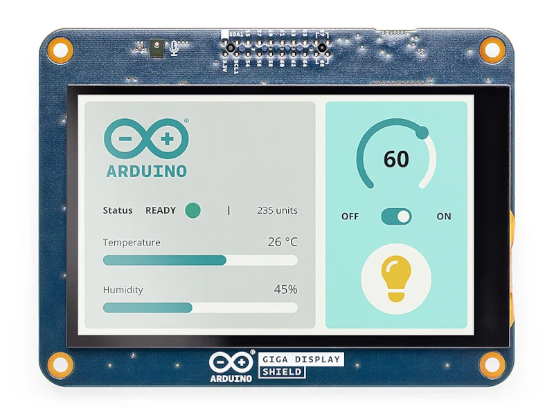

<!-- Copyright 2015-2026 Zephyr Project members and individual contributors. -->
<!-- SPDX-License-Identifier: Apache-2.0 -->
<!-- 中文翻译；编号、导航与译注为本地新增。 -->

<a id="arduino-giga-display-shield"></a>

<a id="id1"></a>

# 第46章\_Arduino GIGA显示扩展板（Display Shield）

原文：[官方页面](https://docs.zephyrproject.org/latest/boards/shields/arduino_giga_display_shield/doc/index.html)。读取日期：2026-10-16；来源摘要见[来源记录](../SOURCES.md)。

<a id="overview"></a>

## 概述（Overview）

Arduino GIGA Display Shield用于扩展Arduino GIGA R1 WiFi。原文说明其提供DSI、DPI等显示模块连接器，便于为项目增加显示功能，并提供摄像头接口及microSD卡槽。

扩展板正面配有KD040WVFID026-01-C025A面板，为3.97英寸480×800像素TFT显示屏，带电容多点触摸屏，GT911控制器通过I2C访问。

扩展板通过高密度连接器连接Arduino GIGA R1 WiFi。

<a id="id4"></a>

更多信息见Arduino GIGA Display Shield网站[注1](#id3)。（[Arduino GIGA 显示扩展板 网站](https://docs.arduino.cc/hardware/giga-display-shield/)）

<a id="id2"></a>



Arduino GIGA显示扩展板（Display Shield）

<a id="requirements"></a>

## 前置要求（Requirements）

该扩展板只能配合Arduino GIGA R1 WiFi，后者提供显示及摄像头所需连接器与接口；还必须定义I2C、SPI、DSI等外设节点别名，才能正确连接扩展板。

<a id="programming"></a>

## 编程（Programming）

构建使用此扩展板的项目时，为west build添加--shield arduino_giga_display_shield，例如：

```text
# From the root of the zephyr repository
west build -b arduino_giga_r1/stm32h747xx/m7 --shield arduino_giga_display_shield samples/subsys/display/lvgl
```

<a id="references"></a>

## 参考资料（References）

<a id="id3"></a>

〔[1](#id4)〕 [https://docs.arduino.cc/hardware/giga-display-shield/](https://docs.arduino.cc/hardware/giga-display-shield/)

## 译注

本页显示接口、摄像头及存储卡描述来自官方页面，未作为实板验证结果。

---

[上一章](P045_ArduCam_Mega_SPI_Camera_Shield.md) · [返回大纲](大纲.md) · [全站翻译进度](../PROGRESS.md) · [下一章](P047_Arduino_Modulino_Buttons.md)
