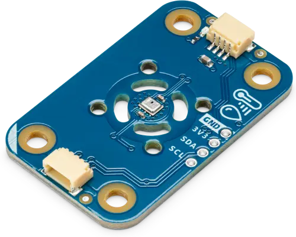

<!-- Copyright 2015-2026 Zephyr Project members and individual contributors. -->
<!-- SPDX-License-Identifier: Apache-2.0 -->
<!-- 中文翻译；编号、导航与译注为本地新增。 -->

<a id="arduino-modulino-thermo"></a>

<a id="id1"></a>

# 第51章\_Arduino Modulino温湿度模块（Thermo）

原文：[官方页面](https://docs.zephyrproject.org/latest/boards/shields/arduino_modulino_thermo/doc/index.html)。读取日期：2026-10-16；来源摘要见[来源记录](../SOURCES.md)。

<a id="overview"></a>

## 概述（Overview）

Arduino Modulino Thermo兼容Qwiic，采用Renesas HS3003温湿度传感器。



<a id="programming"></a>

## 编程（Programming）

调用west build时设置--shield arduino_modulino_thermo。

例如：

```text
# From the root of the zephyr repository
west build -b arduino_uno_r4@wifi --shield arduino_modulino_thermo samples/sensor/dht_polling
```

---

[上一章](P050_Arduino_Modulino_Pixels.md) · [返回大纲](大纲.md) · [全站翻译进度](../PROGRESS.md) · [下一章](P052_Arduino_UNO_click_shield.md)
