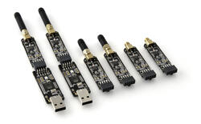

<!-- Copyright 2015-2026 Zephyr Project members and individual contributors. -->
<!-- SPDX-License-Identifier: Apache-2.0 -->
<!-- 中文翻译；编号、导航与译注为本地新增。 -->

<a id="atmel-at86rf2xx-transceivers"></a>

<a id="id1"></a>

# 第53章\_Atmel AT86RF2XX收发器（Transceivers）

原文：[官方页面](https://docs.zephyrproject.org/latest/boards/shields/atmel_rf2xx/doc/index.html)。读取日期：2026-10-16；来源摘要见[来源记录](../SOURCES.md)。

<a id="overview"></a>

## 概述（Overview）

Atmel AT86RF2xx是面向IEEE 802.15.4、ZigBee、RF4CE、6LoWPAN及ISM应用的高性能射频收发器，提供从SPI到天线的完整方案，可由任意外部微控制器操作。

Zephyr的[IEEE 802.15.4](../networking/P170_IEEE802154无线网络.md#ieee802154-interface) AT86RF2xx驱动目前支持除AT86RF230外的2.4 GHz系列收发器，可配合IEEE 802.15.4及Thread网络协议栈。（[Thread协议](../networking/P171_Thread协议.md#thread-protocol-interface)）

<a id="id3"></a>

<a id="id5"></a>

<a id="id7"></a>

这是通用扩展板定义，并不限于Atmel开发套件。它提供[AT AVR-RZ600](https://www.microchip.com/DevelopmentTools/ProductDetails/PartNO/ATAVRRZ600) [注1](#id2)及[AT REB233-XPRO](https://www.microchip.com/DevelopmentTools/ProductDetails/PartNO/ATREB233-XPRO) [注2](#id4)兼容配置，因此可用于具有10针Xplained或20针Xplained Pro扩展排针的Atmel开发板，详情见Atmel Xplained Pro硬件开发套件用户指南[注3](#id6)。此外还提供Arduino及mikroBUS标准接口变体。若项目不适配现有变体，可创建覆盖文件，但应尽可能优先使用标准接口。（[Atmel Xplained Pro 硬件开发套件用户指南](http://ww1.microchip.com/downloads/en/DeviceDoc/Atmel-42091-Atmel-Xplained-Pro-Hardware-Development-Kit_User%20Guide.pdf)）

<a id="rz600-module"></a>

### RZ600模块

<a id="id11"></a>

<a id="id17"></a>

RZ600开发套件需要Atmel Xplained或Xplained Pro连接器，其模块不提供收发器高级功能。Xplained接口应选[atmel_rf2xx_xplained](https://github.com/zephyrproject-rtos/zephyr/blob/master/boards/shields/atmel_rf2xx/atmel_rf2xx_xplained.overlay) [注5](#id10)；Xplained Pro接口应启用[atmel_rf2xx_legacy](https://github.com/zephyrproject-rtos/zephyr/blob/master/boards/shields/atmel_rf2xx/atmel_rf2xx_legacy.overlay) [注7](#id16)。



<a id="pins-assignment-of-the-rz600-module"></a>

### RZ600模块的引脚分配

<table>
<tr>
<th>引脚（Pin）</th>
<th>名称（Name）</th>
<th>功能（Function）</th>
</tr>
<tr>
<td>1</td>
<td>复位（RST）</td>
<td>GPIO复位</td>
</tr>
<tr>
<td>2</td>
<td>MISC</td>
<td>DNU：请勿使用（Do Not Use）</td>
</tr>
<tr>
<td>3</td>
<td>IRQ</td>
<td>GPIO中断</td>
</tr>
<tr>
<td>4</td>
<td>SLP_TR</td>
<td>GPIO多用途控制信号</td>
</tr>
<tr>
<td>5</td>
<td>片选（CS）</td>
<td>SPI片选</td>
</tr>
<tr>
<td>6</td>
<td>主机输出从机输入（MOSI）</td>
<td>SPI主出从入MOSI</td>
</tr>
<tr>
<td>7</td>
<td>主机输入从机输出（MISO）</td>
<td>SPI主入从出MISO</td>
</tr>
<tr>
<td>8</td>
<td>SCLK</td>
<td>SPI时钟</td>
</tr>
<tr>
<td>9</td>
<td>地（GND）</td>
<td></td>
</tr>
<tr>
<td>10</td>
<td>电源（VDD）</td>
<td>电源+3.3 V</td>
</tr>
</table>

<a id="reb233-xpro-module"></a>

### REB233-XPRO模块

<a id="id14"></a>

REB233-XPRO开发套件使用Atmel Xplained Pro接口，选择[atmel_rf2xx_xpro](https://github.com/zephyrproject-rtos/zephyr/blob/master/boards/shields/atmel_rf2xx/atmel_rf2xx_xpro.overlay) [注6](#id13)启用。


<a id="pins-assignment-of-the-reb233-xpro-module"></a>

### REB233-XPRO模块的引脚分配

<table>
<tr>
<th>引脚（Pin）</th>
<th>名称（Name）</th>
<th>功能（Function）</th>
</tr>
<tr>
<td>1</td>
<td>ID</td>
<td>DNU：请勿使用（Do Not Use）</td>
</tr>
<tr>
<td>2</td>
<td>地（GND）</td>
<td></td>
</tr>
<tr>
<td>3</td>
<td>DIG1</td>
<td>DNU：请勿使用（Do Not Use）</td>
</tr>
<tr>
<td>4</td>
<td>DIG3</td>
<td>DNU：请勿使用（Do Not Use）</td>
</tr>
<tr>
<td>5</td>
<td>DIG2</td>
<td>GPIO接收帧时间戳（RX Frame Time Stamping）</td>
</tr>
<tr>
<td>6</td>
<td>CLKM</td>
<td>DNU：请勿使用（Do Not Use）</td>
</tr>
<tr>
<td>7</td>
<td>复位（RST）</td>
<td>GPIO复位</td>
</tr>
<tr>
<td>8</td>
<td></td>
<td></td>
</tr>
<tr>
<td>9</td>
<td>IRQ</td>
<td>GPIO中断</td>
</tr>
<tr>
<td>10</td>
<td>SLP_TR</td>
<td>GPIO多用途控制信号</td>
</tr>
<tr>
<td>11</td>
<td>串行数据线（SDA）</td>
<td>AT24MAC602 EEPROM</td>
</tr>
<tr>
<td>12</td>
<td>串行时钟线（SCL）</td>
<td>AT24MAC602 EEPROM</td>
</tr>
<tr>
<td>13</td>
<td></td>
<td></td>
</tr>
<tr>
<td>14</td>
<td></td>
<td></td>
</tr>
<tr>
<td>15</td>
<td>片选（CS）</td>
<td>SPI片选</td>
</tr>
<tr>
<td>16</td>
<td>主机输出从机输入（MOSI）</td>
<td>SPI主出从入MOSI</td>
</tr>
<tr>
<td>17</td>
<td>主机输入从机输出（MISO）</td>
<td>SPI主入从出MISO</td>
</tr>
<tr>
<td>18</td>
<td>SCLK</td>
<td>SPI时钟</td>
</tr>
<tr>
<td>19</td>
<td>地（GND）</td>
<td></td>
</tr>
<tr>
<td>20</td>
<td>电源（VDD）</td>
<td>电源+3.3 V</td>
</tr>
</table>

注意（Note）

RF2xx驱动目前尚未实现DIG2功能。

<a id="arduino-shields"></a>

### Arduino扩展板（Shields）

<a id="id20"></a>

Arduino Uno R3接口变体不提供高级功能，选择[atmel_rf2xx_arduino](https://github.com/zephyrproject-rtos/zephyr/blob/master/boards/shields/atmel_rf2xx/atmel_rf2xx_arduino.overlay) [注8](#id19)启用。

<a id="pins-assignment-of-the-arduino-shield-modules"></a>

### Arduino扩展模块的引脚分配

<table>
<tr>
<th>引脚（Pin）</th>
<th>名称（Name）</th>
<th>功能（Function）</th>
</tr>
<tr>
<td>D0</td>
<td></td>
<td></td>
</tr>
<tr>
<td>D1</td>
<td></td>
<td></td>
</tr>
<tr>
<td>D2</td>
<td>IRQ</td>
<td>GPIO中断</td>
</tr>
<tr>
<td><code>D3</code></td>
<td></td>
<td></td>
</tr>
<tr>
<td><code>D4</code></td>
<td></td>
<td></td>
</tr>
<tr>
<td>D5</td>
<td></td>
<td></td>
</tr>
<tr>
<td>D6</td>
<td></td>
<td></td>
</tr>
<tr>
<td><code>D7</code></td>
<td></td>
<td></td>
</tr>
<tr>
<td>D8</td>
<td>复位（RST）</td>
<td>GPIO复位</td>
</tr>
<tr>
<td>D9</td>
<td>SLP_TR</td>
<td>GPIO多用途控制信号</td>
</tr>
<tr>
<td>D10</td>
<td>片选（CS）</td>
<td>SPI片选</td>
</tr>
<tr>
<td>D11</td>
<td>主机输出从机输入（MOSI）</td>
<td>SPI主出从入MOSI</td>
</tr>
<tr>
<td>D12</td>
<td>主机输入从机输出（MISO）</td>
<td>SPI主入从出MISO</td>
</tr>
<tr>
<td>D13</td>
<td>SCLK</td>
<td>SPI时钟</td>
</tr>
<tr>
<td>D14</td>
<td></td>
<td></td>
</tr>
<tr>
<td>D15</td>
<td></td>
<td></td>
</tr>
<tr>
<td></td>
<td>地（GND）</td>
<td></td>
</tr>
<tr>
<td></td>
<td>电源（VDD）</td>
<td>电源+3.3 V</td>
</tr>
<tr>
<td></td>
<td>电源（VCC）</td>
<td>电源+5.0 V</td>
</tr>
</table>

<a id="mikrobus-shields"></a>

### mikroBUS扩展板（Shields）

<a id="id23"></a>

mikroBUS接口变体不提供高级功能，选择[atmel_rf2xx_mikrobus](https://github.com/zephyrproject-rtos/zephyr/blob/master/boards/shields/atmel_rf2xx/atmel_rf2xx_mikrobus.overlay) [注9](#id22)启用。

<a id="pins-assignment-of-the-mikrobus-shield-modules"></a>

### mikroBUS扩展模块的引脚分配

<table>
<tr>
<th>引脚（Pin）</th>
<th>名称（Name）</th>
<th>功能（Function）</th>
</tr>
<tr>
<td>模拟输入（AN）</td>
<td>复位（RST）</td>
<td>GPIO复位</td>
</tr>
<tr>
<td>复位（RST）</td>
<td></td>
<td></td>
</tr>
<tr>
<td>片选（CS）</td>
<td>片选（CS）</td>
<td>SPI片选</td>
</tr>
<tr>
<td>串行时钟（SCK）</td>
<td>SCLK</td>
<td>SPI时钟</td>
</tr>
<tr>
<td>主机输入从机输出（MISO）</td>
<td>主机输入从机输出（MISO）</td>
<td>SPI主入从出MISO</td>
</tr>
<tr>
<td>主机输出从机输入（MOSI）</td>
<td>主机输出从机输入（MOSI）</td>
<td>SPI主出从入MOSI</td>
</tr>
<tr>
<td>VCC-3.3</td>
<td>电源（VDD）</td>
<td>电源+3.3 V</td>
</tr>
<tr>
<td>地（GND）</td>
<td>地（GND）</td>
<td></td>
</tr>
<tr>
<td>地（GND）</td>
<td>地（GND）</td>
<td></td>
</tr>
<tr>
<td>VCC-5.0</td>
<td>电源（VCC）</td>
<td>电源+5.0 V</td>
</tr>
<tr>
<td>串行数据线（SDA）</td>
<td></td>
<td></td>
</tr>
<tr>
<td>串行时钟线（SCL）</td>
<td></td>
<td></td>
</tr>
<tr>
<td>发送（TX）</td>
<td></td>
<td></td>
</tr>
<tr>
<td>接收（RX）</td>
<td></td>
<td></td>
</tr>
<tr>
<td>中断（INT）</td>
<td>IRQ</td>
<td>GPIO中断</td>
</tr>
<tr>
<td>脉宽调制（PWM）</td>
<td>SLP_TR</td>
<td>GPIO多用途控制信号</td>
</tr>
</table>

<a id="supported-variations"></a>

### 支持的变体（Supported Variations）

下表按应用建议选择变体。开发板有Arduino、mikroBUS、Xplained或Xplained Pro标准接口时，应选匹配配置；使用没有标准接口的开发板时，atmel_rf2xx需要专用<board>.overlay。其余配置根据实际标准排针选择。

<table>
<tr>
<th>连接器标准</th>
<th>扩展板名称（Designation）</th>
<th>变体（Variation）</th>
</tr>
<tr>
<td>无标准接口，使用覆盖文件</td>
<td><a id="id9"></a><br><br><a href="https://github.com/zephyrproject-rtos/zephyr/blob/master/boards/shields/atmel_rf2xx/atmel_rf2xx.overlay">atmel_rf2xx</a> <a href="#id8">注4</a></td>
<td>1</td>
</tr>
<tr>
<td>Atmel Xplained排针</td>
<td><a id="id12"></a><br><br><a href="https://github.com/zephyrproject-rtos/zephyr/blob/master/boards/shields/atmel_rf2xx/atmel_rf2xx_xplained.overlay">atmel_rf2xx_xplained</a> <a href="#id10">注5</a></td>
<td>2</td>
</tr>
<tr>
<td>Atmel Xplained Pro排针</td>
<td><a id="id15"></a><br><br><a href="https://github.com/zephyrproject-rtos/zephyr/blob/master/boards/shields/atmel_rf2xx/atmel_rf2xx_xpro.overlay">atmel_rf2xx_xpro</a> <a href="#id13">注6</a></td>
<td>3</td>
</tr>
<tr>
<td>Atmel Xplained Pro排针</td>
<td><a id="id18"></a><br><br><a href="https://github.com/zephyrproject-rtos/zephyr/blob/master/boards/shields/atmel_rf2xx/atmel_rf2xx_legacy.overlay">atmel_rf2xx_legacy</a> <a href="#id16">注7</a></td>
<td>4</td>
</tr>
<tr>
<td>Arduino</td>
<td><a id="id21"></a><br><br><a href="https://github.com/zephyrproject-rtos/zephyr/blob/master/boards/shields/atmel_rf2xx/atmel_rf2xx_arduino.overlay">atmel_rf2xx_arduino</a> <a href="#id19">注8</a></td>
<td>5</td>
</tr>
<tr>
<td>MikroBus</td>
<td><a id="id24"></a><br><br><a href="https://github.com/zephyrproject-rtos/zephyr/blob/master/boards/shields/atmel_rf2xx/atmel_rf2xx_mikrobus.overlay">atmel_rf2xx_mikrobus</a> <a href="#id22">注9</a></td>
<td>6</td>
</tr>
</table>

<a id="requirements"></a>

## 前置要求（Requirements）

该扩展板要求开发板配置提供SPI接口、中断信号及2个GPIO，详情见“[扩展板（Shields）](https://docs.zephyrproject.org/latest/hardware/porting/shields.html#shields)”。

注意（Note）

对于已有网络接口的开发板，应阅读网络文档以正确配置两个接口。为简化示例运行，可在Networking → Link Layer Options中仅启用IEEE 802.15.4，避免多接口引起的问题。

<a id="tested-boards"></a>

### 已测试开发板（Tested Boards）

<table>
<tr>
<th>开发板（Board）</th>
<th>禁用的接口</th>
<th>变体（Variation）</th>
</tr>
<tr>
<td>Atmel sam4s_xplained</td>
<td></td>
<td>2</td>
</tr>
<tr>
<td>Atmel sam4e_xpro</td>
<td>以太网（Ethernet）</td>
<td>3 , 4</td>
</tr>
<tr>
<td>Atmel sam_v71_xult/samv71q21</td>
<td>以太网（Ethernet）</td>
<td>3 , 4 , 5</td>
</tr>
</table>

<a id="sample-usage"></a>

## 示例用法（Sample Usage）

可用Zephyr Echo服务器及客户端示例体验IEEE 802.15.4或OpenThread，这些示例已提供两者的配置。启用IEEE 802.15.4时使用overlay-802154.conf，启用OpenThread时使用overlay-ot.conf；详情见高级Echo服务器及客户端示例。（[回显服务器（高级）（Echo Server / Advanced）](../networking/P047_高级回显服务器示例.md#sockets-echo-server)；[回显客户端（高级）（Echo Client / Advanced）](../networking/P048_高级回显客户端示例.md#sockets-echo-client)）

<a id="build-and-programming"></a>

## 构建与编程（Build and Programming）

调用west build时设置--shield <shield designator>，替换为所需扩展板名称。

```text
west build -b sam4s_xplained --shield atmel_rf2xx_xplained samples/net/sockets/echo_server -- -DEXTRA_CONF_FILE=overlay-802154.conf
west flash
```

```text
west build -b [sam4e_xpro | sam_v71_xult/samv71q21] --shield [atmel_rf2xx_xpro | atmel_rf2xx_legacy] samples/net/sockets/echo_server -- -DEXTRA_CONF_FILE=overlay-802154.conf
west flash
```

```text
west build -b [sam_v71_xult/samv71q21 | frdm_k64f | nucleo_f767zi] --shield atmel_rf2xx_arduino samples/net/sockets/echo_server -- -DEXTRA_CONF_FILE=overlay-802154.conf
west flash
```

```text
west build -b lpcxpresso55s69_ns --shield atmel_rf2xx_microbus samples/net/sockets/echo_server -- -DEXTRA_CONF_FILE=overlay-802154.conf
west flash
```

<a id="references"></a>

## 参考资料（References）

<a id="id2"></a>

〔[1](#id3)〕 [https://www.microchip.com/DevelopmentTools/ProductDetails/PartNO/ATAVRRZ600](https://www.microchip.com/DevelopmentTools/ProductDetails/PartNO/ATAVRRZ600)

<a id="id4"></a>

〔[2](#id5)〕 [https://www.microchip.com/DevelopmentTools/ProductDetails/PartNO/ATREB233-XPRO](https://www.microchip.com/DevelopmentTools/ProductDetails/PartNO/ATREB233-XPRO)

<a id="id6"></a>

〔[3](#id7)〕 [http://ww1.microchip.com/downloads/en/DeviceDoc/Atmel-42091-Atmel-Xplained-Pro-Hardware-Development-Kit_User%20Guide.pdf](http://ww1.microchip.com/downloads/en/DeviceDoc/Atmel-42091-Atmel-Xplained-Pro-Hardware-Development-Kit_User%20Guide.pdf)

<a id="id8"></a>

〔[4](#id9)〕 [https://github.com/zephyrproject-rtos/zephyr/blob/master/boards/shields/atmel_rf2xx/atmel_rf2xx.overlay](https://github.com/zephyrproject-rtos/zephyr/blob/master/boards/shields/atmel_rf2xx/atmel_rf2xx.overlay)

<a id="id10"></a>

〔5〕 ([1](#id11),[2](#id12)) [https://github.com/zephyrproject-rtos/zephyr/blob/master/boards/shields/atmel_rf2xx/atmel_rf2xx_xplained.overlay](https://github.com/zephyrproject-rtos/zephyr/blob/master/boards/shields/atmel_rf2xx/atmel_rf2xx_xplained.overlay)

<a id="id13"></a>

〔6〕 ([1](#id14),[2](#id15)) [https://github.com/zephyrproject-rtos/zephyr/blob/master/boards/shields/atmel_rf2xx/atmel_rf2xx_xpro.overlay](https://github.com/zephyrproject-rtos/zephyr/blob/master/boards/shields/atmel_rf2xx/atmel_rf2xx_xpro.overlay)

<a id="id16"></a>

〔7〕 ([1](#id17),[2](#id18)) [https://github.com/zephyrproject-rtos/zephyr/blob/master/boards/shields/atmel_rf2xx/atmel_rf2xx_legacy.overlay](https://github.com/zephyrproject-rtos/zephyr/blob/master/boards/shields/atmel_rf2xx/atmel_rf2xx_legacy.overlay)

<a id="id19"></a>

〔8〕 ([1](#id20),[2](#id21)) [https://github.com/zephyrproject-rtos/zephyr/blob/master/boards/shields/atmel_rf2xx/atmel_rf2xx_arduino.overlay](https://github.com/zephyrproject-rtos/zephyr/blob/master/boards/shields/atmel_rf2xx/atmel_rf2xx_arduino.overlay)

<a id="id22"></a>

〔9〕 ([1](#id23),[2](#id24)) [https://github.com/zephyrproject-rtos/zephyr/blob/master/boards/shields/atmel_rf2xx/atmel_rf2xx_mikrobus.overlay](https://github.com/zephyrproject-rtos/zephyr/blob/master/boards/shields/atmel_rf2xx/atmel_rf2xx_mikrobus.overlay)

## 译注

AT86RF230不在支持范围；DIG2功能尚未实现。旧扩展头与Xplained Pro接线分别保留。

## 原文外链核对

2026-10-16核对并重试以下原文外链时未能确认可访问性，保留原始目标，不将访问失败解释为原文内容有误。

- [ATAVRRZ600](https://www.microchip.com/DevelopmentTools/ProductDetails/PartNO/ATAVRRZ600)：HTTP Error 403: Forbidden。
- [ATREB233-XPRO](https://www.microchip.com/DevelopmentTools/ProductDetails/PartNO/ATREB233-XPRO)：HTTP Error 403: Forbidden。

---

[上一章](P052_Arduino_UNO_click_shield.md) · [返回大纲](大纲.md) · [全站翻译进度](../PROGRESS.md) · [下一章](P054_BOOSTXL-ULPSENSE_Ultra-low_Power_Sensor_BoosterPack.md)
