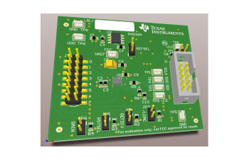
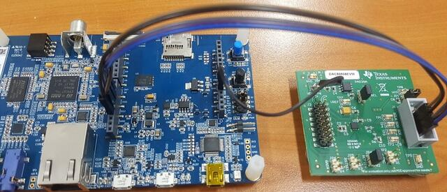

<!-- Copyright 2015-2026 Zephyr Project members and individual contributors. -->
<!-- SPDX-License-Identifier: Apache-2.0 -->
<!-- 中文翻译；编号、导航与译注为本地新增。 -->

# 第58章\_DAC80508评估模块（Evaluation Module）

原文：[官方页面](https://docs.zephyrproject.org/latest/boards/shields/dac80508_evm/doc/index.html)。读取日期：2026-10-16；来源摘要见[来源记录](../SOURCES.md)。

## 概述（Overview）

德州仪器Texas Instruments DAC80508评估模块EVM用于开发TI DAC80508系列DAC。

## 前置要求（Requirements）

该扩展板只能用于提供Arduino连接器配置并定义SPI节点别名的开发板，详情见“[扩展板（Shields）](https://docs.zephyrproject.org/latest/hardware/porting/shields.html#shields)”。

DAC80508 EVM的SPI引脚可用跳线接到开发板Arduino排针；还必须将5 V接到EVM的TP6 VDD。

DAC80508系列及DACx0508 EVM的接口使用详情见以下TI资料：

- [DACx0508评估模块用户指南](https://www.ti.com/lit/pdf/slau734)
- [DAC80508真16位、8通道SPI DAC](https://www.ti.com/product/DAC80508)

---

[上一章](P057_Canis_Labs_CANPico_Shield.md) · [返回大纲](大纲.md) · [全站翻译进度](../PROGRESS.md) · [下一章](P059_DFRobot_Gravity_TM6605_Haptic_Motor_Driver_Module.md)
