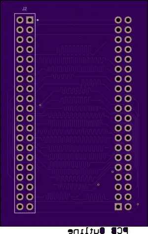

<!-- Copyright 2015-2026 Zephyr Project members and individual contributors. -->
<!-- SPDX-License-Identifier: Apache-2.0 -->
<!-- 中文翻译；编号、导航与译注为本地新增。 -->

<a id="ek-ra8d1-to-rtk7eka6m3b00001bu-display-adapter"></a>

<a id="ek-ra8d1-rtk7eka6m3b00001bu"></a>

# 第63章\_EK-RA8D1转RTK7EKA6M3B00001BU显示适配器（Display Adapter）

原文：[官方页面](https://docs.zephyrproject.org/latest/boards/shields/ek_ra8d1_rtk7eka6m3b00001bu/doc/index.html)。读取日期：2026-10-16；来源摘要见[来源记录](../SOURCES.md)。

<a id="overview"></a>

## 概述（Overview）

此开源硬件转换PCB将EK-RA8D1的并行图形扩展端口J57转接到RTK7EKA6M3B00001BU显示扩展板。

<a id="id2"></a>

[](images/top.webp)

EK-RA8D1转RTK7EKA6M3B00001BU显示适配器正面

<a id="id3"></a>

[](images/bottom.webp)

EK-RA8D1转RTK7EKA6M3B00001BU显示适配器背面

<a id="programming"></a>

## 编程（Programming）

调用west build时设置--shield ek_ra8d1_rtk7eka6m3b00001bu；它只是转接板，通常与RTK7EKA6M3B00001BU扩展板一起使用。

例如：

```text
# From the root of the zephyr repository
west build -b ek_ra8d1 --shield ek_ra8d1_rtk7eka6m3b00001bu --shield rtk7eka6m3b00001bu tests/drivers/display/display_read_write
```

<a id="references"></a>

## 参考资料（References）


- [EK-RA8D1转RTK7EKA6M3B00001BU显示适配器（Display Adapter）](https://oshpark.com/shared_projects/pzfp0mCD)

---

[上一章](P062_DVP_FPC-24_MT9M114_Camera_Module.md) · [返回大纲](大纲.md) · [全站翻译进度](../PROGRESS.md) · [下一章](P064_ESP-8266_Modules.md)
