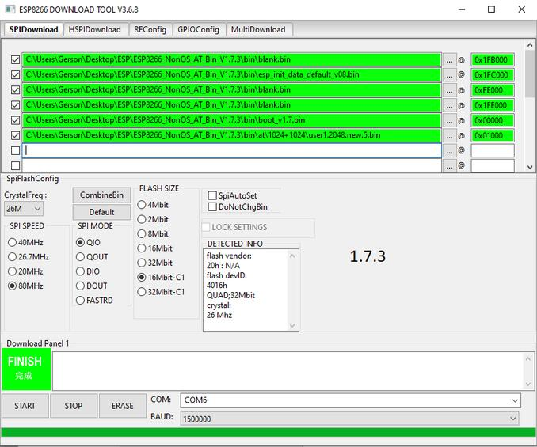

<!-- Copyright 2015-2026 Zephyr Project members and individual contributors. -->
<!-- SPDX-License-Identifier: Apache-2.0 -->
<!-- 中文翻译；编号、导航与译注为本地新增。 -->

<a id="esp-8266-modules"></a>

<a id="module-esp-8266"></a>

# 第64章\_ESP-8266模块（Modules）

原文：[官方页面](https://docs.zephyrproject.org/latest/boards/shields/esp_8266/doc/index.html)。读取日期：2026-10-16；来源摘要见[来源记录](../SOURCES.md)。

<a id="overview"></a>

## 概述（Overview）

ESP-8266是经济的Wi-Fi SoC无线模块，可让微控制器接入Wi-Fi，支持IEEE 802.11 b/g/n并内置完整TCP/IP协议栈，适合为现有设备增加联网功能。

最简单的ESP-8266模块是ESP-01。此通用扩展板配置兼容任意ESP-8266变体，包括ESP-12E/F。


<a id="pins-assignment-of-the-esp-01-module"></a>

### ESP-01模块的引脚分配

<table>
<tr>
<th>连接器引脚</th>
<th>功能（Function）</th>
</tr>
<tr>
<td>地（GND）</td>
<td>电源地GND</td>
</tr>
<tr>
<td>GPIO1</td>
<td>U0_TXD</td>
</tr>
<tr>
<td>GPIO2</td>
<td></td>
</tr>
<tr>
<td>CHIP_EN</td>
<td>使能ENABLE：接VDD运行，接GND进入低功耗</td>
</tr>
<tr>
<td>GPIO0</td>
<td></td>
</tr>
<tr>
<td>EXT_RST</td>
<td></td>
</tr>
<tr>
<td>GPIO3</td>
<td>U0_RXD</td>
</tr>
<tr>
<td>电源（VDD）</td>
<td>电源+3.3 V</td>
</tr>
</table>

<a id="requirements"></a>

## 前置要求（Requirements）

该扩展板要求开发板配置提供UART接口，详情见“[扩展板（Shields）](https://docs.zephyrproject.org/latest/hardware/porting/shields.html#shields)”。

注意（Note）

部分开发板声明Arduino R3等标准接口，却未定义全部连接；应确认所用板卡包含完整定义，避免构建错误。

<a id="id2"></a>

ESP-8266应烧录Espressif Systems网站提供的[ESP8266 AT Bin](https://www.espressif.com/en/support/download/at)软件[注1](#id1)。ESP-01最多1 MB Flash，可容纳的最后版本为V1.6.2，其命令兼容1.7.x；ESP Wi-Fi驱动最低支持1.7.x版本。

强烈建议2 MB及以上Flash的ESP-8266模块升级到1.7.x，以改善后续兼容性。

本教程不详述固件升级，只提供提示。ESP Wi-Fi已在1 MB Flash的ESP-01上测试，采用Boot Mode及8 Mbit Flash、512 KB+512 KB布局。ESP8266 AT Bin 1.7.x需要以下分区配置：




- 提示（Tips）

  > - 升级前先擦除Flash。
  > - 同时升级全部二进制文件。
  > - ESP-8266启动加载器的输出不是乱码；若模块使用26 MHz晶体，可尝试74880波特连接，以识别启动失败。

注意（Note）

若开发板已有网络接口，应阅读网络文档以正确配置两者。为简化示例运行，可在Networking → Link Layer Options中仅启用Wi-Fi，避免多接口问题。

<a id="supported-variations"></a>

### 支持的变体（Supported Variations）

下表按应用建议选择变体。开发板有Arduino或mikroBUS标准接口时，应选匹配配置；没有标准接口时，esp_8266需要专用<board>.overlay。其余配置根据实际标准排针选择。

<table>
<tr>
<th>连接器标准</th>
<th>扩展板名称（Designation）</th>
<th>变体（Variation）</th>
</tr>
<tr>
<td>无标准接口，使用覆盖文件</td>
<td><a id="id4"></a><br><br><a href="https://github.com/zephyrproject-rtos/zephyr/blob/master/boards/shields/esp_8266/esp_8266.overlay">esp_8266</a> <a href="#id3">注2</a></td>
<td>1</td>
</tr>
<tr>
<td>Arduino</td>
<td><a id="id6"></a><br><br><a href="https://github.com/zephyrproject-rtos/zephyr/blob/master/boards/shields/esp_8266/esp_8266_arduino.overlay">esp_8266_arduino</a> <a href="#id5">注3</a></td>
<td>2</td>
</tr>
<tr>
<td>MikroBus</td>
<td><a id="id8"></a><br><br><a href="https://github.com/zephyrproject-rtos/zephyr/blob/master/boards/shields/esp_8266/esp_8266_mikrobus.overlay">esp_8266_mikrobus</a> <a href="#id7">注4</a></td>
<td>3</td>
</tr>
</table>

<a id="build-and-programming"></a>

## 构建与编程（Build and Programming）

调用west build时设置--shield <shield designation>，替换为所需扩展板名称。

使用专用覆盖文件构建：

```text
# From the root of the zephyr repository
west build -b sam4e_xpro --shield esp_8266 samples/net/wifi
west flash
```

使用标准接口构建：

```text
# From the root of the zephyr repository
west build -b [disco_l475_iot1 | frdm_k64f | lpcxpresso55s69_ns | nucleo_f767zi] --shield [esp_8266_arduino | esp_8266_mikrobus] samples/net/wifi
west flash
```

<a id="references"></a>

## 参考资料（References）

<a id="id1"></a>

〔[1](#id2)〕 [https://www.espressif.com/en/support/download/at](https://www.espressif.com/en/support/download/at)

<a id="id3"></a>

〔[2](#id4)〕 [https://github.com/zephyrproject-rtos/zephyr/blob/master/boards/shields/esp_8266/esp_8266.overlay](https://github.com/zephyrproject-rtos/zephyr/blob/master/boards/shields/esp_8266/esp_8266.overlay)

<a id="id5"></a>

〔[3](#id6)〕 [https://github.com/zephyrproject-rtos/zephyr/blob/master/boards/shields/esp_8266/esp_8266_arduino.overlay](https://github.com/zephyrproject-rtos/zephyr/blob/master/boards/shields/esp_8266/esp_8266_arduino.overlay)

<a id="id7"></a>

〔[4](#id8)〕 [https://github.com/zephyrproject-rtos/zephyr/blob/master/boards/shields/esp_8266/esp_8266_mikrobus.overlay](https://github.com/zephyrproject-rtos/zephyr/blob/master/boards/shields/esp_8266/esp_8266_mikrobus.overlay)

## 译注

ESP-01的Flash容量限制与AT固件最低版本分开说明；26 MHz晶振启动日志为74880波特率。

---

[上一章](P063_EK-RA8D1_to_RTK7EKA6M3B00001BU_Display_Adapter.md) · [返回大纲](大纲.md) · [全站翻译进度](../PROGRESS.md) · [下一章](P065_EVAL-AD4052-ARDZ.md)
