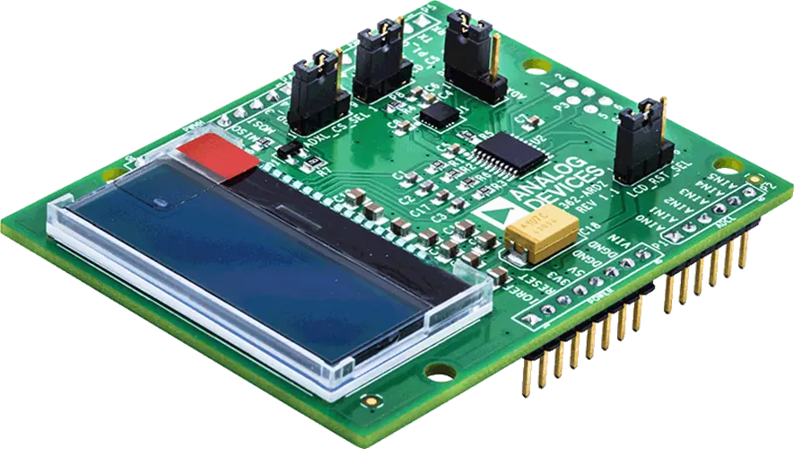

<!-- Copyright 2015-2026 Zephyr Project members and individual contributors. -->
<!-- SPDX-License-Identifier: Apache-2.0 -->
<!-- 中文翻译；编号、导航与译注为本地新增。 -->

<a id="eval-adxl362-ardz"></a>

<a id="id1"></a>

# 第67章\_EVAL-ADXL362-ARDZ

原文：[官方页面](https://docs.zephyrproject.org/latest/boards/shields/eval_adxl362_ardz/doc/index.html)。读取日期：2026-10-16；来源摘要见[来源记录](../SOURCES.md)。

<a id="overview"></a>

## 概述（Overview）

EVAL-ADXL362-ARDZ是采用Analog Devices ADXL362的三轴数字加速度计Arduino扩展板。



<a id="programming"></a>

## 编程（Programming）

调用west build时设置--shield eval_adxl362_ardz，例如：

```text
# From the root of the zephyr repository
west build -b apard32690/max32690/m4 --shield eval_adxl362_ardz samples/sensor/sensor_shell
```

<a id="requirements"></a>

## 前置要求（Requirements）

该扩展板只能用于提供Arduino连接器配置，并定义SPI及GPIO接口节点别名的开发板，详情见“[扩展板（Shields）](https://docs.zephyrproject.org/latest/hardware/porting/shields.html#shields)”。

<a id="references"></a>

## 参考资料（References）


- [EVAL-ADXL362-ARDZ产品页](https://www.analog.com/en/resources/evaluation-hardware-and-software/evaluation-boards-kits/eval-adxl362-ardz.html)
- [EVAL-ADXL362-ARDZ用户指南](https://wiki.analog.com/resources/eval/user-guides/eval-adicup360/hardware/adxl362)
- [EVAL-ADXL362-ARDZ原理图](https://www.analog.com/media/en/reference-design-documentation/design-integration-files/eval-adxl362-ardz-designsupport.zip)
- [ADXL362产品页](https://www.analog.com/en/products/adxl362.html)
- [ADXL362数据手册](https://www.analog.com/media/en/technical-documentation/data-sheets/adxl362.pdf)

## 原文外链核对

2026-10-16核对并重试以下原文外链时未能确认可访问性，保留原始目标，不将访问失败解释为原文内容有误。

- [eval-adxl362-ardz-designsupport.zip](https://www.analog.com/media/en/reference-design-documentation/design-integration-files/eval-adxl362-ardz-designsupport.zip)：The read operation timed out。

---

[上一章](P066_EVAL-AD5529R-ARDZ.md) · [返回大纲](大纲.md) · [全站翻译进度](../PROGRESS.md) · [下一章](P068_EVAL-ADXL367-ARDZ.md)
