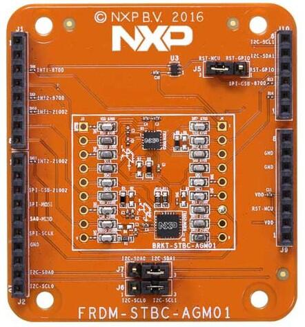

<!-- Copyright 2015-2026 Zephyr Project members and individual contributors. -->
<!-- SPDX-License-Identifier: Apache-2.0 -->
<!-- 中文翻译；编号、导航与译注为本地新增。 -->

<a id="nxp-frdm-stbc-agm01"></a>

<a id="frdm-stbc-agm01-shield"></a>

# 第73章\_NXP FRDM-STBC-AGM01扩展板

原文：[官方页面](https://docs.zephyrproject.org/latest/boards/shields/frdm_stbc_agm01/doc/index.html)。读取日期：2026-10-16；来源摘要见[来源记录](../SOURCES.md)。

<a id="overview"></a>

## 概述（Overview）

FRDM-STBC-AGM01已停产。

FRDM-STBC-AGM01是带FXOS8700及FXAS21002的NXP Freedom开发板。该九轴方案由FXAS21002C陀螺仪及FXOS8700CQ电子罗盘构成，兼容任意具有Arduino R3排针的开发板。



<a id="pin-assignment-of-the-frdm-stbc-agm01-shield"></a>

### FRDM-STBC-AGM01扩展板的引脚分配

<table>
<tr>
<th>扩展板连接器引脚</th>
<th>功能（Function）</th>
</tr>
<tr>
<td>A5</td>
<td>I2C时钟SCL1</td>
</tr>
<tr>
<td>A4</td>
<td>I2C数据SDA1</td>
</tr>
<tr>
<td>D15</td>
<td>I2C时钟SCL0</td>
</tr>
<tr>
<td>D14</td>
<td>I2C数据SDA0</td>
</tr>
<tr>
<td>D2</td>
<td>FXOS8700中断INT1</td>
</tr>
<tr>
<td><code>D4</code></td>
<td>FXOS8700中断INT2</td>
</tr>
<tr>
<td>D5</td>
<td>FXAS21002中断INT1</td>
</tr>
<tr>
<td>D8</td>
<td>FXAS21002中断INT2</td>
</tr>
<tr>
<td>A3</td>
<td>GPIO复位RST</td>
</tr>
</table>

更多FXOS8700、FXAS21002及FRDM-STBC-AGM01信息见：


- [FXAS21002陀螺仪传感器](../sensors/P040_FXAS21002陀螺仪示例.md#fxas21002)
- [FXOS8700网站](https://www.nxp.com/products/sensors/accelerometers/digital-motion-sensor-3d-accelerometer-2g-4g-8g-plus-3d-magnetometer:FXOS8700CQ)
- [FRDM-STBC-AGM01网站](https://www.nxp.com/design/development-boards/freedom-development-boards/sensors/sensor-toolbox-development-boards-for-a-9-axis-solution-using-fxas21002c-and-fxos8700cq:FRDM-STBC-AGM01)
- [FRDM-STBC-AGM01快速参考卡](https://www.nxp.com/docs/en/supporting-information/FRDM-STBC-AGM01-QRC.pdf)
- [FRDM-STBC-AGM01原理图](https://www.nxp.com/downloads/en/schematics/FRDM-STBC-AGM01-SCH.pdf)

<a id="programming"></a>

## 编程（Programming）

调用west build时设置--shield frdm_stbc_agm01，例如：

```text
# From the root of the zephyr repository
west build -b frdm_k22f --shield frdm_stbc_agm01 samples/sensor/fxas21002
```

<a id="support-resources-for-zephyr"></a>

### Zephyr支持资源（Support Resources）


- [NXP开发板支持状态（Board Support Status）](https://github.com/nxp-zephyr/nxp-zsdk/blob/main/doc/releases/Board-Support-Status.md)
- [NXP Zephyr下游软件开发工具包（Downstream SDK）](https://github.com/nxp-zephyr/nxp-zsdk)
- [MCUXpresso for VS Code文档](https://mcuxpresso.nxp.com/mcux-vscode)及[Zephyr实验指南](https://mcuxpresso.nxp.com/mcux-vscode/latest/html/Training-Zephyr-Getting-Started.html)
- [NXP Zephyr知识中心（Knowledge Hub）](https://community.nxp.com/t5/Zephyr-Project-Knowledge-Base/Zephyr-Knowledge-Hub/ta-p/2008548)
- NXP Zephyr主页，包含培训资源（[NXP的Zephyr专题页面](https://nxp.com/zephyr)）
- [NXP Zephyr支持社区论坛（Support Community）](https://community.nxp.com/t5/Zephyr-Project/bd-p/Zephyr-Project)

## 原文外链核对

2026-10-16核对并重试以下原文外链时未能确认可访问性，保留原始目标，不将访问失败解释为原文内容有误。

- [2008548](https://community.nxp.com/t5/Zephyr-Project-Knowledge-Base/Zephyr-Knowledge-Hub/ta-p/2008548)：HTTP Error 403: Forbidden。
- [Zephyr-Project](https://community.nxp.com/t5/Zephyr-Project/bd-p/Zephyr-Project)：HTTP Error 403: Forbidden。
- [Training-Zephyr-Getting-Started.html](https://mcuxpresso.nxp.com/mcux-vscode/latest/html/Training-Zephyr-Getting-Started.html)：HTTP Error 404: Not Found。
- [zephyr](https://nxp.com/zephyr)：HTTP Error 404: Not Found。
- [sensor-toolbox-development-boards-for-a-9-axis-solution-using-fxas21002c-and-fxos8700cq:FRDM-STBC-AGM01](https://www.nxp.com/design/development-boards/freedom-development-boards/sensors/sensor-toolbox-development-boards-for-a-9-axis-solution-using-fxas21002c-and-fxos8700cq:FRDM-STBC-AGM01)：HTTP Error 404: Not Found。
- [FRDM-STBC-AGM01-QRC.pdf](https://www.nxp.com/docs/en/supporting-information/FRDM-STBC-AGM01-QRC.pdf)：HTTP Error 404: Not Found。
- [FRDM-STBC-AGM01-SCH.pdf](https://www.nxp.com/downloads/en/schematics/FRDM-STBC-AGM01-SCH.pdf)：HTTP Error 404: Not Found。
- [digital-motion-sensor-3d-accelerometer-2g-4g-8g-plus-3d-magnetometer:FXOS8700CQ](https://www.nxp.com/products/sensors/accelerometers/digital-motion-sensor-3d-accelerometer-2g-4g-8g-plus-3d-magnetometer:FXOS8700CQ)：HTTP Error 404: Not Found。

---

[上一章](P072_NXP_FRDM-KW41Z_Shield.md) · [返回大纲](大纲.md) · [全站翻译进度](../PROGRESS.md) · [下一章](P074_FTDI_VM800C_Embedded_Video_Engine_Board.md)
