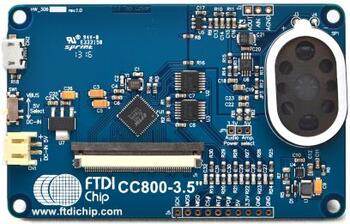

<!-- Copyright 2015-2026 Zephyr Project members and individual contributors. -->
<!-- SPDX-License-Identifier: Apache-2.0 -->
<!-- 中文翻译；编号、导航与译注为本地新增。 -->

<a id="ftdi-vm800c-embedded-video-engine-board"></a>

# 第74章\_FTDI VM800C嵌入式视频引擎板（Embedded Video Engine Board）

原文：[官方页面](https://docs.zephyrproject.org/latest/boards/shields/ftdi_vm800c/doc/index.html)。读取日期：2026-10-16；来源摘要见[来源记录](../SOURCES.md)。

<a id="overview"></a>

## 概述（Overview）

VM800C是FTDI FT800的开发模块，用于开发及演示FT800嵌入式视频引擎（EVE）功能。模块充当SPI从机，需要SPI主机与微控制器连接并完成系统集成。



<a id="pins-assignment-of-the-arduino-shield-modules"></a>

### Arduino扩展模块的引脚分配

<table>
<tr>
<th>引脚（Pin）</th>
<th>名称（Name）</th>
<th>功能（Function）</th>
</tr>
<tr>
<td>D0</td>
<td></td>
<td></td>
</tr>
<tr>
<td>D1</td>
<td></td>
<td></td>
</tr>
<tr>
<td>D2</td>
<td>INT#，低有效中断</td>
<td>GPIO中断</td>
</tr>
<tr>
<td><code>D3</code></td>
<td></td>
<td></td>
</tr>
<tr>
<td><code>D4</code></td>
<td></td>
<td></td>
</tr>
<tr>
<td>D5</td>
<td></td>
<td></td>
</tr>
<tr>
<td>D6</td>
<td></td>
<td></td>
</tr>
<tr>
<td><code>D7</code></td>
<td></td>
<td></td>
</tr>
<tr>
<td>D8</td>
<td></td>
<td></td>
</tr>
<tr>
<td>D9</td>
<td></td>
<td></td>
</tr>
<tr>
<td>D10</td>
<td>CS#，低有效片选</td>
<td>SPI片选</td>
</tr>
<tr>
<td>D11</td>
<td>主机输出从机输入（MOSI）</td>
<td>SPI主出从入MOSI</td>
</tr>
<tr>
<td>D12</td>
<td>主机输入从机输出（MISO）</td>
<td>SPI主入从出MISO</td>
</tr>
<tr>
<td>D13</td>
<td>SCLK</td>
<td>SPI时钟</td>
</tr>
<tr>
<td>D14</td>
<td></td>
<td></td>
</tr>
<tr>
<td>D15</td>
<td></td>
<td></td>
</tr>
<tr>
<td></td>
<td>地（GND）</td>
<td></td>
</tr>
<tr>
<td></td>
<td>3.3V</td>
<td>电源+3.3 V</td>
</tr>
<tr>
<td></td>
<td>5V</td>
<td>电源+5.0 V或+3.3 V</td>
</tr>
</table>

<a id="requirements"></a>

## 前置要求（Requirements）

该扩展板要求开发板配置提供SPI接口及中断信号，详情见“[扩展板（Shields）](https://docs.zephyrproject.org/latest/hardware/porting/shields.html#shields)”。

<a id="sample-usage"></a>

## 示例用法（Sample Usage）

可使用Zephyr [FT800](../driver_samples/P047_FT800图形控制器示例.md#ft800)示例，该示例已提供FT800嵌入式视频引擎的默认配置，详情见FT800示例文档。

<a id="build-and-programming"></a>

## 构建与编程（Build and Programming）

调用west build时设置--shield <shield designator>，替换为所需扩展板名称。

```text
west build -b nrf52840dk/nrf52840 --shield ftdi_vm800c samples/drivers/misc/ft800
west flash
```

<a id="references"></a>

## 参考资料（References）

---

[上一章](P073_NXP_FRDM-STBC-AGM01.md) · [返回大纲](大纲.md) · [全站翻译进度](../PROGRESS.md) · [下一章](P075_NXP_G1120B0MIPI_MIPI_Display.md)
