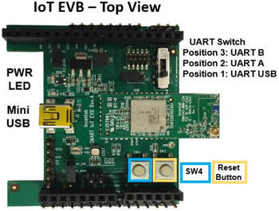

<!-- Copyright 2015-2026 Zephyr Project members and individual contributors. -->
<!-- SPDX-License-Identifier: Apache-2.0 -->
<!-- 中文翻译；编号、导航与译注为本地新增。 -->

<a id="inventek-es-wifi-shield"></a>

<a id="inventek-eswifi-shield"></a>

# 第77章\_Inventek es-WIFI扩展板（Shield）

原文：[官方页面](https://docs.zephyrproject.org/latest/boards/shields/inventek_eswifi/doc/index.html)。读取日期：2026-10-16；来源摘要见[来源记录](../SOURCES.md)。

<a id="overview"></a>

## 概述（Overview）

es-WIFI是Inventek Systems开发的嵌入式串口转Wi-Fi模块，集成Wi-Fi并可选低功耗蓝牙，可运行Cypress WICED或Inventek IWIN无线互操作网络AT命令集。当前驱动支持SPI或UART两种串行接口。

Zephyr es-WIFI的SPI驱动基于ISM43362-M3G-L44实现，UART驱动基于ISM4343-WBM-L151实现；用户也可通过JTAG排针重新编程模块，切换接口类型。

<a id="ismart4343c-evb"></a>

### ISMART4343C-EVB

<a id="id3"></a>

<a id="id9"></a>

<a id="id12"></a>

<a id="id5"></a>

[ISMART4343C-EVB](https://www.inventeksys.com/ismart4343-c-arduino-shield-wi-fi-2ghz-bluetooth-ble/) [注1](#id2)是兼容Arduino Uno R3的开发套件，可评估SPI或UART接口es-WIFI模块。UART选[inventek_eswifi_arduino_uart](https://github.com/zephyrproject-rtos/zephyr/blob/master/boards/shields/inventek_eswifi/inventek_eswifi_arduino_uart.overlay) [注4](#id8)，SPI选[inventek_eswifi_arduino_spi](https://github.com/zephyrproject-rtos/zephyr/blob/master/boards/shields/inventek_eswifi/inventek_eswifi_arduino_spi.overlay) [注5](#id11)。若Arduino排针提供5 V，J17选1-2；否则选2-3使用USB 5 V，详情见ISMART4343C-EVB用户手册[注2](#id4)。（[ISMART4343C-EVB 用户手册](https://www.inventeksys.com/wp-content/uploads/IoT-EVB-Users-Manual.pdf)）

注意（Note）

Inventek评估板信号仅支持3.3 V电平。



<a id="pins-assignment-of-the-ismart-evbs"></a>

### ISMART评估板的引脚分配

下表按接口列出信号。使用UART固件时，SW3必须置位置3，启用RX／TX信号。

要通过Arduino排针完全控制模块，需要手工接线。Inventek扩展板的D3～D7默认未连接；标为可选的信号可辅助开发，但当前驱动未处理，亦可保持原状。有些Arduino板的NRST未连接GPIO，建议将该引脚折开并用导线接D6。唤醒WAKE-UP位于J26第1脚，扩展板配置用D7控制，应将两者连接。下图展示建议接线。


<table>
<tr>
<th>Arduino连接器引脚</th>
<th>功能（Function）</th>
<th>串行连接</th>
</tr>
<tr>
<td>D0</td>
<td>UART接收（RX）</td>
<td>通用异步收发器（UART）</td>
</tr>
<tr>
<td>D1</td>
<td>UART发送（TX）</td>
<td>通用异步收发器（UART）</td>
</tr>
<tr>
<td><code>D3</code></td>
<td>CFG-1</td>
<td>UART／SPI，可选</td>
</tr>
<tr>
<td><code>D4</code></td>
<td>CFG-0</td>
<td>UART／SPI，可选</td>
</tr>
<tr>
<td>D5</td>
<td>BOOT-0</td>
<td>UART／SPI，可选</td>
</tr>
<tr>
<td>D6</td>
<td>低电平复位（NRST）</td>
<td>UART／SPI，须接线</td>
</tr>
<tr>
<td><code>D7</code></td>
<td>WAKE-UP</td>
<td>UART／SPI，须接线</td>
</tr>
<tr>
<td>D9</td>
<td>CMD/RDY</td>
<td>串行外设接口（SPI）</td>
</tr>
<tr>
<td>D10</td>
<td>SPI片选（CS）</td>
<td>串行外设接口（SPI）</td>
</tr>
<tr>
<td>D11</td>
<td>SPI主机输出从机输入（MOSI）</td>
<td>串行外设接口（SPI）</td>
</tr>
<tr>
<td>D12</td>
<td>SPI主机输入从机输出（MISO）</td>
<td>串行外设接口（SPI）</td>
</tr>
<tr>
<td>D13</td>
<td>SPI串行时钟（SCK）</td>
<td>串行外设接口（SPI）</td>
</tr>
</table>

<a id="supported-variations"></a>

### 支持的变体（Supported Variations）

下表按应用建议变体。有标准Arduino R3连接器时，应按UART或SPI接口选择匹配配置；inventek_eswifi允许通过专用<board>.overlay及<board>.defconfig测试板载模块。

<table>
<tr>
<th>连接器标准</th>
<th>扩展板名称（Designation）</th>
<th>变体（Variation）</th>
</tr>
<tr>
<td>无标准接口，使用覆盖文件</td>
<td><a id="id7"></a><br><br><a href="https://github.com/zephyrproject-rtos/zephyr/blob/master/boards/shields/inventek_eswifi/inventek_eswifi.overlay">inventek_eswifi</a> <a href="#id6">注3</a></td>
<td>1</td>
</tr>
<tr>
<td>Arduino UART接口</td>
<td><a id="id10"></a><br><br><a href="https://github.com/zephyrproject-rtos/zephyr/blob/master/boards/shields/inventek_eswifi/inventek_eswifi_arduino_uart.overlay">inventek_eswifi_arduino_uart</a> <a href="#id8">注4</a></td>
<td>2</td>
</tr>
<tr>
<td>Arduino SPI接口</td>
<td><a id="id13"></a><br><br><a href="https://github.com/zephyrproject-rtos/zephyr/blob/master/boards/shields/inventek_eswifi/inventek_eswifi_arduino_spi.overlay">inventek_eswifi_arduino_spi</a> <a href="#id11">注5</a></td>
<td>3</td>
</tr>
</table>

<a id="requirements"></a>

## 前置要求（Requirements）

该扩展板要求开发板配置提供UART或SPI接口，以及2～3个GPIO，详情见“[扩展板（Shields）](https://docs.zephyrproject.org/latest/hardware/porting/shields.html#shields)”。

注意（Note）

有些开发板已有网络接口，应阅读网络文档以正确配置两者。为简化示例，可在Networking → Link Layer Options中仅启用Wi-Fi，避免多接口问题。

<a id="tested-boards"></a>

### 已测试开发板（Tested Boards）

<table>
<tr>
<th>开发板（Board）</th>
<th>禁用的接口</th>
<th>变体（Variation）</th>
</tr>
<tr>
<td>Atmel sam_v71_xult/samv71q21</td>
<td>以太网（Ethernet）</td>
<td>2 , 3</td>
</tr>
<tr>
<td>ST nucleo_f767zi开发板</td>
<td>以太网（Ethernet）</td>
<td>2 , 3</td>
</tr>
<tr>
<td>ST disco_l475_iot1开发板</td>
<td></td>
<td><ul><li></li></ul></td>
</tr>
</table>

注意（Note）

ST disco_l475_iot1已配有使用IWIN SPI固件的ISM43362，无需本扩展板即可使用es-WIFI；此处仅用它示范板载模块配置。

<a id="sample-usage"></a>

## 示例用法（Sample Usage）

Wi-Fi参考示例为Wi-Fi Shell，可扫描附近无线网络；提供密码后可选择网络、连接并发送ping。（[Wi-Fi命令行（Shell）](../networking/P169_WiFi命令行示例.md#wifi-shell)）

<a id="build-and-programming"></a>

## 构建与编程（Build and Programming）

调用west build时设置--shield <shield designator>，替换为所需扩展板名称。

```text
west build -b [sam_v71_xult/samv71q21 | nucleo_f767zi] --shield inventek_eswifi_arduino_uart samples/net/wifi
west flash
```

```text
west build -b [sam_v71_xult/samv71q21 | nucleo_f767zi] --shield inventek_eswifi_arduino_spi samples/net/wifi
west flash
```

```text
west build -b disco_l475_iot1 samples/net/wifi
west flash
```

<a id="references"></a>

## 参考资料（References）

<a id="id2"></a>

〔[1](#id3)〕 [https://www.inventeksys.com/ismart4343-c-arduino-shield-wi-fi-2ghz-bluetooth-ble/](https://www.inventeksys.com/ismart4343-c-arduino-shield-wi-fi-2ghz-bluetooth-ble/)

<a id="id4"></a>

〔[2](#id5)〕 [https://www.inventeksys.com/wp-content/uploads/IoT-EVB-Users-Manual.pdf](https://www.inventeksys.com/wp-content/uploads/IoT-EVB-Users-Manual.pdf)

<a id="id6"></a>

〔[3](#id7)〕 [https://github.com/zephyrproject-rtos/zephyr/blob/master/boards/shields/inventek_eswifi/inventek_eswifi.overlay](https://github.com/zephyrproject-rtos/zephyr/blob/master/boards/shields/inventek_eswifi/inventek_eswifi.overlay)

<a id="id8"></a>

〔4〕 ([1](#id9),[2](#id10)) [https://github.com/zephyrproject-rtos/zephyr/blob/master/boards/shields/inventek_eswifi/inventek_eswifi_arduino_uart.overlay](https://github.com/zephyrproject-rtos/zephyr/blob/master/boards/shields/inventek_eswifi/inventek_eswifi_arduino_uart.overlay)

<a id="id11"></a>

〔5〕 ([1](#id12),[2](#id13)) [https://github.com/zephyrproject-rtos/zephyr/blob/master/boards/shields/inventek_eswifi/inventek_eswifi_arduino_spi.overlay](https://github.com/zephyrproject-rtos/zephyr/blob/master/boards/shields/inventek_eswifi/inventek_eswifi_arduino_spi.overlay)

## 译注

模块为3.3 V供电。J17电源、SW3接口选择及NRST／WAKEUP额外布线分别保留。

---

[上一章](P076_Shields.md) · [返回大纲](大纲.md) · [全站翻译进度](../PROGRESS.md) · [下一章](P078_NXP_LCD_PAR_S035_TFT_LCD_Module.md)
