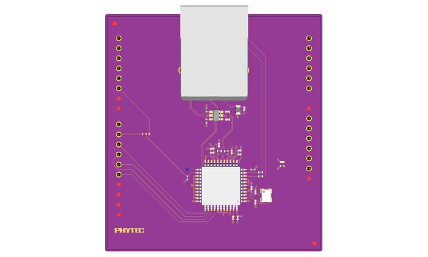

<!-- Copyright 2015-2026 Zephyr Project members and individual contributors. -->
<!-- SPDX-License-Identifier: Apache-2.0 -->
<!-- 中文翻译；编号、导航与译注为本地新增。 -->

<a id="phytec-link-board-eth"></a>

<a id="link-board-eth-shield"></a>

# 第79章\_PHYTEC link board ETH以太网扩展板

原文：[官方页面](https://docs.zephyrproject.org/latest/boards/shields/link_board_eth/doc/index.html)。读取日期：2026-10-16；来源摘要见[来源记录](../SOURCES.md)。

<a id="overview"></a>

## 概述（Overview）

link board ETH采用ENC424J600以太网控制器，兼容Arduino UNO R3连接器，是为[reel board](../boards_phytec/P009_reel_board.md#reel_board)开发的扩展组件。该系列及其连接方法见reel board文档。



<a id="hardware"></a>

## 硬件（Hardware）


- ENC424J600

  > - 带SPI接口的10/100 Base-T/TX以太网控制器
  > - 出厂预编程的唯一MAC地址
- 连接能力（Connectivity）

  > - 兼容Arduino
  > - RJ45连接器
- 电气特性（Electrical Characteristics）

  > - 供电电压3.3 V
  > - 供电电流75～147 mA

<a id="pins-assignment-of-the-shield-connector"></a>

### 扩展板连接器的引脚分配

ENC424J600可选SPI或并行从端口PSP，启动时自动选择SPI，无需MCU干预。

<table>
<tr>
<th>扩展板连接器引脚</th>
<th>功能（Function）</th>
<th>ENC424J600引脚</th>
</tr>
<tr>
<td>D0</td>
<td>未连接</td>
<td></td>
</tr>
<tr>
<td>D1</td>
<td>未连接</td>
<td></td>
</tr>
<tr>
<td>D2</td>
<td>未连接</td>
<td></td>
</tr>
<tr>
<td><code>D3</code></td>
<td>未连接</td>
<td></td>
</tr>
<tr>
<td><code>D4</code></td>
<td>未连接</td>
<td></td>
</tr>
<tr>
<td>D5</td>
<td>备选中断INTn</td>
<td></td>
</tr>
<tr>
<td>D6</td>
<td>未焊接</td>
<td></td>
</tr>
<tr>
<td><code>D7</code></td>
<td>未焊接</td>
<td></td>
</tr>
<tr>
<td>D8</td>
<td>未连接</td>
<td></td>
</tr>
<tr>
<td>D9</td>
<td>INTn</td>
<td>第24脚，中断输出</td>
</tr>
<tr>
<td>D10</td>
<td>SPI低有效片选CSn</td>
<td>第34脚，SPI片选</td>
</tr>
<tr>
<td>D11</td>
<td>SPI主机输出从机输入（MOSI）</td>
<td>第36脚，SPI串行数据输入</td>
</tr>
<tr>
<td>D12</td>
<td>SPI主机输入从机输出（MISO）</td>
<td>第35脚，SPI串行数据输出</td>
</tr>
<tr>
<td>D13</td>
<td>SPI串行时钟（SCK）</td>
<td>第37脚，SPI串行时钟输入</td>
</tr>
<tr>
<td>D14</td>
<td>未焊接</td>
<td></td>
</tr>
<tr>
<td>D15</td>
<td>未焊接</td>
<td></td>
</tr>
</table>

<table>
<tr>
<th>扩展板连接器引脚</th>
<th>功能（Function）</th>
<th>ENC424J600引脚</th>
</tr>
<tr>
<td>A0</td>
<td>未连接</td>
<td></td>
</tr>
<tr>
<td>A1</td>
<td>未连接</td>
<td></td>
</tr>
<tr>
<td>A2</td>
<td>未连接</td>
<td></td>
</tr>
<tr>
<td>A3</td>
<td>未连接</td>
<td></td>
</tr>
<tr>
<td>A4</td>
<td>未连接</td>
<td></td>
</tr>
<tr>
<td>A5</td>
<td>未连接</td>
<td></td>
</tr>
</table>

更多link board ETH及ENC424J600信息见：


- [link board ETH网站](https://www.phytec.eu/en/produkte/low-power-solutions/reel-board/)
- [ENC424J600网站](https://www.microchip.com/wwwproducts/en/ENC424J600)

<a id="programming"></a>

## 编程（Programming）

在Zephyr应用中调用west build或CMake时设置--shield link_board_eth，例如：

使用west：

```text
# From the root of the zephyr repository
west build -b reel_board --shield link_board_eth samples/net/zperf
```

使用CMake及Ninja：

```text
# From the root of the zephyr repository
# Use cmake to configure a Ninja-based buildsystem:
cmake -Bbuild -GNinja -DBOARD=reel_board -DSHIELD="link_board_eth" samples/net/zperf

# Now run the build tool on the generated build system:
ninja -Cbuild
```

## 原文外链核对

2026-10-16核对并重试以下原文外链时未能确认可访问性，保留原始目标，不将访问失败解释为原文内容有误。

- [ENC424J600](https://www.microchip.com/wwwproducts/en/ENC424J600)：HTTP Error 403: Forbidden。

---

[上一章](P078_NXP_LCD_PAR_S035_TFT_LCD_Module.md) · [返回大纲](大纲.md) · [全站翻译进度](../PROGRESS.md) · [下一章](P080_LMP90100_Sensor_AFE_Evaluation_Board.md)
