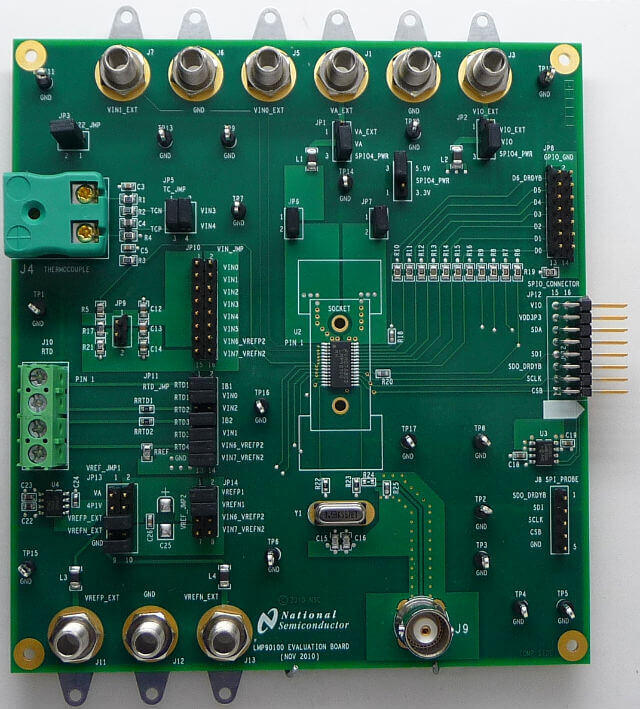

<!-- Copyright 2015-2026 Zephyr Project members and individual contributors. -->
<!-- SPDX-License-Identifier: Apache-2.0 -->
<!-- 中文翻译；编号、导航与译注为本地新增。 -->

<a id="lmp90100-sensor-afe-evaluation-board"></a>

<a id="lmp90100-evb-shield"></a>

# 第80章\_LMP90100传感器模拟前端评估板（Sensor AFE Evaluation Board）

原文：[官方页面](https://docs.zephyrproject.org/latest/boards/shields/lmp90100_evb/doc/index.html)。读取日期：2026-10-16；来源摘要见[来源记录](../SOURCES.md)。

<a id="overview"></a>

## 概述（Overview）

德州仪器LMP90100传感器模拟前端评估板EVB用于开发TI LMP90xxx模拟传感器前端系列。

<a id="id1"></a>



LMP90100 EVB评估板，图片来源：Texas Instruments

<a id="requirements"></a>

## 前置要求（Requirements）

该扩展板只能用于提供Arduino连接器配置并定义SPI节点别名的开发板，详情见“[扩展板（Shields）](https://docs.zephyrproject.org/latest/hardware/porting/shields.html#shields)”。

LMP90100 EVB的SPIO连接器引脚可用跳线接到开发板Arduino排针。

LMP90xxx系列及LMP90100 EVB的接口详情见以下TI资料：


- [LMP90100传感器模拟前端评估板用户指南](https://www.farnell.com/datasheets/1604987.pdf)
- [LMP90100多通道、低功耗24位传感器模拟前端AFE](http://www.ti.com/product/LMP90100)

<a id="samples"></a>

## 示例（Samples）

Zephyr RTOS提供一个面向LMP90100 EVB的示例：


- [LMP90100传感器模拟前端评估板：电阻温度检测器RTD示例](../shield_samples/P002_LMP90100电阻温度检测.md#lmp90100-evb-rtd-sample)

<a id="programming"></a>

## 编程（Programming）

调用west build时设置--shield lmp90100_evb，例如：

```text
# From the root of the zephyr repository
west build -b frdm_k64f --shield lmp90100_evb samples/shields/lmp90100_evb/rtd
```

---

[上一章](P079_PHYTEC_link_board_ETH.md) · [返回大纲](大纲.md) · [全站翻译进度](../PROGRESS.md) · [下一章](P081_Sharp_memory_display_generic_shield.md)
