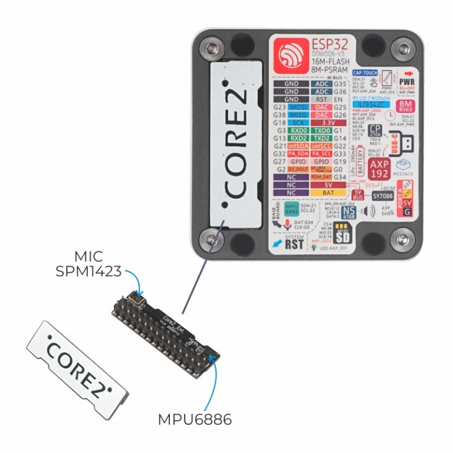

<!-- Copyright 2015-2026 Zephyr Project members and individual contributors. -->
<!-- SPDX-License-Identifier: Apache-2.0 -->
<!-- 中文翻译；编号、导航与译注为本地新增。 -->

<a id="m5stack-core2-base-shield"></a>

<a id="m5stack-core2-ext"></a>

# 第83章\_M5Stack-Core2底部扩展板（Base Shield）

原文：[官方页面](https://docs.zephyrproject.org/latest/boards/shields/m5stack_core2_ext/doc/index.html)。读取日期：2026-10-16；来源摘要见[来源记录](../SOURCES.md)。

<a id="overview"></a>

## 概述（Overview）

<a id="id3"></a>

[M5Stack-Core2](https://docs.m5stack.com/en/core/core2) [注1](#id2)附带连接M5Stack扩展接口的底座扩展板，配有MPU6886六轴运动跟踪器6DOF IMU及SPM1423麦克风。

<a id="id1"></a>

[](images/m5stack_core2_ext.webp)

M5Stack-Core2扩展模块

注意（Note）

SPM1423麦克风功能尚未实现。

<a id="pins-assignments"></a>

### 引脚分配（Pin Assignments）

<table>
<tr>
<th>扩展板连接器引脚</th>
<th>功能（Function）</th>
</tr>
<tr>
<td>0</td>
<td>地（GND）</td>
</tr>
<tr>
<td>11</td>
<td>3.3V</td>
</tr>
<tr>
<td>16</td>
<td>I2C内部数据线intSDA</td>
</tr>
<tr>
<td>17</td>
<td>I2C内部时钟线intSCL</td>
</tr>
</table>

<a id="programming"></a>

## 编程（Programming）

调用west build时设置--shield m5stack_core2_ext，例如：

```text
# From the root of the zephyr repository
west build -b m5stack_core2/esp32/procpu --shield m5stack_core2_ext samples/sensor/mpu6050
```

<a id="references"></a>

## 参考资料（References）

<a id="id2"></a>

〔[1](#id3)〕 [https://docs.m5stack.com/en/core/core2](https://docs.m5stack.com/en/core/core2)

## 译注

Core2扩展模块麦克风尚未实现。

---

[上一章](P082_M5Stack-Cardputer_base_shield.md) · [返回大纲](大纲.md) · [全站翻译进度](../PROGRESS.md) · [下一章](P084_M5Stack_Unit_Gesture.md)
