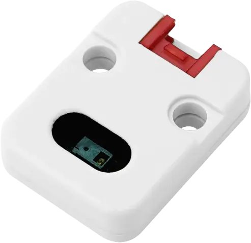

<!-- Copyright 2015-2026 Zephyr Project members and individual contributors. -->
<!-- SPDX-License-Identifier: Apache-2.0 -->
<!-- 中文翻译；编号、导航与译注为本地新增。 -->

<a id="m5stack-unit-gesture"></a>

<a id="m5stack-unit-gesture-shield"></a>

# 第84章\_M5Stack Unit手势模块（Gesture）

原文：[官方页面](https://docs.zephyrproject.org/latest/boards/shields/m5stack_unit_gesture/doc/index.html)。读取日期：2026-10-16；来源摘要见[来源记录](../SOURCES.md)。

<a id="overview"></a>

## 概述（Overview）

[M5Stack Unit Gesture](https://docs.m5stack.com/en/unit/gesture)是紧凑手势模块，采用原相PixArt PAJ7620U2，通过兼容Grove的4针HY2.0-4P线缆以I2C连接。

<a id="id2"></a>

[](images/m5stack_gesture_unit.webp)

M5Stack Unit手势模块（Gesture）

<a id="requirements"></a>

## 前置要求（Requirements）

该扩展板可用于提供4针I2C连接器，并在设备树中将其标为zephyr_i2c的开发板，见“[扩展板（Shields）](https://docs.zephyrproject.org/latest/hardware/porting/shields.html#shields)”。

此模块的PAJ7620中断线未接Grove连接器，不能使用中断驱动的触发模式。

<a id="pin-assignments"></a>

### 引脚分配（Pin Assignments）

<table>
<tr>
<th>Grove引脚</th>
<th>功能（Function）</th>
</tr>
<tr>
<td>1</td>
<td>I2C串行时钟（SCL）</td>
</tr>
<tr>
<td>2</td>
<td>I2C串行数据（SDA）</td>
</tr>
<tr>
<td>3</td>
<td>VCC，模块I/O电源</td>
</tr>
<tr>
<td>4</td>
<td>地（GND）</td>
</tr>
</table>

<a id="programming"></a>

## 编程（Programming）

调用west build时设置--shield m5stack_unit_gesture，例如以轮询模式运行PAJ7620手势传感器示例：（[PAJ7620手势传感器（Gesture Sensor）](../sensors/P064_PAJ7620手势传感器示例.md#paj7620_gesture)）

```text
# From the root of the zephyr repository
west build -b m5stack_core2/esp32/procpu --shield m5stack_unit_gesture samples/sensor/paj7620_gesture
```

<a id="references"></a>

## 参考资料（References）

## 译注

手势模块中断未引出，只能轮询。

---

[上一章](P083_M5Stack-Core2_base_shield.md) · [返回大纲](大纲.md) · [全站翻译进度](../PROGRESS.md) · [下一章](P085_M5Stack_Unit_Mini_OLED.md)
