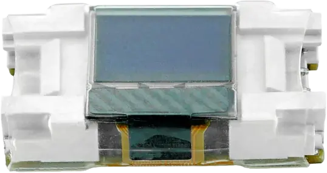

<!-- Copyright 2015-2026 Zephyr Project members and individual contributors. -->
<!-- SPDX-License-Identifier: Apache-2.0 -->
<!-- 中文翻译；编号、导航与译注为本地新增。 -->

<a id="m5stack-unit-mini-oled"></a>

<a id="m5stack-unit-minioled-shield"></a>

# 第85章\_M5Stack Unit Mini OLED模块

原文：[官方页面](https://docs.zephyrproject.org/latest/boards/shields/m5stack_unit_minioled/doc/index.html)。读取日期：2026-10-16；来源摘要见[来源记录](../SOURCES.md)。

<a id="overview"></a>

## 概述（Overview）

<a id="id4"></a>

[M5Stack Unit Mini OLED](https://docs.m5stack.com/en/unit/MiniOLED%20Unit) [注1](#id3)是0.42英寸单色白光OLED模块，分辨率72×40，采用SSD1315控制器。

<a id="id2"></a>

[](images/m5stack_unit_minioled.webp)

M5Stack Unit Mini OLED模块，图片来源：M5Stack

<a id="requirements"></a>

## 前置要求（Requirements）

开发板须为所连接的Grove接口定义zephyr_i2c，见“[扩展板接口（Shield Interfaces）](https://docs.zephyrproject.org/latest/hardware/porting/shields.html#shield-interfaces)”。

<a id="pin-assignments"></a>

### 引脚分配（Pin Assignments）

<table>
<tr>
<th>Grove引脚</th>
<th>功能（Function）</th>
</tr>
<tr>
<td>1</td>
<td>I2C串行时钟（SCL）</td>
</tr>
<tr>
<td>2</td>
<td>I2C串行数据（SDA）</td>
</tr>
<tr>
<td>3</td>
<td>VCC，3.3 V</td>
</tr>
<tr>
<td>4</td>
<td>地（GND）</td>
</tr>
</table>

<a id="programming"></a>

## 编程（Programming）

调用west build时设置--shield m5stack_unit_minioled，例如运行LVGL显示示例：

```text
# From the root of the zephyr repository
west build -b m5stack_atoms3/esp32s3/procpu --shield m5stack_unit_minioled samples/subsys/display/lvgl
```

<a id="references"></a>

## 参考资料（References）

<a id="id3"></a>

〔[1](#id4)〕 [https://docs.m5stack.com/en/unit/MiniOLED%20Unit](https://docs.m5stack.com/en/unit/MiniOLED%20Unit)

---

[上一章](P084_M5Stack_Unit_Gesture.md) · [返回大纲](大纲.md) · [全站翻译进度](../PROGRESS.md) · [下一章](P086_MAX7219_LED_display_driver_shield.md)
