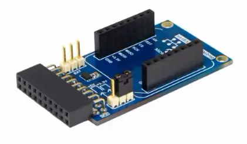

<!-- Copyright 2015-2026 Zephyr Project members and individual contributors. -->
<!-- SPDX-License-Identifier: Apache-2.0 -->
<!-- 中文翻译；编号、导航与译注为本地新增。 -->

<a id="rnbd451-add-on-board"></a>

<a id="rnbd451-add-on-shield"></a>

# 第88章\_RNBD451附加板（Add-on Board）

原文：[官方页面](https://docs.zephyrproject.org/latest/boards/shields/mchp_rnbd451_bt/doc/index.html)。读取日期：2026-10-16；来源摘要见[来源记录](../SOURCES.md)。

<a id="overview"></a>

## 概述（Overview）

RNBD451附加板用于评估及演示Microchip RNBD451PE低功耗蓝牙模块的特性、能力及接口，是高效低成本开发平台。它符合mikroBUS标准，板载MCP2200 USB转UART，无需其他硬件即可开始评估。

<a id="id2"></a>

更多信息见RNBD451附加板主用户指南[注1](#id1)。（[RNBD451 附加板主要用户指南](https://ww1.microchip.com/downloads/aemDocuments/documents/WSG/ProductDocuments/UserGuides/RNBD451-Add-On-Board-User-Guide-DS50003476.pdf)）

[](images/mchp_rnbd451_bt_mikrobus.webp)

<a id="requirements"></a>

## 前置要求（Requirements）

该扩展板兼容带mikroBUS插座的开发板；若没有插座，可用适配器提供扩展排针及mikroBUS接口。mikroBUS Xplained Pro是Xplained Pro评估平台扩展板，可在该平台MCU板上连接mikroBUS Click板。

[](images/2080-atmbusadapter-xpro.webp)

<a id="configurations"></a>

## 配置（Configurations）

上电复位POR后启动RNBD451 BLE控制器时，Zephyr蓝牙子系统首先发送HCI复位命令。但原设计发送过早：RNBD451从POR到可接收首条HCI命令需要超过400 ms。

为解决此时序问题，应用应延迟启用Bluetooth，确保HCI复位命令适时发送。加入以下代码，在bt_enable()前延迟500 ms：

`k_sleep(K_MSEC(500));`

<a id="programming"></a>

## 编程（Programming）

按mikroBUS或Xplained Pro接口选择，在west build中添加--shield mchp_rnbd451_bt_mikrobus或--shield mchp_rnbd451_bt_xplained_pro：

```text
west build -b your_board_name --shield mchp_rnbd451_bt_mikrobus samples/bluetooth/peripheral
```

或（Or）

```text
west build -b your_board_name --shield mchp_rnbd451_bt_xplained_pro samples/bluetooth/peripheral
```

<a id="references"></a>

## 参考资料（References）

<a id="id1"></a>

〔[1](#id2)〕 [https://ww1.microchip.com/downloads/aemDocuments/documents/WSG/ProductDocuments/UserGuides/RNBD451-Add-On-Board-User-Guide-DS50003476.pdf](https://ww1.microchip.com/downloads/aemDocuments/documents/WSG/ProductDocuments/UserGuides/RNBD451-Add-On-Board-User-Guide-DS50003476.pdf)

## 译注

RNBD451启动就绪超过400 ms，官方建议bt_enable前等待500 ms。

---

[上一章](P087_MB1280_STMod_fan-out_shield.md) · [返回大纲](大纲.md) · [全站翻译进度](../PROGRESS.md) · [下一章](P089_Microchip_MCP2515_CAN_bus_shields.md)
