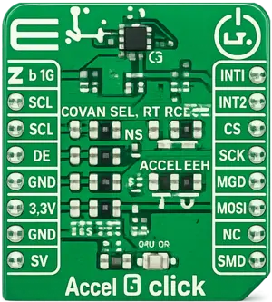

<!-- Copyright 2015-2026 Zephyr Project members and individual contributors. -->
<!-- SPDX-License-Identifier: Apache-2.0 -->
<!-- 中文翻译；编号、导航与译注为本地新增。 -->

<a id="mikroelektronika-3-axis-accel-4-click"></a>

<a id="mikroe-accel4-click-shield"></a>

# 第92章\_MikroElektronika三轴Accel 4 Click加速度计扩展板

原文：[官方页面](https://docs.zephyrproject.org/latest/boards/shields/mikroe_accel4_click/doc/index.html)。读取日期：2026-10-16；来源摘要见[来源记录](../SOURCES.md)。

<a id="overview"></a>

## 概述（Overview）

[Accel 4 Click](https://www.mikroe.com/accel-4-click)采用FXLS8974CF三轴加速度计。

每个轴有独立感应元件，可精确可靠地测量三维加速度，为位置计算提供依据。FXLS8974CF支持I2C及SPI，并带可编程中断引擎，便于优化固件。

<a id="id1"></a>

[](images/mikroe_accel_4_click.webp)

Accel 4 Click加速度计扩展板

<a id="requirements"></a>

## 前置要求（Requirements）

此扩展板只能用于提供mikroBUS插座，并为其I2C接口定义mikrobus_i2c节点标签的开发板，详情见“[扩展板（Shields）](https://docs.zephyrproject.org/latest/hardware/porting/shields.html#shields)”。

<a id="programming"></a>

## 编程（Programming）

调用west build时设置--shield mikroe_accel4_click，例如：

```text
# From the root of the zephyr repository
west build -b frdm_mcxn947/mcxn947/cpu0 --shield mikroe_accel4_click samples/sensor/accel_polling
west flash
```

FXLS8974CF的其他绑定属性见[nxp,fxls8974](../compatible_binding_reference/P051_nxp_fxls8974.md#std-dtcompatible-nxp-fxls8974)文档。

<a id="references"></a>

## 参考资料（References）


- [Accel 4 Click加速度计扩展板](https://www.mikroe.com/accel-4-click)
- [Accel 4 Click原理图](https://download.mikroe.com/documents/add-on-boards/click/accel_4_click/Accel_4_click_v100_Schematic.PDF)

## 原文外链核对

2026-10-16核对并重试以下原文外链时未能确认可访问性，保留原始目标，不将访问失败解释为原文内容有误。

- [accel-4-click](https://www.mikroe.com/accel-4-click)：HTTP Error 403: Forbidden。

---

[上一章](P091_MikroElektronika_ACCEL_13_Click.md) · [返回大纲](大纲.md) · [全站翻译进度](../PROGRESS.md) · [下一章](P093_MikroElektronika_ADC_Click.md)
