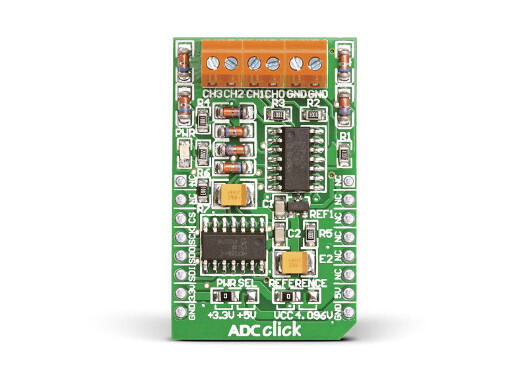

<!-- Copyright 2015-2026 Zephyr Project members and individual contributors. -->
<!-- SPDX-License-Identifier: Apache-2.0 -->
<!-- 中文翻译；编号、导航与译注为本地新增。 -->

<a id="mikroelektronika-adc-click"></a>

<a id="mikroe-adc-click-shield"></a>

# 第93章\_MikroElektronika ADC Click模数转换扩展板

原文：[官方页面](https://docs.zephyrproject.org/latest/boards/shields/mikroe_adc_click/doc/index.html)。读取日期：2026-10-16；来源摘要见[来源记录](../SOURCES.md)。

<a id="overview"></a>

## 概述（Overview）

MikroElektronika ADC Click采用[MCP3204](https://www.microchip.com/wwwproducts/en/en010533) 12位模数转换器，外形符合mikroBUS。（[mikroBUS™](https://www.mikroe.com/mikrobus)）

<a id="id1"></a>



MikroElektronika ADC Click模数转换扩展板，图片来源：MikroElektronika

<a id="requirements"></a>

## 前置要求（Requirements）

此扩展板只能用于提供mikroBUS连接器配置并定义其SPI节点别名的开发板，详情见“[扩展板（Shields）](https://docs.zephyrproject.org/latest/hardware/porting/shields.html#shields)”。

MCP3204及ADC Click接口详情见：


- [MCP3204数据手册](http://ww1.microchip.com/downloads/en/DeviceDoc/21298e.pdf)
- [ADC Click模数转换扩展板](https://www.mikroe.com/adc-click)

<a id="programming"></a>

## 编程（Programming）

调用west build时设置--shield mikro_adc_click，例如：

```text
west build -b lpcxpresso55s16 --shield mikroe_adc_click <my_app>
```

## 原文外链核对

2026-10-16核对并重试以下原文外链时未能确认可访问性，保留原始目标，不将访问失败解释为原文内容有误。

- [en010533](https://www.microchip.com/wwwproducts/en/en010533)：HTTP Error 403: Forbidden。
- [adc-click](https://www.mikroe.com/adc-click)：HTTP Error 403: Forbidden。
- [mikrobus](https://www.mikroe.com/mikrobus)：HTTP Error 403: Forbidden。

---

[上一章](P092_MikroElektronika_3_axis_Accel_4_Click.md) · [返回大纲](大纲.md) · [全站翻译进度](../PROGRESS.md) · [下一章](P094_MikroElektronika_Air_Quality_3_Click.md)
