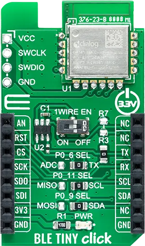
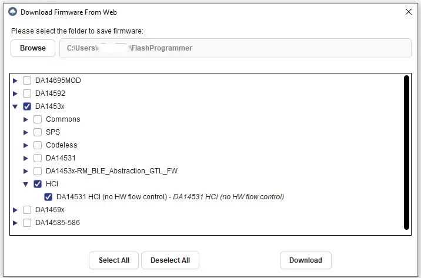

<!-- Copyright 2015-2026 Zephyr Project members and individual contributors. -->
<!-- SPDX-License-Identifier: Apache-2.0 -->
<!-- 中文翻译；编号、导航与译注为本地新增。 -->

<a id="mikroelektronika-ble-tiny-click"></a>

<a id="mikroe-ble-tiny-click-shield"></a>

# 第96章\_MikroElektronika BLE TINY Click低功耗蓝牙扩展板

原文：[官方页面](https://docs.zephyrproject.org/latest/boards/shields/mikroe_ble_tiny_click/doc/index.html)。读取日期：2026-10-16；来源摘要见[来源记录](../SOURCES.md)。

<a id="overview"></a>

## 概述（Overview）

<a id="id4"></a>

<a id="id6"></a>

MikroElektronika BLE TINY Click采用Renesas [DA14531MOD](https://www.renesas.com/us/en/products/wireless-connectivity/bluetooth-low-energy/da14531mod-smartbond-tiny-bluetooth-low-energy-module)低功耗蓝牙模块[注1](#id3)，外形符合mikroBUS [注2](#id5)。（[mikroBUS™](https://www.mikroe.com/mikrobus)）

<a id="id1"></a>



MikroElektronika BLE TINY Click低功耗蓝牙扩展板，图片来源：MikroElektronika

<a id="requirements"></a>

## 前置要求（Requirements）

此扩展板只能用于提供mikroBUS插座并定义mikrobus_serial节点标签的开发板，详情见“[扩展板（Shields）](https://docs.zephyrproject.org/latest/hardware/porting/shields.html#shields)”。

注意（Note）

<a id="id12"></a>

DA14531模块的复位输入为高有效，连接mikroBUS的RST脚；许多主板的RST是低有效系统复位，因此会意外持续复位该模块。移除BLE TINY Click的R3可解决，详情见原理图[注5](#id11)。（[BLE TINY Click模块 原理图](https://download.mikroe.com/documents/add-on-boards/click/ble_tiny_click/BLE_TINY_click_v102_Schematic.pdf)）

模块必须烧录支持UART HCI接口且不使用硬件流控的二进制，因为Click接口未提供流控信号。

<a id="id14"></a>

可使用[Renesas SmartBond Flash Programmer](https://www.renesas.com/us/en/software-tool/smartbond-flash-programmer) [注6](#id13)下载合适镜像，再通过Click板的SWD排针写入DA14531。安装并打开工具，点击“在线搜索（Search Online）”，按下图选择所需二进制：

<a id="id2"></a>



选择要下载的DA14531 HCI二进制文件

点击“编程（Program）”，将二进制文件写入DA14531模块。

DA14531及BLE TINY Click接口详情见：


- <a id="id8"></a>

  DA14531MOD数据手册[注3](#id7)（[DA14531MOD 数据手册](https://www.renesas.com/us/en/document/dst/da14531-module-datasheet?r=1601921)）
- <a id="id10"></a>

  [BLE TINY Click](https://www.mikroe.com/ble-tiny-click)扩展板[注4](#id9)

<a id="programming"></a>

## 编程（Programming）

调用west build时设置--shield mikroe_ble_tiny_click，例如：

```text
# From the root of the zephyr repository
west build -b ek-ra8m1 --shield mikroe_ble_tiny_click samples/bluetooth/beacon
```

<a id="references"></a>

## 参考资料（References）

<a id="id3"></a>

〔[1](#id4)〕 [https://www.renesas.com/us/en/products/wireless-connectivity/bluetooth-low-energy/da14531mod-smartbond-tiny-bluetooth-low-energy-module](https://www.renesas.com/us/en/products/wireless-connectivity/bluetooth-low-energy/da14531mod-smartbond-tiny-bluetooth-low-energy-module)

<a id="id5"></a>

〔[2](#id6)〕 [https://www.mikroe.com/mikrobus](https://www.mikroe.com/mikrobus)

<a id="id7"></a>

〔[3](#id8)〕 [Renesas DA14531模块数据手册](https://www.renesas.com/us/en/document/dst/da14531-module-datasheet?r=1601921)

<a id="id9"></a>

〔[4](#id10)〕 [https://www.mikroe.com/ble-tiny-click](https://www.mikroe.com/ble-tiny-click)

<a id="id11"></a>

〔[5](#id12)〕 [https://download.mikroe.com/documents/add-on-boards/click/ble_tiny_click/BLE_TINY_click_v102_Schematic.pdf](https://download.mikroe.com/documents/add-on-boards/click/ble_tiny_click/BLE_TINY_click_v102_Schematic.pdf)

<a id="id13"></a>

〔[6](#id14)〕 [https://www.renesas.com/us/en/software-tool/smartbond-flash-programmer](https://www.renesas.com/us/en/software-tool/smartbond-flash-programmer)

## 译注

BLE tiny的DA14531复位为高有效；须按原文移除R3。本模块UART HCI不使用流控，与Renesas Pmod方案不同。

## 原文外链核对

2026-10-16核对并重试以下原文外链时未能确认可访问性，保留原始目标，不将访问失败解释为原文内容有误。

- [ble-tiny-click](https://www.mikroe.com/ble-tiny-click)：HTTP Error 403: Forbidden。
- [mikrobus](https://www.mikroe.com/mikrobus)：HTTP Error 403: Forbidden。

---

[上一章](P095_MikroElektronika_Ambient_2_Click.md) · [返回大纲](大纲.md) · [全站翻译进度](../PROGRESS.md) · [下一章](P097_MikroElektronika_CAN_FD_6_Click.md)
