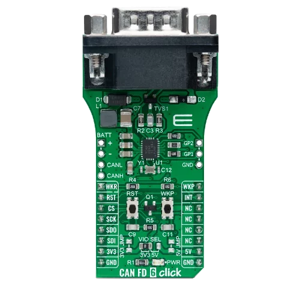

<!-- Copyright 2015-2026 Zephyr Project members and individual contributors. -->
<!-- SPDX-License-Identifier: Apache-2.0 -->
<!-- 中文翻译；编号、导航与译注为本地新增。 -->

<a id="mikroelektronika-can-fd-6-click"></a>

<a id="mikroe-can-fd-6-click-shield"></a>

# 第97章\_MikroElektronika CAN FD 6 Click扩展板

原文：[官方页面](https://docs.zephyrproject.org/latest/boards/shields/mikroe_can_fd_6_click/doc/index.html)。读取日期：2026-10-16；来源摘要见[来源记录](../SOURCES.md)。

<a id="overview"></a>

## 概述（Overview）

<a id="id5"></a>

CAN FD 6 Click采用[TI TCAN4550-Q1](https://www.ti.com/product/TCAN4550-Q1)汽车系统基础芯片（SBC）[注2](#id4)，通过SPI提供集成CAN FD控制器，并内置最高5 Mbit/s的高速CAN FD收发器。

<a id="id3"></a>

更多信息见Mikroe CAN FD 6 Click [注1](#id2)。（[Mikroe CAN FD 6 click模块](https://www.mikroe.com/can-fd-6-click)）

<a id="id1"></a>



MikroElektronika CAN FD 6 Click扩展板，图片来源：MikroElektronika

<a id="requirements"></a>

### 前置要求（Requirements）

扩展板使用mikroBUS接口，目标板须定义mikrobus_spi及mikrobus_header节点标签，支持电平触发中断及最高18 MHz SPI时钟；标签详情见“[扩展板（Shields）](https://docs.zephyrproject.org/latest/hardware/porting/shields.html#shields)”。

<a id="programming"></a>

### 编程（Programming）

调用west build时设置--shield mikroe_can_fd_6_click，例如：

```text
# From the root of the zephyr repository
west build -b mikroe_stm32_m4_clicker --shield mikroe_can_fd_6_click samples/drivers/can/counter
west flash
```

<a id="references"></a>

### 参考资料（References）

<a id="id2"></a>

〔[1](#id3)〕 [https://www.mikroe.com/can-fd-6-click](https://www.mikroe.com/can-fd-6-click)

<a id="id4"></a>

〔[2](#id5)〕 [https://www.ti.com/product/TCAN4550-Q1](https://www.ti.com/product/TCAN4550-Q1)

## 原文外链核对

2026-10-16核对并重试以下原文外链时未能确认可访问性，保留原始目标，不将访问失败解释为原文内容有误。

- [can-fd-6-click](https://www.mikroe.com/can-fd-6-click)：HTTP Error 403: Forbidden。

---

[上一章](P096_MikroElektronika_BLE_TINY_Click.md) · [返回大纲](大纲.md) · [全站翻译进度](../PROGRESS.md) · [下一章](P098_MikroElektronika_DALI_2_Click.md)
