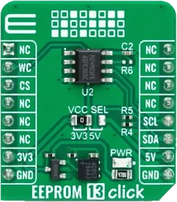

<!-- Copyright 2015-2026 Zephyr Project members and individual contributors. -->
<!-- SPDX-License-Identifier: Apache-2.0 -->
<!-- 中文翻译；编号、导航与译注为本地新增。 -->

<a id="mikroelektronika-eeprom-13-click"></a>

<a id="mikroe-eeprom-13-click-shield"></a>

# 第99章\_MikroElektronika EEPROM 13 Click存储扩展板

原文：[官方页面](https://docs.zephyrproject.org/latest/boards/shields/mikroe_eeprom_13_click/doc/index.html)。读取日期：2026-10-16；来源摘要见[来源记录](../SOURCES.md)。

<a id="overview"></a>

## 概述（Overview）

<a id="id3"></a>

[EEPROM 13 Click](https://www.mikroe.com/eeprom-13-click) [注1](#id2)是紧凑参数存储方案，适用于多种嵌入式应用。

<a id="id5"></a>

它采用意法半导体[M24M01E](https://www.st.com/en/memories/m24m01e-f.html) 1 Mbit串行EEPROM [注2](#id4)，提供覆盖全部存储器的增强硬件写保护，页大小256字节，另有256字节标识页。

<a id="id1"></a>



EEPROM 13 Click扩展板，图片来源：MikroElektronika

<a id="requirements"></a>

## 前置要求（Requirements）

此扩展板只能用于提供mikroBUS插座，并为其I2C接口定义mikrobus_i2c节点标签的开发板，详情见“[扩展板（Shields）](https://docs.zephyrproject.org/latest/hardware/porting/shields.html#shields)”。

<a id="programming"></a>

## 编程（Programming）

调用west build时设置--shield mikroe_eeprom_13_click，例如：

```text
# From the root of the zephyr repository
west build -b frdm_mcxn947/mcxn947/cpu0 --shield mikroe_eeprom_13_click samples/drivers/eeprom
```

<a id="references"></a>

## 参考资料（References）

<a id="id2"></a>

〔[1](#id3)〕 [https://www.mikroe.com/eeprom-13-click](https://www.mikroe.com/eeprom-13-click)

<a id="id4"></a>

〔[2](#id5)〕 [https://www.st.com/en/memories/m24m01e-f.html](https://www.st.com/en/memories/m24m01e-f.html)

## 原文外链核对

2026-10-16核对并重试以下原文外链时未能确认可访问性，保留原始目标，不将访问失败解释为原文内容有误。

- [eeprom-13-click](https://www.mikroe.com/eeprom-13-click)：HTTP Error 403: Forbidden。
- [m24m01e-f.html](https://www.st.com/en/memories/m24m01e-f.html)：HTTP Error 567: Unknown Status。

---

[上一章](P098_MikroElektronika_DALI_2_Click.md) · [返回大纲](大纲.md) · [全站翻译进度](../PROGRESS.md) · [下一章](P100_MikroElektronika_EERAM_3.3V_Click.md)
