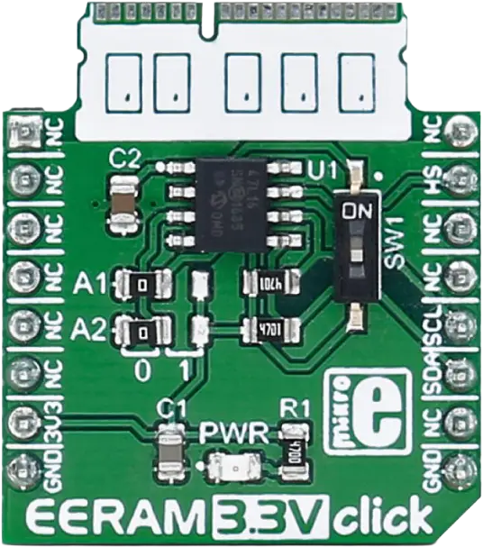

<!-- Copyright 2015-2026 Zephyr Project members and individual contributors. -->
<!-- SPDX-License-Identifier: Apache-2.0 -->
<!-- 中文翻译；编号、导航与译注为本地新增。 -->

<a id="mikroelektronika-eeram-3-3v-click"></a>

<a id="mikroe-eeram-33v-click-shield"></a>

# 第100章\_MikroElektronika EERAM 3.3V Click存储扩展板

原文：[官方页面](https://docs.zephyrproject.org/latest/boards/shields/mikroe_eeram_33v_click/doc/index.html)。读取日期：2026-10-16；来源摘要见[来源记录](../SOURCES.md)。

<a id="overview"></a>

## 概述（Overview）

<a id="id3"></a>

<a id="id5"></a>

[EERAM 3.3V Click](https://www.mikroe.com/eeram-33v-click) [注1](#id2)是基于Microchip [47L16](https://www.microchip.com/en-us/product/47l16) [注2](#id4)的紧凑附加板，提供带自动EEPROM备份的2 KB I2C SRAM，即EERAM。

47L16通过I2C地址0x50提供2048字节SRAM。写入立即完成，没有跨页限制或写周期等待；断电时SRAM自动备份到内部EEPROM，无需驱动显式操作即可非易失存储。

覆盖文件设置eeprom-0别名，使应用可通过通用atmel,at24驱动及标准Zephyr EEPROM API访问设备。

<a id="id1"></a>



EERAM 3.3V Click扩展板，图片来源：MikroElektronika

<a id="requirements"></a>

## 前置要求（Requirements）

此扩展板只能用于提供mikroBUS插座，并为其I2C接口定义mikrobus_i2c节点标签的开发板，详情见“[扩展板（Shields）](https://docs.zephyrproject.org/latest/hardware/porting/shields.html#shields)”。

<a id="programming"></a>

## 编程（Programming）

调用west build时设置--shield mikroe_eeram_33v_click，例如：

```text
# From the root of the zephyr repository
west build -b frdm_mcxn947/mcxn947/cpu0 --shield mikroe_eeram_33v_click samples/drivers/eeprom
```

<a id="references"></a>

## 参考资料（References）

<a id="id2"></a>

〔[1](#id3)〕 [https://www.mikroe.com/eeram-33v-click](https://www.mikroe.com/eeram-33v-click)

<a id="id4"></a>

〔[2](#id5)〕 [https://www.microchip.com/en-us/product/47l16](https://www.microchip.com/en-us/product/47l16)

## 原文外链核对

2026-10-16核对并重试以下原文外链时未能确认可访问性，保留原始目标，不将访问失败解释为原文内容有误。

- [47l16](https://www.microchip.com/en-us/product/47l16)：HTTP Error 403: Forbidden。
- [eeram-33v-click](https://www.mikroe.com/eeram-33v-click)：HTTP Error 403: Forbidden。

---

[上一章](P099_MikroElektronika_EEPROM_13_Click.md) · [返回大纲](大纲.md) · [全站翻译进度](../PROGRESS.md) · [下一章](P101_MikroElektronika_ETH_3_Click.md)
