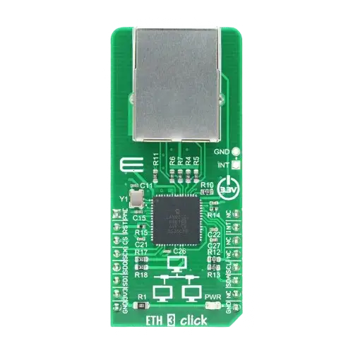

<!-- Copyright 2015-2026 Zephyr Project members and individual contributors. -->
<!-- SPDX-License-Identifier: Apache-2.0 -->
<!-- 中文翻译；编号、导航与译注为本地新增。 -->

<a id="mikroelektronika-eth-3-click"></a>

<a id="mikroe-eth3-click"></a>

# 第101章\_MikroElektronika ETH 3 Click以太网扩展板

原文：[官方页面](https://docs.zephyrproject.org/latest/boards/shields/mikroe_eth3_click/doc/index.html)。读取日期：2026-10-16；来源摘要见[来源记录](../SOURCES.md)。

<a id="overview"></a>

## 概述（Overview）

<a id="id5"></a>

<a id="id3"></a>

ETH 3 Click采用mikroBUS外形，搭载[LAN9250](https://www.microchip.com/en-us/product/lan9250) [注2](#id4)独立10/100 Mbit/s BASE-T以太网控制器，集成MAC及PHY，具有16 Kbyte FIFO及SPI接口；更多信息见ETH 3 Click扩展板网站[注1](#id2)。（[ETH 3 Click模块 扩展板 网站](https://www.mikroe.com/eth-3-click)）

<a id="id1"></a>



MikroElektronika ETH 3 Click以太网扩展板，图片来源：MikroElektronika

<a id="pins-assignment-of-the-eth-click-shield"></a>

### ETH Click扩展板的引脚分配

<table>
<tr>
<th>扩展板连接器引脚</th>
<th>功能（Function）</th>
</tr>
<tr>
<td>RST#，低有效复位</td>
<td>以太网控制器复位</td>
</tr>
<tr>
<td>CS#，低有效片选</td>
<td>SPI片选</td>
</tr>
<tr>
<td>串行时钟（SCK）</td>
<td>SPI时钟</td>
</tr>
<tr>
<td>串行数据输出（SDO）</td>
<td>SPI从机数据输出MISO</td>
</tr>
<tr>
<td>SDI</td>
<td>SPI从机数据输入，原文括号仍写MISO，照录并提示</td>
</tr>
<tr>
<td>中断（INT）</td>
<td>以太网控制器中断输出</td>
</tr>
</table>

<a id="requirements"></a>

## 前置要求（Requirements）

此扩展板只能用于提供mikroBUS连接器配置，并定义SPI及GPIO节点别名的开发板，详情见“[扩展板（Shields）](https://docs.zephyrproject.org/latest/hardware/porting/shields.html#shields)”。

<a id="programming"></a>

## 编程（Programming）

调用west build时设置--shield mikroe_eth3_click，例如：

```text
# From the root of the zephyr repository
west build -b mikroe_stm32_m4_clicker --shield mikroe_eth3_click samples/net/dhcpv4_client
```

<a id="references"></a>

## 参考资料（References）

<a id="id2"></a>

〔[1](#id3)〕 [https://www.mikroe.com/eth-3-click](https://www.mikroe.com/eth-3-click)

<a id="id4"></a>

〔[2](#id5)〕 [https://www.microchip.com/en-us/product/lan9250](https://www.microchip.com/en-us/product/lan9250)

## 原文外链核对

2026-10-16核对并重试以下原文外链时未能确认可访问性，保留原始目标，不将访问失败解释为原文内容有误。

- [lan9250](https://www.microchip.com/en-us/product/lan9250)：HTTP Error 403: Forbidden。
- [eth-3-click](https://www.mikroe.com/eth-3-click)：HTTP Error 403: Forbidden。

---

[上一章](P100_MikroElektronika_EERAM_3.3V_Click.md) · [返回大纲](大纲.md) · [全站翻译进度](../PROGRESS.md) · [下一章](P102_MikroElektronika_ETH_Click.md)
