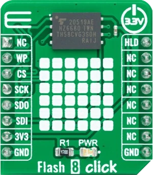

<!-- Copyright 2015-2026 Zephyr Project members and individual contributors. -->
<!-- SPDX-License-Identifier: Apache-2.0 -->
<!-- 中文翻译；编号、导航与译注为本地新增。 -->

<a id="mikroelektronika-flash-8-click"></a>

<a id="mikroe-flash-8-click-shield"></a>

# 第105章\_MikroElektronika Flash 8 Click闪存扩展板

原文：[官方页面](https://docs.zephyrproject.org/latest/boards/shields/mikroe_flash_8_click/doc/index.html)。读取日期：2026-10-16；来源摘要见[来源记录](../SOURCES.md)。

<a id="overview"></a>

## 概述（Overview）

[Flash 8 Click](https://www.mikroe.com/flash-8-click)是提供高可靠存储方案的紧凑附加板。

它采用兆易创新GigaDevice GD5F2GQ5UEYIGR 2 Gbit高密度非易失存储器，基于行业标准NAND内核，可作为SPI NOR及传统并行NAND的替代方案。器件提供8 Kbyte OTP安全区域、软件及硬件写保护，至少10万次写周期及超过10年的数据保持期。

<a id="id1"></a>

[](images/mikroe_flash_8_click.webp)

Flash 8 Click闪存扩展板

<a id="requirements"></a>

## 前置要求（Requirements）

此扩展板只能用于提供mikroBUS插座，并为SPI定义mikrobus_spi节点标签的开发板，详情见“[扩展板（Shields）](https://docs.zephyrproject.org/latest/hardware/porting/shields.html#shields)”。

<a id="programming"></a>

## 编程（Programming）

调用west build时设置--shield mikroe_flash_8_click，例如：

```text
# From the root of the zephyr repository
west build -b frdm_mcxn947/mcxn947/cpu0 --shield mikroe_flash_8_click samples/drivers/flash_shell
```

<a id="references"></a>

## 参考资料（References）


- [Flash 8 Click闪存扩展板](https://www.mikroe.com/flash-8-click)

## 原文外链核对

2026-10-16核对并重试以下原文外链时未能确认可访问性，保留原始目标，不将访问失败解释为原文内容有误。

- [flash-8-click](https://www.mikroe.com/flash-8-click)：HTTP Error 403: Forbidden。

---

[上一章](P104_MikroElektronika_Flash_6_Click.md) · [返回大纲](大纲.md) · [全站翻译进度](../PROGRESS.md) · [下一章](P106_MikroElektronika_H_Bridge_4_Click.md)
