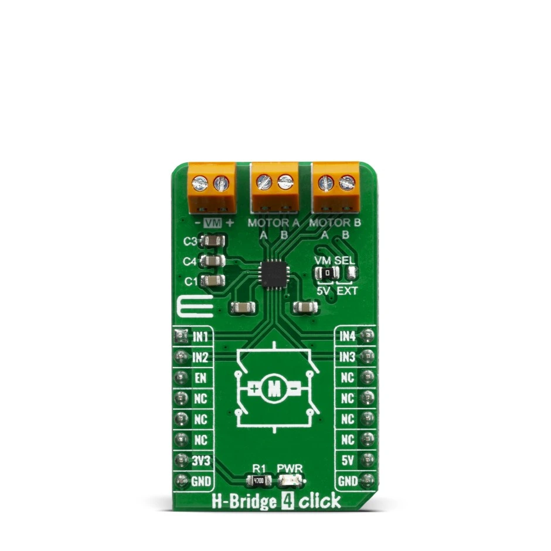

<!-- Copyright 2015-2026 Zephyr Project members and individual contributors. -->
<!-- SPDX-License-Identifier: Apache-2.0 -->
<!-- 中文翻译；编号、导航与译注为本地新增。 -->

<a id="mikroelektronika-h-bridge-4-click"></a>

<a id="mikroe-h-bridge-4-click-shield"></a>

# 第106章\_MikroElektronika H Bridge 4 Click电机驱动扩展板

原文：[官方页面](https://docs.zephyrproject.org/latest/boards/shields/mikroe_h_bridge_4_click/doc/index.html)。读取日期：2026-10-16；来源摘要见[来源记录](../SOURCES.md)。

<a id="overview"></a>

## 概述（Overview）

H-Bridge 4 Click采用双通道H桥AP1010AEN，支持最高18 V电机电压，可驱动2个直流电机或1个步进电机。保护电路包括欠压锁定、过热关断及过流保护，DIS OCP端可关闭过流保护。

H-Bridge 4 Click支持多种连接方式，可用于直流或步进电机应用。

<a id="id1"></a>



MikroElektronika H Bridge 4 Click电机驱动扩展板，图片来源：MikroElektronika

<a id="requirements"></a>

## 前置要求（Requirements）

此扩展板可用于定义mikrobus_header节点标签的开发板，详情见“[扩展板（Shields）](https://docs.zephyrproject.org/latest/hardware/porting/shields.html#shields)”。

<a id="programming"></a>

## 编程（Programming）

```text
# From the root of the zephyr repository
west build -b <board> --shield mikroe_h_bridge_4_click samples/drivers/stepper/generic
west flash
```

<a id="references"></a>

## 参考资料（References）

---

[上一章](P105_MikroElektronika_Flash_8_Click.md) · [返回大纲](大纲.md) · [全站翻译进度](../PROGRESS.md) · [下一章](P107_MikroElektronika_Illuminance_Click.md)
