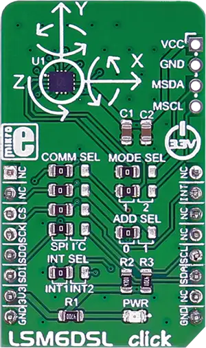

<!-- Copyright 2015-2026 Zephyr Project members and individual contributors. -->
<!-- SPDX-License-Identifier: Apache-2.0 -->
<!-- 中文翻译；编号、导航与译注为本地新增。 -->

<a id="mikroelektronika-lsm6dsl-click"></a>

<a id="mikroe-lsm6dsl-click-shield"></a>

# 第110章\_MikroElektronika LSM6DSL Click惯性传感器扩展板

原文：[官方页面](https://docs.zephyrproject.org/latest/boards/shields/mikroe_lsm6dsl_click/doc/index.html)。读取日期：2026-10-16；来源摘要见[来源记录](../SOURCES.md)。

<a id="overview"></a>

## 概述（Overview）

[LSM6DSL Click](https://www.mikroe.com/lsm6dsl-click)提供六自由度测量，搭载LSM6DSL高性能三轴数字加速度计及三轴数字陀螺仪，使用3.3 V电源，通过SPI或I2C连接目标MCU，并由mikroBUS INT脚提供附加功能。译注：原文将测量量写作线速度和角速度，器件类型按同段保留。（[LSM6DSL Click惯性传感器扩展板](https://www.mikroe.com/lsm6dsl-click)）

<a id="id1"></a>

[](images/mikroe_lsm6dsl_click.webp)

LSM6DSL Click惯性传感器扩展板

<a id="requirements"></a>

## 前置要求（Requirements）

此扩展板只能用于提供mikroBUS插座，并为SPI定义mikrobus_spi节点标签的开发板，详情见“[扩展板（Shields）](https://docs.zephyrproject.org/latest/hardware/porting/shields.html#shields)”。

<a id="programming"></a>

## 编程（Programming）

调用west build时设置-DSHIELD=mikroe_lsm6dsl_click，例如：

```text
# From the root of the zephyr repository
west build -b mikroe_clicker_ra4m1 --shield mikroe_lsm6dsl_click samples/sensor/accel_trig
```

<a id="references"></a>

## 参考资料（References）


- [LSM6DSL Click惯性传感器扩展板](https://www.mikroe.com/lsm6dsl-click)
- [LSM6DSL Click原理图](https://download.mikroe.com/documents/add-on-boards/click/lsm6dsl/lsm6dsl-click-schematic-v100.pdf)

## 译注

原文使用linear velocity字样；器件为加速度计及陀螺仪，术语差异在正文提示。

## 原文外链核对

2026-10-16核对并重试以下原文外链时未能确认可访问性，保留原始目标，不将访问失败解释为原文内容有误。

- [lsm6dsl-click](https://www.mikroe.com/lsm6dsl-click)：HTTP Error 403: Forbidden。

---

[上一章](P109_MikroElektronika_LIN_Click.md) · [返回大纲](大纲.md) · [全站翻译进度](../PROGRESS.md) · [下一章](P111_MikroElektronika_LTE_IoT_10_Click.md)
