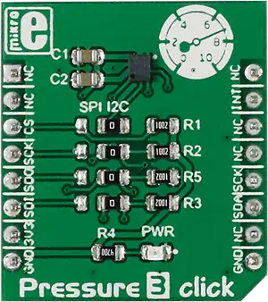

<!-- Copyright 2015-2026 Zephyr Project members and individual contributors. -->
<!-- SPDX-License-Identifier: Apache-2.0 -->
<!-- 中文翻译；编号、导航与译注为本地新增。 -->

<a id="mikroelektronika-pressure-3-click"></a>

<a id="mikroe-pressure-3-click-shield"></a>

# 第115章\_MikroElektronika Pressure 3 Click气压扩展板

原文：[官方页面](https://docs.zephyrproject.org/latest/boards/shields/mikroe_pressure_3_click/doc/index.html)。读取日期：2026-10-16；来源摘要见[来源记录](../SOURCES.md)。

<a id="overview"></a>

## 概述（Overview）

[Pressure 3 Click](https://www.mikroe.com/pressure-3-click)是包含板载气压传感器的紧凑附加板。

它采用Infineon面向便携设备的DPS310 XENSIV数字气压传感器，标准模式典型测量时间27.6 ms，低精度模式可降至3.6 ms。量程300～1200 hPa，相对精度0.06 hPa，绝对精度1 hPa，适用于便携气象站、室内导航、无人机高度控制等依赖气压测量的应用。

<a id="id1"></a>

[](images/mikroe_pressure_3_click.webp)

Pressure 3 Click气压扩展板

<a id="requirements"></a>

## 前置要求（Requirements）

此扩展板只能用于提供mikroBUS插座，并为其I2C接口定义mikrobus_i2c节点标签的开发板，详情见“[扩展板（Shields）](https://docs.zephyrproject.org/latest/hardware/porting/shields.html#shields)”。

<a id="programming"></a>

## 编程（Programming）

调用west build时设置-DSHIELD=mikroe_pressure_3_click，例如：

```text
# From the root of the zephyr repository
west build -b mikroe_clicker_ra4m1 --shield mikroe_pressure_3_click samples/sensor/pressure_polling
```

<a id="references"></a>

## 参考资料（References）


- [Pressure 3 Click气压扩展板](https://www.mikroe.com/pressure-3-click)
- [Pressure 3 Click原理图](https://download.mikroe.com/documents/add-on-boards/click/pressure-3/pressure-3-click-schematic-v100.pdf)

## 原文外链核对

2026-10-16核对并重试以下原文外链时未能确认可访问性，保留原始目标，不将访问失败解释为原文内容有误。

- [pressure-3-click](https://www.mikroe.com/pressure-3-click)：HTTP Error 403: Forbidden。

---

[上一章](P114_MikroElektronika_MCP251xFD_Click_shields.md) · [返回大纲](大纲.md) · [全站翻译进度](../PROGRESS.md) · [下一章](P116_MikroElektronika_Proximity_9_Click.md)
