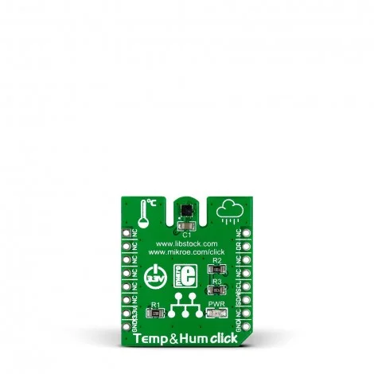

<!-- Copyright 2015-2026 Zephyr Project members and individual contributors. -->
<!-- SPDX-License-Identifier: Apache-2.0 -->
<!-- 中文翻译；编号、导航与译注为本地新增。 -->

<a id="mikroelektronika-temp-hum-click"></a>

<a id="mikroe-temp-hum-click-shield"></a>

# 第121章\_MikroElektronika Temp&Hum Click温湿度扩展板

原文：[官方页面](https://docs.zephyrproject.org/latest/boards/shields/mikroe_temp_hum_click/doc/index.html)。读取日期：2026-10-16；来源摘要见[来源记录](../SOURCES.md)。

<a id="overview"></a>

## 概述（Overview）

[Temp&Hum Click](https://www.mikroe.com/temp-hum-click)基于HTS221数字传感器，测量温度及相对湿度。

此扩展板通过mikroBUS插座上的I2C提供HTS221。

<a id="id1"></a>

[](images/mikroe_temp_hum_click.webp)

Temp&Hum Click温湿度扩展板

<a id="requirements"></a>

## 前置要求（Requirements）

开发板须有mikroBUS插座，并提供符合所选插座接线的I2C节点标签，例如mikrobus_i2c或板级mikrobus_1_i2c／mikrobus_2_i2c，详情见“[扩展板（Shields）](https://docs.zephyrproject.org/latest/hardware/porting/shields.html#shields)”。

<a id="programming"></a>

## 编程（Programming）

调用west build时设置-DSHIELD=mikroe_temp_hum_click，例如：

```text
# From the root of the zephyr repository
west build -b mikroe_clicker_2 --shield mikroe_temp_hum_click samples/sensor/hts221
```

其他绑定属性见[st,hts221](../compatible_binding_reference/P069_st_hts221.md#std-dtcompatible-st-hts221)文档。

<a id="references"></a>

## 参考资料（References）


- [Temp&Hum Click温湿度扩展板](https://www.mikroe.com/temp-hum-click)
- [HTS221](https://www.st.com/en/mems-and-sensors/hts221.html)

## 原文外链核对

2026-10-16核对并重试以下原文外链时未能确认可访问性，保留原始目标，不将访问失败解释为原文内容有误。

- [temp-hum-click](https://www.mikroe.com/temp-hum-click)：HTTP Error 403: Forbidden。
- [hts221.html](https://www.st.com/en/mems-and-sensors/hts221.html)：HTTP Error 567: Unknown Status。

---

[上一章](P120_MikroElektronika_Stepper_19_Click.md) · [返回大纲](大纲.md) · [全站翻译进度](../PROGRESS.md) · [下一章](P122_MikroElektronika_Two_Wire_ETH_Click.md)
