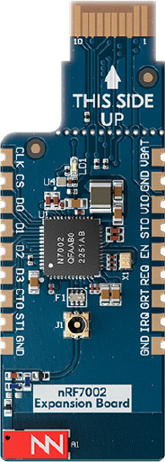

<!-- Copyright 2015-2026 Zephyr Project members and individual contributors. -->
<!-- SPDX-License-Identifier: Apache-2.0 -->
<!-- 中文翻译；编号、导航与译注为本地新增。 -->

<a id="nrf7002-eb"></a>

<a id="nrf7002eb"></a>

# 第130章\_nRF7002评估板（EB）

原文：[官方页面](https://docs.zephyrproject.org/latest/boards/shields/nrf7002eb/doc/index.html)。读取日期：2026-10-16；来源摘要见[来源记录](../SOURCES.md)。

<a id="overview"></a>

## 概述（Overview）

nRF7002 EB是U盘大小的扩展评估板，通过Nordic边缘连接器连接Thingy53等兼容Nordic主板。

nRF7002 EB基于nRF7002 SoC，为主机提供低功耗Wi-Fi 6，支持2.4及5 GHz双频，可接入Wi-Fi并用于Wi-Fi定位，例如嗅探附近热点SSID。

<a id="id1"></a>



nRF7002评估板（EB）

<a id="requirements"></a>

## 前置要求（Requirements）

nRF7002 EB可直接插入Nordic边缘连接器，以SPI通信，可配合任意支持此连接器的主板。

<a id="prerequisites"></a>

### 前置条件（Prerequisites）

nRF70驱动需要二进制固件才能运行Wi-Fi，执行以下命令取得文件。

```text
west update
west blobs fetch nrf_wifi
```

<a id="usage"></a>

## 用途（Usage）

调用west build时设置--shield nrf7002eb，即可在应用中使用。

<a id="shield-variants"></a>

## 扩展板变体（Shield Variants）

nRF7002 EB有包含共存COEX引脚的变体，但部分主板的边缘接口未连接这些信号，例如早于v1.0.0的Thingy53。


- nrf7002eb：默认变体
- nrf7002eb_coex：包含COEX引脚
- nrf7002eb_coex_sa：包含COEX引脚的独立变体

<a id="sr-co-existence"></a>

## 短距离无线共存（SR Co-existence）

主板支持时，nRF7002 EB可使用短距离无线共存，相关引脚连接主板GPIO。

可用以下2个Kconfig选项启用SR共存：


- [CONFIG_NRF70_SR_COEX](https://docs.zephyrproject.org/latest/kconfig.html#CONFIG_NRF70_SR_COEX)：启用SR共存
- [CONFIG_NRF70_SR_COEX_RF_SWITCH](https://docs.zephyrproject.org/latest/kconfig.html#CONFIG_NRF70_SR_COEX_RF_SWITCH)：控制SR侧射频开关

<a id="references"></a>

## 参考资料（References）


- [使用nRF7002 EB开发](https://docs.nordicsemi.com/bundle/ncs-latest/page/nrf/app_dev/device_guides/nrf70/nrf7002eb_dev_guide.html)
- [nRF7002 EB产品规格](https://infocenter.nordicsemi.com/topic/ug_nrf7002_eb/UG/nrf7002_EB/intro.html)
- [nRF7002产品规格](https://infocenter.nordicsemi.com/index.jsp?topic=%2Fstruct_nrf70%2Fstruct%2Fnrf7002.html&cp=3_0)
- [nRF7002无线共存](https://infocenter.nordicsemi.com/index.jsp?topic=%2Fps_nrf7002%2Fchapters%2Ffunctional%2Fdoc%2Fcoexistence.html&cp=3_0_0_7)

## 译注

EB与EB II连接器不同；Thingy:53早期硬件版本的COEX连接条件保留。

## 原文外链核对

2026-10-16核对并重试以下原文外链时未能确认可访问性，保留原始目标，不将访问失败解释为原文内容有误。

- [nrf7002eb_dev_guide.html](https://docs.nordicsemi.com/bundle/ncs-latest/page/nrf/app_dev/device_guides/nrf70/nrf7002eb_dev_guide.html)：HTTP Error 403: Forbidden。
- [index.jsp?topic=%2Fps_nrf7002%2Fchapters%2Ffunctional%2Fdoc%2Fcoexistence.html&cp=3_0_0_7](https://infocenter.nordicsemi.com/index.jsp?topic=%2Fps_nrf7002%2Fchapters%2Ffunctional%2Fdoc%2Fcoexistence.html&cp=3_0_0_7)：HTTP Error 403: Forbidden。
- [index.jsp?topic=%2Fstruct_nrf70%2Fstruct%2Fnrf7002.html&cp=3_0](https://infocenter.nordicsemi.com/index.jsp?topic=%2Fstruct_nrf70%2Fstruct%2Fnrf7002.html&cp=3_0)：HTTP Error 403: Forbidden。
- [intro.html](https://infocenter.nordicsemi.com/topic/ug_nrf7002_eb/UG/nrf7002_EB/intro.html)：HTTP Error 403: Forbidden。

---

[上一章](P129_nPM6001_EK.md) · [返回大纲](大纲.md) · [全站翻译进度](../PROGRESS.md) · [下一章](P131_nRF7002_EB_II.md)
