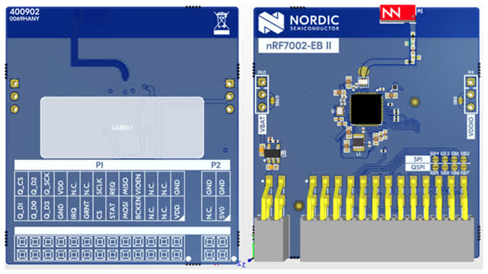

<!-- Copyright 2015-2026 Zephyr Project members and individual contributors. -->
<!-- SPDX-License-Identifier: Apache-2.0 -->
<!-- 中文翻译；编号、导航与译注为本地新增。 -->

<a id="nrf7002-eb-ii"></a>

<a id="nrf7002eb2"></a>

# 第131章\_nRF7002第二代评估板（EB II）

原文：[官方页面](https://docs.zephyrproject.org/latest/boards/shields/nrf7002eb2/doc/index.html)。读取日期：2026-10-16；来源摘要见[来源记录](../SOURCES.md)。

<a id="overview"></a>

## 概述（Overview）

nRF7002 EB II是U盘大小的扩展评估板，通过Nordic扩展排针连接兼容Nordic主板。

nRF7002 EB II基于nRF7002，为主机提供低功耗Wi-Fi 6及2.4／5 GHz双频，还通过变体覆盖文件支持nRF7001及nRF7000。可接入Wi-Fi并用于Wi-Fi定位，例如嗅探附近热点SSID。

<a id="id1"></a>



nRF7002第二代评估板（EB II）

<a id="requirements"></a>

## 前置要求（Requirements）

nRF7002 EB II可直接插入Nordic扩展排针，以SPI通信，可配合任意支持此排针的主板。

<a id="prerequisites"></a>

### 前置条件（Prerequisites）

nRF70驱动需要二进制固件才能运行Wi-Fi，执行以下命令取得文件。

```text
west update
west blobs fetch nrf_wifi
```

<a id="usage"></a>

## 用途（Usage）

调用west build时设置--shield nrf7002eb2，即可在应用中使用。

<a id="console-and-uart-impact"></a>

## 对控制台及UART的影响

在nRF54L15 DK上，扩展排针与虚拟串口1 VCOM1共用引脚。

由于应用核CPUAPP需要控制台，覆盖文件禁用冲突的UART20，并将应用控制台，包括Shell、mcumgr及Bluetooth监视器，改接UART30，对应VCOM0。

注意（Note）

nRF54LM20 DK不受影响，UART20的P1.16～P1.19不与扩展板信号重叠，因此连接后UART20 VCOM1仍为默认控制台，全部按键也可使用。本节其余内容仅适用于nRF54L15 DK。

<a id="key-changes-and-requirements"></a>

### 主要变化及要求


- 虚拟串口切换：应用控制台从次端口移到主端口，即操作系统最先枚举的VCOM。所有Shell、烧录及mcumgr操作均应使用此主端口，例如Linux中编号较小的ttyACM或Windows COM口。
- 必须在[nRF Connect Board Configurator](https://docs.nordicsemi.com/bundle/nrf-connect-board-configurator/page/index.html)中禁用次端口VCOM1，扩展板才能正常工作。
- 物理限制：扩展板占用了VCOM1的电气连接，只剩VCOM0可用。
- FLPR内核：应用核占用唯一可用VCOM0后，FLPR默认没有UART输出。即使覆盖文件将其改到其他UART，除非关闭应用核控制台以释放VCOM0，也无法经USB连接电脑。此时FLPR控制台可改用rtt-console片段。

<a id="uart-and-port-mapping"></a>

### UART与端口映射

<a id="id2"></a>

<table>
<tr>
<th>特性（Feature）</th>
<th>标准配置，无扩展板</th>
<th>连接扩展板后</th>
</tr>
<tr>
<td>应用核UART实例</td>
<td>UART20</td>
<td>UART30</td>
</tr>
<tr>
<td>应用核虚拟串口</td>
<td>串口1</td>
<td>串口0</td>
</tr>
<tr>
<td>FLPR核UART实例</td>
<td>UART30</td>
<td>无（None）</td>
</tr>
<tr>
<td>FLPR核虚拟串口</td>
<td>串口0</td>
<td>无（None）</td>
</tr>
<tr>
<td>开发板配置工具（Board Configurator）</td>
<td>全部端口启用</td>
<td>禁用VCOM1</td>
</tr>
</table>

注意（Caution）

若同时连接多块设备，须识别此板的主端口；连接扩展板时使用VCOM1会导致引脚冲突及硬件不稳定。

<a id="shield-variants"></a>

## 扩展板变体（Shield Variants）

nRF7002 EB II提供多种变体，支持不同nRF70 SoC及功能：


- nrf7002eb2：默认使用nRF7002
- nrf7002eb2_nrf7001：使用nRF7001
- nrf7002eb2_nrf7000：使用nRF7000
- nrf7002eb2_coex仅增加SR共存引脚，不能独立使用；需与nrf7002eb2或nrf7002eb2_nrf7000等主扩展板一起，放在同一个--shield参数中，例如--shield "nrf7002eb2;nrf7002eb2_coex"。

<a id="sr-co-existence"></a>

## 短距离无线共存（SR Co-existence）

主板支持时，nRF7002 EB II可使用SR共存，相关引脚连接主板GPIO；将nrf7002eb2_coex与任意一个主变体一起启用，见前述变体说明。

可用以下2个Kconfig选项启用SR共存：


- [CONFIG_NRF70_SR_COEX](https://docs.zephyrproject.org/latest/kconfig.html#CONFIG_NRF70_SR_COEX)：启用SR共存
- [CONFIG_NRF70_SR_COEX_RF_SWITCH](https://docs.zephyrproject.org/latest/kconfig.html#CONFIG_NRF70_SR_COEX_RF_SWITCH)：控制SR侧射频开关

<a id="references"></a>

## 参考资料（References）


- [使用nRF7002 EB II开发](https://docs.nordicsemi.com/bundle/ncs-latest/page/nrf/app_dev/device_guides/nrf70/nrf7002eb2_dev_guide.html)

## 译注

nRF54L15使用此扩展板时UART20引脚冲突，需要UART30及板配置器VCOM设置；共存选项作为同一个分号分隔参数。

## 原文外链核对

2026-10-16核对并重试以下原文外链时未能确认可访问性，保留原始目标，不将访问失败解释为原文内容有误。

- [nrf7002eb2_dev_guide.html](https://docs.nordicsemi.com/bundle/ncs-latest/page/nrf/app_dev/device_guides/nrf70/nrf7002eb2_dev_guide.html)：HTTP Error 403: Forbidden。
- [index.html](https://docs.nordicsemi.com/bundle/nrf-connect-board-configurator/page/index.html)：HTTP Error 403: Forbidden。

---

[上一章](P130_nRF7002_EB.md) · [返回大纲](大纲.md) · [全站翻译进度](../PROGRESS.md) · [下一章](P132_nRF7002_EK.md)
