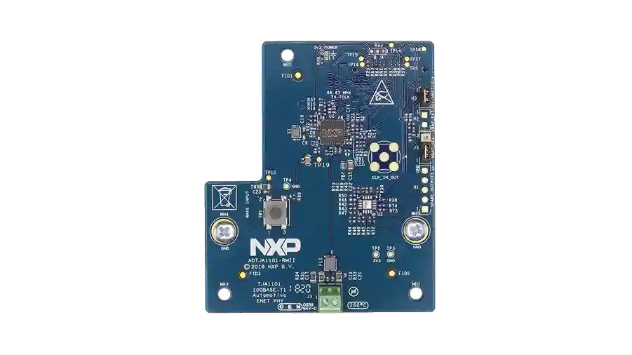

<!-- Copyright 2015-2026 Zephyr Project members and individual contributors. -->
<!-- SPDX-License-Identifier: Apache-2.0 -->
<!-- 中文翻译；编号、导航与译注为本地新增。 -->

# 第133章\_NXP ADTJA1101-RMII车载以太网适配器（Automotive Ethernet Adapter）

原文：[官方页面](https://docs.zephyrproject.org/latest/boards/shields/nxp_adtja1101/doc/index.html)。读取日期：2026-10-16；来源摘要见[来源记录](../SOURCES.md)。

## 概述（Overview）

ADTJA1101-RMII专为S32K148微控制器及i.MX8平台增加100 Mbit/s车载以太网连接而设计。

它可插入NXP S32K148-Q176评估板通用扩展接口，将S32K148的RMII直接连接到NXP TJA1101 100BASE-T1 PHY。

更多信息见[ADTJA1101-RMII](https://www.nxp.com/part/ADTJA1101-RMII) [注1](#id1)。

## 编程（Programming）

调用west build时设置--shield nxp_adtja1101。

## 参考资料（References）

〔[1](#id2)〕 [https://www.nxp.com/part/ADTJA1101-RMII](https://www.nxp.com/part/ADTJA1101-RMII)

## 原文外链核对

2026-10-16核对并重试以下原文外链时未能确认可访问性，保留原始目标，不将访问失败解释为原文内容有误。

- [ADTJA1101-RMII](https://www.nxp.com/part/ADTJA1101-RMII)：HTTP Error 404: Not Found。

---

[上一章](P132_nRF7002_EK.md) · [返回大纲](大纲.md) · [全站翻译进度](../PROGRESS.md) · [下一章](P134_NXP_Arduino_WiFi_and_BT_Shield.md)
