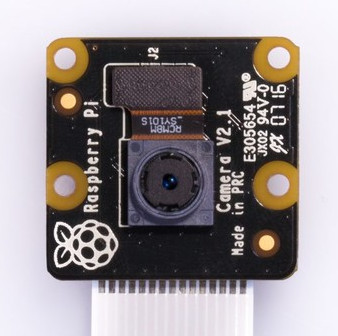

<!-- Copyright 2015-2026 Zephyr Project members and individual contributors. -->
<!-- SPDX-License-Identifier: Apache-2.0 -->
<!-- 中文翻译；编号、导航与译注为本地新增。 -->

<a id="raspberry-pi-camera-module-2"></a>

<a id="id1"></a>

# 第148章\_树莓派摄像头模块2（Raspberry Pi Camera Module 2）

原文：[官方页面](https://docs.zephyrproject.org/latest/boards/shields/raspberry_pi_camera_module_2/doc/index.html)。读取日期：2026-10-16；来源摘要见[来源记录](../SOURCES.md)。

<a id="overview"></a>

## 概述（Overview）

树莓派摄像头模块2采用Sony IMX219滚动快门（Rolling Shutter）传感器，提供由树莓派普及、广泛用于各种开发板的15针FFC连接器。

NoIR版本与普通版本相同，只移除了红外滤光片。

<a id="id2"></a>

[](images/raspberry_pi_camera_module_2.jpg)

树莓派摄像头模块2普通版，图片来源：Raspberry Pi。

<a id="id3"></a>

[](images/rpi_cam_v2_noir.jpg)

树莓派摄像头模块2 NoIR版，图片来源：Raspberry Pi。

<a id="requirements"></a>

## 前置要求（Requirements）

此摄像头模块兼容所有提供15针FFC连接器，且设备树具有[raspberrypi,csi-connector](../gpio_raspberrypi_renesas_binding_reference/P004_raspberrypi_csi-connector.md#std-dtcompatible-raspberrypi-csi-connector)所需定义的开发板。

<a id="usage"></a>

## 用途（Usage）

对于具有所需设备树节点标签的开发板，将SHIELD设为raspberry_pi_camera_module_2，即可在任意应用中使用该扩展板：

```text
# From the root of the zephyr repository
west build -b stm32n6570_dk --shield raspberry_pi_camera_module_2 samples/subsys/video/capture
```

<a id="references"></a>

## 参考资料（References）


- [产品页面（Product Page）](https://www.raspberrypi.com/products/camera-module-v2/)
- [NoIR版本产品页](https://www.raspberrypi.com/products/pi-noir-camera-v2/)
- [数据手册（Datasheet）](https://datasheets.raspberrypi.com/camera/camera-module-2-schematics.pdf)
- [机械尺寸图（Mechanical Drawing）](https://datasheets.raspberrypi.com/camera/camera-module-2-mechanical-drawing.pdf)

## 原文外链核对

2026-10-16核对并重试以下原文外链时未能确认可访问性，保留原始目标，不将访问失败解释为原文内容有误。

- [](https://www.raspberrypi.com/products/camera-module-v2/)：HTTP Error 403: Forbidden。
- [](https://www.raspberrypi.com/products/pi-noir-camera-v2/)：HTTP Error 403: Forbidden。

---

[上一章](P147_RAK19007_WisBlock_Base_Board_2nd_Gen.md) · [返回大纲](大纲.md) · [全站翻译进度](../PROGRESS.md) · [下一章](P149_Renesas_AIK_OV2640_Camera_Shield.md)
