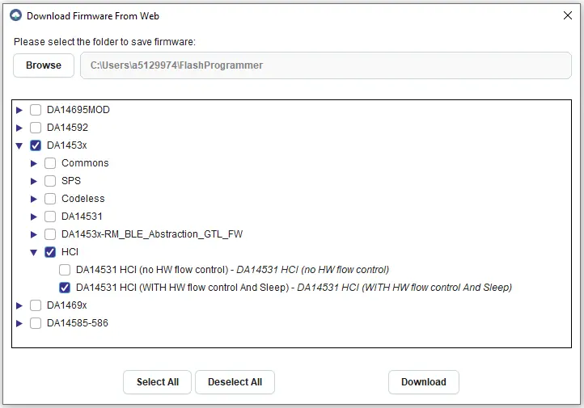

<!-- Copyright 2015-2026 Zephyr Project members and individual contributors. -->
<!-- SPDX-License-Identifier: Apache-2.0 -->
<!-- 中文翻译；编号、导航与译注为本地新增。 -->

<a id="renesas-da14531-pmod-board"></a>

<a id="renesas-us159-da14531evz-shield"></a>

# 第150章\_Renesas DA14531 Pmod扩展板

原文：[官方页面](https://docs.zephyrproject.org/latest/boards/shields/renesas_us159_da14531evz/doc/index.html)。读取日期：2026-10-16；来源摘要见[来源记录](../SOURCES.md)。

<a id="overview"></a>

## 概述（Overview）

<a id="id4"></a>

<a id="id6"></a>

Renesas US159 DA14531EVZ采用[Digilent Pmod™](https://digilent.com/reference/pmod/start)[注2](#id5)外形，搭载[DA14531MOD](https://www.renesas.com/us/en/products/wireless-connectivity/bluetooth-low-energy/da14531mod-smartbond-tiny-bluetooth-low-energy-module)[注1](#id3)低功耗蓝牙（Bluetooth LE）模块。

<a id="id1"></a>


Renesas US159 DA14531EVZ Pmod，图片来源：Renesas Electronics

<a id="requirements"></a>

## 前置要求（Requirements）

此扩展板只能用于提供Pmod™插座及pmod_serial节点标签的开发板，详情见“[扩展板（Shields）](https://docs.zephyrproject.org/latest/hardware/porting/shields.html#shields)”。

扩展板上的DA14531模块必须烧录支持UART HCI接口且启用硬件流控（Hardware Flow Control）的二进制固件。

<a id="id8"></a>

可用[Renesas SmartBond Flash Programmer](https://www.renesas.com/us/en/software-tool/smartbond-flash-programmer)[注3](#id7)下载合适的二进制文件，再通过Pmod板上的SWD排针烧录DA14531。安装并打开工具后，点击“Search Online”（在线搜索），按下图选择所需固件并下载：

<a id="id2"></a>



选择要下载的DA14531 HCI二进制文件

点击“编程（Program）”，将二进制文件写入DA14531模块。

DA14531及US159 DA14531EVZ Pmod的接口详情见以下文档：


- <a id="id10"></a>

  DA14531MOD数据手册[注4](#id9)（[DA14531MOD 数据手册](https://www.renesas.com/us/en/document/dst/da14531-module-datasheet?r=1601921)）
- <a id="id12"></a>

  [US159 DA14531EVZ Pmod](https://www.renesas.com/en/products/wireless-connectivity/bluetooth-low-energy/us159-da14531evz-low-power-bluetooth-pmod-board-renesas-quickconnect-iot)[注5](#id11)

<a id="programming"></a>

## 编程（Programming）

调用west build时设置--shield renesas_us159_da14531evz，例如：

```text
# From the root of the zephyr repository
west build -b ek_ra8m1 --shield renesas_us159_da14531evz samples/bluetooth/beacon
```

<a id="references"></a>

## 参考资料（References）

<a id="id3"></a>

〔[1](#id4)〕 [https://www.renesas.com/us/en/products/wireless-connectivity/bluetooth-low-energy/da14531mod-smartbond-tiny-bluetooth-low-energy-module](https://www.renesas.com/us/en/products/wireless-connectivity/bluetooth-low-energy/da14531mod-smartbond-tiny-bluetooth-low-energy-module)

<a id="id5"></a>

〔[2](#id6)〕 [https://digilent.com/reference/pmod/start](https://digilent.com/reference/pmod/start)

<a id="id7"></a>

〔[3](#id8)〕 [https://www.renesas.com/us/en/software-tool/smartbond-flash-programmer](https://www.renesas.com/us/en/software-tool/smartbond-flash-programmer)

<a id="id9"></a>

〔[4](#id10)〕 [Renesas DA14531模块数据手册](https://www.renesas.com/us/en/document/dst/da14531-module-datasheet?r=1601921)

<a id="id11"></a>

〔[5](#id12)〕 [https://www.renesas.com/en/products/wireless-connectivity/bluetooth-low-energy/us159-da14531evz-low-power-bluetooth-pmod-board-renesas-quickconnect-iot](https://www.renesas.com/en/products/wireless-connectivity/bluetooth-low-energy/us159-da14531evz-low-power-bluetooth-pmod-board-renesas-quickconnect-iot)

## 译注

Renesas DA14531 Pmod要求支持UART HCI且启用硬件流控的固件。

## 原文外链核对

2026-10-16核对并重试以下原文外链时未能确认可访问性，保留原始目标，不将访问失败解释为原文内容有误。

- [start](https://digilent.com/reference/pmod/start)：HTTP Error 403: Forbidden。

---

[上一章](P149_Renesas_AIK_OV2640_Camera_Shield.md) · [返回大纲](大纲.md) · [全站翻译进度](../PROGRESS.md) · [下一章](P151_Reyax_LoRa_RYLR896_and_RYLR915_Modules.md)
