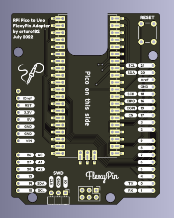

<!-- Copyright 2015-2026 Zephyr Project members and individual contributors. -->
<!-- SPDX-License-Identifier: Apache-2.0 -->
<!-- 中文翻译；编号、导航与译注为本地新增。 -->

<a id="raspberry-pi-pico-to-uno-flexypin-adapter"></a>

<a id="rpi-pico-uno-flexypin"></a>

# 第156章\_树莓派Pico转UNO FlexyPin适配板（Adapter）

原文：[官方页面](https://docs.zephyrproject.org/latest/boards/shields/rpi_pico_uno_flexypin/doc/index.html)。读取日期：2026-10-16；来源摘要见[来源记录](../SOURCES.md)。

<a id="overview"></a>

## 概述（Overview）

树莓派Pico转UNO FlexyPin适配板是开源硬件转换PCB，将Raspberry Pi Pico适配为Arduino UNO外形，设计用于FlexyPin连接针。FlexyPin固定Pico，并接触其邮票孔（Castellated Through-hole）。

也可通过简单焊接，将其用作树莓派Pico到Arduino UNO外形的转换板。



<a id="pins-assignment-of-the-raspberry-pi-pico-to-uno-flexypin-adapter"></a>

### 树莓派Pico转UNO FlexyPin适配板的引脚分配

<table>
<tr>
<th>Rpi-Pico引脚</th>
<th>UNO排针</th>
</tr>
<tr>
<td>GP0，UART0发送TX</td>
<td>D1</td>
</tr>
<tr>
<td>GP1，UART0接收RX</td>
<td>D0</td>
</tr>
<tr>
<td>GP2</td>
<td>D8</td>
</tr>
<tr>
<td>GP3</td>
<td>D9</td>
</tr>
<tr>
<td>GP4</td>
<td>D2</td>
</tr>
<tr>
<td>GP5</td>
<td><code>D3</code></td>
</tr>
<tr>
<td>GP6</td>
<td><code>D4</code></td>
</tr>
<tr>
<td>GP7</td>
<td>D5</td>
</tr>
<tr>
<td>GP8</td>
<td>D6</td>
</tr>
<tr>
<td>GP9</td>
<td><code>D7</code></td>
</tr>
<tr>
<td>GP13</td>
<td>A3</td>
</tr>
<tr>
<td>GP14，I2C1数据SDA</td>
<td>A4</td>
</tr>
<tr>
<td>GP15，I2C1时钟SCL</td>
<td>A5</td>
</tr>
<tr>
<td>GP16，SPI0接收RX／控制器输入外设输出CIPO</td>
<td>D12</td>
</tr>
<tr>
<td>GP17，SPI0片选CS</td>
<td>D10</td>
</tr>
<tr>
<td>GP18，SPI0时钟SCK</td>
<td>D13</td>
</tr>
<tr>
<td>GP19，SPI0发送TX／控制器输出外设输入COPI</td>
<td>D11</td>
</tr>
<tr>
<td>GP20</td>
<td>D14</td>
</tr>
<tr>
<td>GP21，I2C0时钟SCL</td>
<td>D15</td>
</tr>
<tr>
<td>GP26，I2C0数据SDA</td>
<td>A0</td>
</tr>
<tr>
<td>GP27</td>
<td>A1</td>
</tr>
<tr>
<td>GP28</td>
<td>A2</td>
</tr>
</table>

<a id="programming"></a>

## 编程（Programming）

调用west build时设置--shield rpi_pico_uno_flexypin。此扩展板仅负责转换，通常与其他Arduino扩展板一起使用。

例如：

```text
# From the root of the zephyr repository
west build -b rpi_pico --shield rpi_pico_uno_flexypin --shield esp_8266_arduino samples/net/wifi
```

<a id="references"></a>

## 参考资料（References）

---

[上一章](P155_NXP_RK055HDMIPI4MA0_MIPI_Display.md) · [返回大纲](大纲.md) · [全站翻译进度](../PROGRESS.md) · [下一章](P157_RTK0EG0019B01002BJ_Capacitive_Touch_Application_Shield.md)
