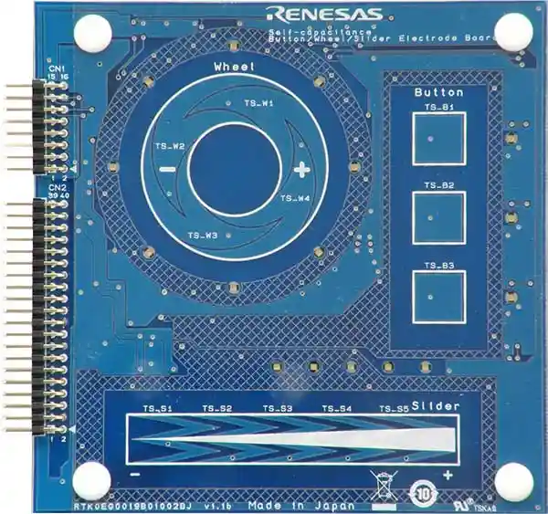

<!-- Copyright 2015-2026 Zephyr Project members and individual contributors. -->
<!-- SPDX-License-Identifier: Apache-2.0 -->
<!-- 中文翻译；编号、导航与译注为本地新增。 -->

<a id="rtk0eg0019b01002bj-capacitive-touch-application-shield"></a>

<a id="rtk0eg0019b01002bj"></a>

# 第157章\_RTK0EG0019B01002BJ电容触摸应用扩展板（Capacitive Touch Application Shield）

原文：[官方页面](https://docs.zephyrproject.org/latest/boards/shields/rtk0eg0019b01002bj/doc/index.html)。读取日期：2026-10-16；来源摘要见[来源记录](../SOURCES.md)。

<a id="overview"></a>

## 概述（Overview）

RTK0EG0019B01002BJ电容触摸应用扩展板设计用于Renesas电容触摸评估套件。

扩展板提供按键、滑条及触摸轮等多种触摸传感器，是开发触摸应用的平台。

<a id="id1"></a>

[](images/rtk0eg0019b01002bj.webp)

RTK0EG0019B01002BJ电容触摸应用扩展板，图片来源：Renesas Electronics Corporation

<a id="pins-assignment-of-the-rtk0eg0019b01002bj-shield"></a>

### RTK0EG0019B01002BJ扩展板的引脚分配

<a id="application-header-1-cn1"></a>

#### 应用排针1，CN1

<table>
<tr>
<th>CN1引脚</th>
<th>功能（Function）</th>
<th>CN1引脚</th>
<th>功能（Function）</th>
</tr>
<tr>
<td>15</td>
<td>电源（VCC）</td>
<td>16</td>
<td>地（GND）</td>
</tr>
<tr>
<td>13</td>
<td>LED_ROW0</td>
<td>14</td>
<td>LED_ROW1</td>
</tr>
<tr>
<td>11</td>
<td>LED_ROW2</td>
<td>12</td>
<td>LED_ROW3</td>
</tr>
<tr>
<td>9</td>
<td>未连接（N/C）</td>
<td>10</td>
<td>未连接（N/C）</td>
</tr>
<tr>
<td>7</td>
<td>LED_COL3</td>
<td>8</td>
<td>未连接（N/C）</td>
</tr>
<tr>
<td>5</td>
<td>LED_COL1</td>
<td>6</td>
<td>LED_COL2</td>
</tr>
<tr>
<td>3</td>
<td>未连接（N/C）</td>
<td>4</td>
<td>LED_COL0</td>
</tr>
<tr>
<td>1</td>
<td>未连接（N/C）</td>
<td>2</td>
<td>未连接（N/C）</td>
</tr>
</table>

<a id="application-header-2-cn2"></a>

#### 应用排针2，CN2

<table>
<tr>
<th>CN2引脚</th>
<th>触摸电极（Touch Electrode）</th>
<th>CN2引脚</th>
<th>触摸电极（Touch Electrode）</th>
</tr>
<tr>
<td>39</td>
<td>未连接（N/C）</td>
<td>40</td>
<td>TSCAP</td>
</tr>
<tr>
<td>37</td>
<td>未连接（N/C）</td>
<td>38</td>
<td>未连接（N/C）</td>
</tr>
<tr>
<td>35</td>
<td>未连接（N/C）</td>
<td>36</td>
<td>TS-W1</td>
</tr>
<tr>
<td>33</td>
<td>未连接（N/C）</td>
<td>34</td>
<td>TS-W2</td>
</tr>
<tr>
<td>31</td>
<td>TS-W3</td>
<td>32</td>
<td>未连接（N/C）</td>
</tr>
<tr>
<td>29</td>
<td>未连接（N/C）</td>
<td>30</td>
<td>未连接（N/C）</td>
</tr>
<tr>
<td>27</td>
<td>未连接（N/C）</td>
<td>28</td>
<td>TS-W4</td>
</tr>
<tr>
<td>25</td>
<td>未连接（N/C）</td>
<td>26</td>
<td>未连接（N/C）</td>
</tr>
<tr>
<td>23</td>
<td>未连接（N/C）</td>
<td>24</td>
<td>未连接（N/C）</td>
</tr>
<tr>
<td>21</td>
<td>未连接（N/C）</td>
<td>22</td>
<td>SHIELD-W1</td>
</tr>
<tr>
<td>19</td>
<td>未连接（N/C）</td>
<td>20</td>
<td>未连接（N/C）</td>
</tr>
<tr>
<td>17</td>
<td>未连接（N/C）</td>
<td>18</td>
<td>未连接（N/C）</td>
</tr>
<tr>
<td>15</td>
<td>未连接（N/C）</td>
<td>16</td>
<td>未连接（N/C）</td>
</tr>
<tr>
<td>13</td>
<td>未连接（N/C）</td>
<td>14</td>
<td>未连接（N/C）</td>
</tr>
<tr>
<td>11</td>
<td>未连接（N/C）</td>
<td>12</td>
<td>未连接（N/C）</td>
</tr>
<tr>
<td>9</td>
<td>TS-B1</td>
<td>10</td>
<td>TS-B2</td>
</tr>
<tr>
<td>7</td>
<td>SHIELD-B1</td>
<td>8</td>
<td>TS-B3</td>
</tr>
<tr>
<td>5</td>
<td>TS-S1</td>
<td>6</td>
<td>SHIELD-S1</td>
</tr>
<tr>
<td>3</td>
<td>TS-S3</td>
<td>4</td>
<td>TS-S2</td>
</tr>
<tr>
<td>1</td>
<td>TS-S5</td>
<td>2</td>
<td>TS-S4</td>
</tr>
</table>

<a id="programming"></a>

## 编程（Programming）

调用west build时设置--shield rtk0eg0019b01002bj，例如：

```text
# From the root of the zephyr repository
west build -b rssk_ra2l1 --shield rtk0eg0019b01002bj samples/shields/rtk0eg0019b01002bj
```

<a id="references"></a>

## 参考资料（References）


- [RA2L1电容触摸评估系统（Capacitive Touch Evaluation System）](https://www.renesas.com/en/products/microcontrollers-microprocessors/ra-cortex-m-mcus/rtk0eg0022s01001bj-capacitive-touch-evaluation-system-ra2l1)

---

[上一章](P156_Raspberry_Pi_Pico_to_UNO_FlexyPin_Adapter.md) · [返回大纲](大纲.md) · [全站翻译进度](../PROGRESS.md) · [下一章](P158_RTK7EKA6M3B00001BU_Display.md)
