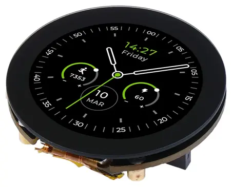

<!-- Copyright 2015-2026 Zephyr Project members and individual contributors. -->
<!-- SPDX-License-Identifier: Apache-2.0 -->
<!-- 中文翻译；编号、导航与译注为本地新增。 -->

<a id="seeed-studio-xiao-round-display"></a>

<a id="seeed-xiao-round-display"></a>

# 第166章\_Seeed Studio XIAO圆形显示屏（Round Display）

原文：[官方页面](https://docs.zephyrproject.org/latest/boards/shields/seeed_xiao_round_display/doc/index.html)。读取日期：2026-10-16；来源摘要见[来源记录](../SOURCES.md)。

<a id="overview"></a>

## 概述（Overview）

Seeed Studio XIAO圆形显示扩展板兼容所有XIAO开发板。一面为全覆盖触摸屏，外形为直径39 mm圆盘，紧凑尺寸内集成RTC、充电芯片及TF卡槽，适合智能家居、可穿戴设备等交互显示应用。

更多信息见[入门指南（Getting Started）页面](https://wiki.seeedstudio.com/get_start_round_display/)。

<a id="id1"></a>



Seeed Studio XIAO圆形显示屏，图片来源：Seeed Studio

<a id="programming"></a>

## 编程（Programming）

调用west build时设置--shield seeed_xiao_round_display。

<a id="lvgl-basic-sample"></a>

### LVGL基础示例（Basic Sample）

例如：

```text
# From the root of the zephyr repository
west build -b xiao_ble/nrf52840 --shield seeed_xiao_round_display samples/subsys/display/lvgl
```

---

[上一章](P165_Seeed_Studio_24GHz_mmWave_Sensor_for_XIAO.md) · [返回大纲](大纲.md) · [全站翻译进度](../PROGRESS.md) · [下一章](P167_Semtech_SX1261MB2BAS_LoRa_Shield.md)
