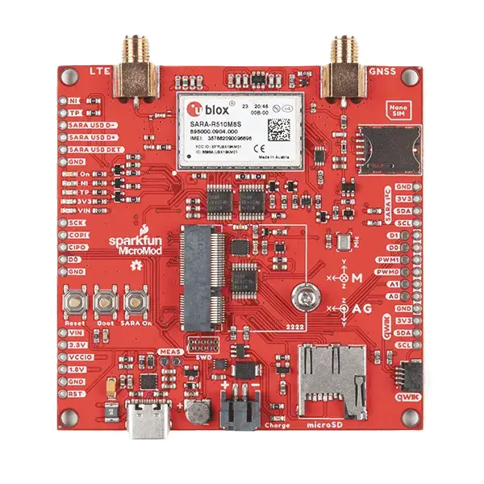

<!-- Copyright 2015-2026 Zephyr Project members and individual contributors. -->
<!-- SPDX-License-Identifier: Apache-2.0 -->
<!-- 中文翻译；编号、导航与译注为本地新增。 -->

<a id="sparkfun-sparkfun-micromod-asset-tracker-shield"></a>

<a id="sparkfun-carrier-asset-tracker"></a>

# 第171章\_Sparkfun SparkFun MicroMod资产追踪扩展板（Asset Tracker Shield）

原文：[官方页面](https://docs.zephyrproject.org/latest/boards/shields/sparkfun_carrier_asset_tracker/doc/index.html)。读取日期：2026-10-16；来源摘要见[来源记录](../SOURCES.md)。

<a id="overview"></a>

## 概述（Overview）

SparkFun MicroMod资产追踪载板属于Sparkfun Micromod标准。该模块化接口生态采用M.2标准，可将所选处理器与特定功能板组合。

资产追踪载板基于u-blox SARA-R510M8S模块，提供适用于多个地区的Secure Cloud LTE-M及NB-IoT数据通信，并通过集成的u-blox M8 GNSS接收机提供全球导航卫星系统（GNSS）能力，取得准确定位信息。

此外，扩展板集成ICM-20948九自由度惯性测量单元（IMU）、用于数据记录的microSD卡座及nano SIM卡接口。

<a id="id1"></a>



Sparkfun SparkFun MicroMod资产追踪扩展板，图片来源：Sparkfun

<a id="id3"></a>

更多信息见SparkFun MicroMod Asset Tracker指南网站[注1](#id2)。（[SparkFun MicroMod 资产追踪 指南网站](https://learn.sparkfun.com/tutorials/micromod-asset-tracker-carrier-board-hookup-guide)）

<a id="pins-assignment-of-sparkfun-sparkfun-micromod-asset-tracker-shield"></a>

### Sparkfun SparkFun MicroMod资产追踪扩展板的引脚分配

SparkFun MicroMod资产追踪载板使用76针M.2连接器。Zephyr支持的接口及引脚如下：micromod_1_uart别名为UART 1，带CTS及RTS；micromod_2_uart别名为UART 2；micromod_0_i2c及micromod_1_i2c别名分别为I2C 0及I2C 1；micromod_0_spi别名为SPI 0；A0、A1为模拟引脚；D0、D1/CAM_TRIG为数字引脚；I2C_INT#为I2C中断引脚；G0/BUS0、G1/BUS1、G2/BUS2、G3/BUS3、G4/BUS4、G5/BUS5、G6/BUS6、G7/BUS7、G8、G9/ADC_D-/CAM_HSYNC、G10/ADC_D+/CAM_VSYNC、G11/SWO及SPI_CS均为通用引脚。原网页将该引脚表显示为未解析的表格文本，此处保留全部映射。

<a id="id5"></a>

Micromod标准的详细定义见Micromod规范网站[注2](#id4)。（[MicroMod规范网站](https://www.sparkfun.com/micromod)）

<a id="requirements"></a>

## 前置要求（Requirements）

此扩展板只能用于配置了Micromod连接器并定义UART、I2C及SPI接口节点别名的开发板，详情见“[扩展板（Shields）](https://docs.zephyrproject.org/latest/hardware/porting/shields.html#shields)”。

<a id="programming"></a>

## 编程（Programming）

调用west build时设置--shield sparkfun_carrier_asset_tracker，例如：

```text
# From the root of the zephyr repository
west build -b micromod/nrf52840 --shield sparkfun_carrier_asset_tracker samples/net/cellular_modem/
```

<a id="references"></a>

## 参考资料（References）

<a id="id2"></a>

〔[1](#id3)〕 [https://learn.sparkfun.com/tutorials/micromod-asset-tracker-carrier-board-hookup-guide](https://learn.sparkfun.com/tutorials/micromod-asset-tracker-carrier-board-hookup-guide)

<a id="id4"></a>

〔[2](#id5)〕 [https://www.sparkfun.com/micromod](https://www.sparkfun.com/micromod)

## 译注

原网页的接口表未被解析成HTML表格；译文保留其全部接口和引脚映射。

---

[上一章](P170_Semtech_SX1276MB1MAS_LoRa_Shield.md) · [返回大纲](大纲.md) · [全站翻译进度](../PROGRESS.md) · [下一章](P172_Sparkfun_Environmental_Combo_Shield_with_ENS160_and_BME280.md)
