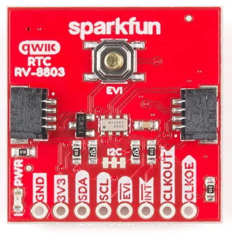

<!-- Copyright 2015-2026 Zephyr Project members and individual contributors. -->
<!-- SPDX-License-Identifier: Apache-2.0 -->
<!-- 中文翻译；编号、导航与译注为本地新增。 -->

<a id="sparkfun-rv8803-shield"></a>

<a id="sparkfun-rv8803"></a>

# 第174章\_Sparkfun RV8803扩展板（Shield）

原文：[官方页面](https://docs.zephyrproject.org/latest/boards/shields/sparkfun_rv8803/doc/index.html)。读取日期：2026-10-16；来源摘要见[来源记录](../SOURCES.md)。

<a id="overview"></a>

## 概述（Overview）

SparkFun RV8803实时时钟扩展板具有Micro Crystal RV-8803-C7实时时钟（RTC）、2个Qwiic连接器及3 V纽扣备用电池。（[SparkFun RV8803 实时时钟 扩展板](https://www.sparkfun.com/sparkfun-real-time-clock-module-rv-8803-qwiic.html)；[Micro Crystal RV-8803-C7 实时时钟](https://www.microcrystal.com/en/products/real-time-clock-rtc-modules/rv-8803-c7)）

<a id="id1"></a>



Sparkfun RV8803扩展板，图片来源：Sparkfun

<a id="requirements"></a>

## 前置要求（Requirements）

该扩展板可用于提供I2C连接器的开发板，例如STEMMA QT或Qwiic；目标板必须定义zephyr_i2c节点标签，详情见“[扩展板（Shields）](https://docs.zephyrproject.org/latest/hardware/porting/shields.html#shields)”。

<a id="pin-assignments"></a>

### 引脚分配（Pin Assignments）

<table>
<tr>
<th>扩展板引脚（Shield Pin）</th>
<th>功能（Function）</th>
</tr>
<tr>
<td>串行数据线（SDA）</td>
<td>RV8803 I2C数据SDA，也连接到Qwiic接口。</td>
</tr>
<tr>
<td>串行时钟线（SCL）</td>
<td>RV8803 I2C时钟SCL，也连接到Qwiic接口。</td>
</tr>
<tr>
<td>EVI</td>
<td>RV8803事件输入，默认低有效，具有外部上拉及板载按键。</td>
</tr>
<tr>
<td>中断（INT）</td>
<td>RV8803中断输出，低有效、开漏，具有外部上拉。</td>
</tr>
<tr>
<td>CLKOUT</td>
<td>RV8803时钟输出，可为32768、1024或1 Hz，由设备树设置控制，由CLKOE使能。</td>
</tr>
<tr>
<td>CLKOE</td>
<td>RV8803 CLKOUT控制，该引脚为高电平时使能输出；扩展板有外部下拉。</td>
</tr>
</table>

使用RV-8803中断输出时，须另接导线，将扩展板INT输出接至微控制器板的合适GPIO，并修改设备树配置；选项见[microcrystal,rv8803](../microchip_microcrystal_nxp_rtc_binding_reference/P008_microcrystal_rv8803.md#std-dtcompatible-microcrystal-rv8803)。

<a id="programming"></a>

## 编程（Programming）

调用west build时设置--shield sparkfun_rv8803，例如运行实时时钟RTC示例：（[实时时钟（RTC）](../timer_reference/P066_实时时钟示例.md#rtc)）

```text
# From the root of the zephyr repository
west build -b adafruit_qt_py_rp2040 --shield sparkfun_rv8803 samples/drivers/rtc
```

## 原文外链核对

2026-10-16核对并重试以下原文外链时未能确认可访问性，保留原始目标，不将访问失败解释为原文内容有误。

- [rv-8803-c7](https://www.microcrystal.com/en/products/real-time-clock-rtc-modules/rv-8803-c7)：The read operation timed out。

---

[上一章](P173_SparkFun_MAX3421E_Shield.md) · [返回大纲](大纲.md) · [全站翻译进度](../PROGRESS.md) · [下一章](P175_Sparkfun_SHTC3_Shield.md)
