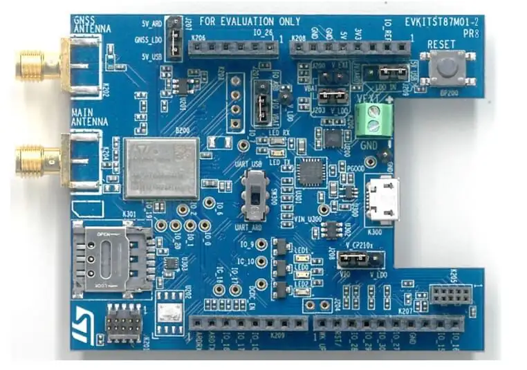

<!-- Copyright 2015-2026 Zephyr Project members and individual contributors. -->
<!-- SPDX-License-Identifier: Apache-2.0 -->
<!-- 中文翻译；编号、导航与译注为本地新增。 -->

<a id="st87mxx-shield"></a>

<a id="st87mxx-generic"></a>

# 第179章\_ST87MXX扩展板（Shield）

原文：[官方页面](https://docs.zephyrproject.org/latest/boards/shields/st87mxx/doc/index.html)。读取日期：2026-10-16；来源摘要见[来源记录](../SOURCES.md)。

<a id="overview"></a>

## 概述（Overview）

EVKITST87M01是ST87M01 NB-IoT模块评估板，采用X-NUCLEO扩展板外形及Arduino兼容连接器。ST87M01还可连接两类主机：PC或配套开发板。

ST87M01是高性能、完全可编程、超紧凑及低功耗的LTE Cat NB2 NB-IoT工业模块系列，提供广泛的全球频段覆盖及先进安全功能。



<a id="features"></a>

### 功能（Features）

板上连接器（Board Connectors）


- USB连接器
- SMA射频天线连接器
- SMA GNSS天线连接器
- 外部电源连接器
- Arduino连接器
- HST跟踪（Trace）连接器
- Nano SIM卡座
- Cortex-M4 JTAG接口

3种供电连接方式


- USB连接器
- 外部连接器
- Arduino连接器

接口（Interfaces）


- 用于AT命令的UART
- 两个模数转换器（ADC）
- 通用输入输出（GPIOs）

发光二极管（LEDs）


- 3个模块活动LED
- 2个UART活动LED

按键（Button）


- 1个复位按键

<a id="pins-assignment-of-the-evkitst87m01"></a>

### EVKITST87M01的引脚分配

<table>
<tr>
<th>K207连接器引脚</th>
<th>功能（Function）</th>
</tr>
<tr>
<td>1</td>
<td>MODEM_WAKE-UP</td>
</tr>
<tr>
<td>2</td>
<td>MODEM_RESET</td>
</tr>
<tr>
<td>7</td>
<td>地（GND）</td>
</tr>
</table>

<table>
<tr>
<th>K208连接器引脚</th>
<th>功能（Function）</th>
</tr>
<tr>
<td>4</td>
<td>3V3</td>
</tr>
<tr>
<td>5</td>
<td>5V0</td>
</tr>
<tr>
<td>6</td>
<td>地（GND）</td>
</tr>
<tr>
<td>7</td>
<td>地（GND）</td>
</tr>
</table>

<table>
<tr>
<th>K209连接器引脚</th>
<th>功能（Function）</th>
</tr>
<tr>
<td>1</td>
<td>UART_RXD</td>
</tr>
<tr>
<td>2</td>
<td>UART_TXD</td>
</tr>
</table>

<a id="requirements"></a>

## 前置要求（Requirements）

此扩展板只能用于已配置Arduino连接器并定义UART及GPIO接口节点别名的开发板。

须在卡座中插入Nano SIM格式的NB-IoT SIM卡，才能使调制解调器接入网络。

<a id="build-and-programming"></a>

## 构建与编程（Build and Programming）

编译时，在west build中设置--shield st87mxx。

然后编译示例，例如：

```text
west build -b your_board --shield st87mxx samples/net/sockets/http_client
west flash
```

<a id="references"></a>

## 参考资料（References）


- [https://www.st.com/en/evaluation-tools/evkitst87m01-2.html](https://www.st.com/en/evaluation-tools/evkitst87m01-2.html)

## 原文外链核对

2026-10-16核对并重试以下原文外链时未能确认可访问性，保留原始目标，不将访问失败解释为原文内容有误。

- [evkitst87m01-2.html](https://www.st.com/en/evaluation-tools/evkitst87m01-2.html)：HTTP Error 567: Unknown Status。

---

[上一章](P178_Generic_ST7789V_Display_Shield.md) · [返回大纲](大纲.md) · [全站翻译进度](../PROGRESS.md) · [下一章](P180_ST_B-CAMS-IMX-MB1854.md)
