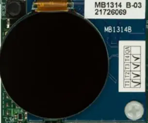

<!-- Copyright 2015-2026 Zephyr Project members and individual contributors. -->
<!-- SPDX-License-Identifier: Apache-2.0 -->
<!-- 中文翻译；编号、导航与译注为本地新增。 -->

<a id="st-b-dsi-mb1314"></a>

<a id="id1"></a>

# 第182章\_ST B-DSI-MB1314显示扩展板

原文：[官方页面](https://docs.zephyrproject.org/latest/boards/shields/st_b_dsi_mb1314/doc/index.html)。读取日期：2026-10-16；来源摘要见[来源记录](../SOURCES.md)。

<a id="overview"></a>

## 概述（Overview）

此扩展板提供DSI显示功能，采用1.2英寸390×390像素圆形AMOLED触摸面板。控制器为RM67162，面板型号为G1120TB103GF-001。

<a id="id2"></a>



B-DSI-MB1314图片

<a id="requirements"></a>

## 前置要求（Requirements）

开发板必须具有zephyr_mipi_dsi及zephyr_lcd_controller设备树标签，才能使用此扩展板。

<a id="usage"></a>

## 用途（Usage）

将SHIELD设为st_b_dsi_mb1314并添加所需板级设备树属性，即可在任意应用中使用此扩展板。

调用west build时设置--shield "st_b_dsi_mb1314"，例如：

```text
# From the root of the zephyr repository
west build -b stm32l4r9i_disco --shield st_b_dsi_mb1314 samples/drivers/display
```

<a id="references"></a>

## 参考资料（References）


- [产品页面（Product Page）](https://www.st.com/en/evaluation-tools/32l4r9idiscovery.html)
- [用户手册（User Manual）](https://www.st.com/resource/en/user_manual/um2271-discovery-kit-with-stm32l4r9ai-mcu-stmicroelectronics.pdf)

## 原文外链核对

2026-10-16核对并重试以下原文外链时未能确认可访问性，保留原始目标，不将访问失败解释为原文内容有误。

- [32l4r9idiscovery.html](https://www.st.com/en/evaluation-tools/32l4r9idiscovery.html)：HTTP Error 567: Unknown Status。
- [um2271-discovery-kit-with-stm32l4r9ai-mcu-stmicroelectronics.pdf](https://www.st.com/resource/en/user_manual/um2271-discovery-kit-with-stm32l4r9ai-mcu-stmicroelectronics.pdf)：HTTP Error 567: Unknown Status。

---

[上一章](P181_ST_B-CAMS-OMV-MB1683.md) · [返回大纲](大纲.md) · [全站翻译进度](../PROGRESS.md) · [下一章](P183_ST_B-LCD40-DSI1.md)
