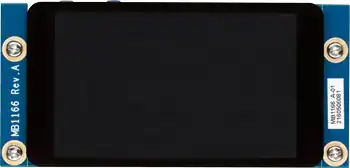
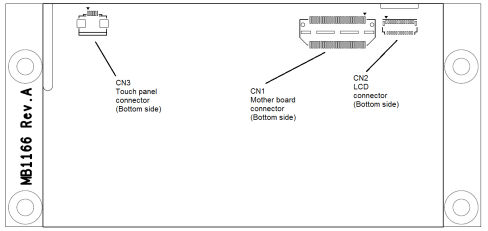

<!-- Copyright 2015-2026 Zephyr Project members and individual contributors. -->
<!-- SPDX-License-Identifier: Apache-2.0 -->
<!-- 中文翻译；编号、导航与译注为本地新增。 -->

<a id="st-b-lcd40-dsi1"></a>

<a id="st-b-lcd40-dsi1-mb1166"></a>

# 第183章\_ST B-LCD40-DSI1显示扩展板

原文：[官方页面](https://docs.zephyrproject.org/latest/boards/shields/st_b_lcd40_dsi1_mb1166/doc/index.html)。读取日期：2026-10-16；来源摘要见[来源记录](../SOURCES.md)。

<a id="overview"></a>

## 概述（Overview）

B-LCD40-DSI1扩展板提供4英寸WVGA TFT LCD，具有MIPI DSI接口及电容触摸屏。

注意（Note）

此扩展板有不同硬件版本。MB1166-A09采用NT35510面板控制器，构建时必须将SHIELD设为st_b_lcd40_dsi1_mb1166_a09。较早版本采用OTM8009a控制器，应使用不带后缀的名称st_b_lcd40_dsi1_mb1166。

<a id="id1"></a>



B-LCD40-DSI1 MB1166图片

<a id="id2"></a>



B-LCD40-DSI1 MB1166连接器

<table>
<tr>
<th>CN1奇数脚</th>
<th>说明（Description）</th>
<th>接口（Interface）</th>
<th>CN1偶数脚</th>
<th>说明（Description）</th>
<th>接口（Interface）</th>
</tr>
<tr>
<td>1</td>
<td>地（GND）</td>
<td><ul><li></li></ul></td>
<td>2</td>
<td><ul><li></li></ul></td>
<td><ul><li></li></ul></td>
</tr>
<tr>
<td>3</td>
<td>DSI_CK_P</td>
<td>DSI</td>
<td>4</td>
<td>TOUCH_INT</td>
<td>中断输出</td>
</tr>
<tr>
<td>5</td>
<td>DSI_CK_N</td>
<td>DSI</td>
<td>6</td>
<td><ul><li></li></ul></td>
<td><ul><li></li></ul></td>
</tr>
<tr>
<td>7</td>
<td>地（GND）</td>
<td><ul><li></li></ul></td>
<td>8</td>
<td><ul><li></li></ul></td>
<td><ul><li></li></ul></td>
</tr>
<tr>
<td>9</td>
<td>DSI_D0_P</td>
<td>DSI</td>
<td>10</td>
<td><ul><li></li></ul></td>
<td><ul><li></li></ul></td>
</tr>
<tr>
<td>11</td>
<td>DSI_D0_N</td>
<td>DSI</td>
<td>12</td>
<td><ul><li></li></ul></td>
<td><ul><li></li></ul></td>
</tr>
<tr>
<td>13</td>
<td>地（GND）</td>
<td><ul><li></li></ul></td>
<td>14</td>
<td><ul><li></li></ul></td>
<td><ul><li></li></ul></td>
</tr>
<tr>
<td>15</td>
<td>DSI_D1_P</td>
<td>DSI</td>
<td>16</td>
<td><ul><li></li></ul></td>
<td><ul><li></li></ul></td>
</tr>
<tr>
<td>17</td>
<td>DSI_D1_N</td>
<td>DSI</td>
<td>18</td>
<td><ul><li></li></ul></td>
<td><ul><li></li></ul></td>
</tr>
<tr>
<td>19</td>
<td>地（GND）</td>
<td><ul><li></li></ul></td>
<td>20</td>
<td><ul><li></li></ul></td>
<td><ul><li></li></ul></td>
</tr>
<tr>
<td>21</td>
<td>背光电源BLVDD，+5 V</td>
<td><ul><li></li></ul></td>
<td>22</td>
<td><ul><li></li></ul></td>
<td><ul><li></li></ul></td>
</tr>
<tr>
<td>23</td>
<td>背光电源BLVDD，+5 V</td>
<td><ul><li></li></ul></td>
<td>24</td>
<td><ul><li></li></ul></td>
<td><ul><li></li></ul></td>
</tr>
<tr>
<td>25</td>
<td><ul><li></li></ul></td>
<td><ul><li></li></ul></td>
<td>26</td>
<td><ul><li></li></ul></td>
<td><ul><li></li></ul></td>
</tr>
<tr>
<td>27</td>
<td>BLGND</td>
<td><ul><li></li></ul></td>
<td>28</td>
<td><ul><li></li></ul></td>
<td><ul><li></li></ul></td>
</tr>
<tr>
<td>29</td>
<td>BLGND</td>
<td><ul><li></li></ul></td>
<td>30</td>
<td><ul><li></li></ul></td>
<td><ul><li></li></ul></td>
</tr>
<tr>
<td>31</td>
<td><ul><li></li></ul></td>
<td><ul><li></li></ul></td>
<td>32</td>
<td><ul><li></li></ul></td>
<td><ul><li></li></ul></td>
</tr>
<tr>
<td>33</td>
<td><ul><li></li></ul></td>
<td><ul><li></li></ul></td>
<td>34</td>
<td><ul><li></li></ul></td>
<td><ul><li></li></ul></td>
</tr>
<tr>
<td>35</td>
<td><ul><li></li></ul></td>
<td><ul><li></li></ul></td>
<td>36</td>
<td>VDD，2.8～3.3 V</td>
<td><ul><li></li></ul></td>
</tr>
<tr>
<td>37</td>
<td><ul><li></li></ul></td>
<td><ul><li></li></ul></td>
<td>38</td>
<td><ul><li></li></ul></td>
<td><ul><li></li></ul></td>
</tr>
<tr>
<td>39</td>
<td><ul><li></li></ul></td>
<td><ul><li></li></ul></td>
<td>40</td>
<td>I2C_SDA</td>
<td>集成电路间总线（I2C）</td>
</tr>
<tr>
<td>41</td>
<td><ul><li></li></ul></td>
<td><ul><li></li></ul></td>
<td>42</td>
<td><ul><li></li></ul></td>
<td><ul><li></li></ul></td>
</tr>
<tr>
<td>43</td>
<td><ul><li></li></ul></td>
<td><ul><li></li></ul></td>
<td>44</td>
<td>I2C_SCL</td>
<td>集成电路间总线（I2C）</td>
</tr>
<tr>
<td>45</td>
<td><ul><li></li></ul></td>
<td><ul><li></li></ul></td>
<td>46</td>
<td><ul><li></li></ul></td>
<td><ul><li></li></ul></td>
</tr>
<tr>
<td>47</td>
<td><ul><li></li></ul></td>
<td><ul><li></li></ul></td>
<td>48</td>
<td><ul><li></li></ul></td>
<td><ul><li></li></ul></td>
</tr>
<tr>
<td>49</td>
<td>DSI_TE</td>
<td>DSI</td>
<td>50</td>
<td><ul><li></li></ul></td>
<td><ul><li></li></ul></td>
</tr>
<tr>
<td>51</td>
<td><ul><li></li></ul></td>
<td><ul><li></li></ul></td>
<td>52</td>
<td><ul><li></li></ul></td>
<td><ul><li></li></ul></td>
</tr>
<tr>
<td>53</td>
<td>BL_CTRL</td>
<td>通用输入输出（GPIO）</td>
<td>54</td>
<td><ul><li></li></ul></td>
<td><ul><li></li></ul></td>
</tr>
<tr>
<td>55</td>
<td><ul><li></li></ul></td>
<td><ul><li></li></ul></td>
<td>56</td>
<td><ul><li></li></ul></td>
<td><ul><li></li></ul></td>
</tr>
<tr>
<td>57</td>
<td>复位（RESET）</td>
<td>通用输入输出（GPIO）</td>
<td>58</td>
<td><ul><li></li></ul></td>
<td><ul><li></li></ul></td>
</tr>
<tr>
<td>59</td>
<td><ul><li></li></ul></td>
<td><ul><li></li></ul></td>
<td>60</td>
<td><ul><li></li></ul></td>
<td><ul><li></li></ul></td>
</tr>
</table>

<a id="requirements"></a>

## 前置要求（Requirements）

开发板必须具有mipi_dsi设备树标签，才能使用此扩展板。

<a id="usage"></a>

## 用途（Usage）

将SHIELD设为st_b_lcd40_dsi1_mb1166或st_b_lcd40_dsi1_mb1166_a09，并添加所需设备树属性，即可在任意应用中使用此扩展板。

调用west build时设置--shield "st_b_lcd40_dsi1_mb1166"，例如：

```text
# From the root of the zephyr repository
west build -b stm32h747i_disco/stm32h747xx/m7 --shield st_b_lcd40_dsi1_mb1166 samples/drivers/display
```

<a id="references"></a>

## 参考资料（References）


- [产品页面（Product Page）](https://www.st.com/en/evaluation-tools/b-lcd40-dsi1.html)
- [产品简介（Databrief）](https://www.st.com/resource/en/data_brief/b-lcd40-dsi1.pdf)
- [用户手册（User Manual）](https://www.st.com/resource/en/user_manual/um2104--4inch-wvga-tft-lcd-board-with-mipi-dsi-interface-and-capacitive-touch-screen-stmicroelectronics.pdf)

## 译注

MB1166-A09采用NT35510，旧版采用OTM8009a，必须选择相应扩展板名称。

## 原文外链核对

2026-10-16核对并重试以下原文外链时未能确认可访问性，保留原始目标，不将访问失败解释为原文内容有误。

- [b-lcd40-dsi1.html](https://www.st.com/en/evaluation-tools/b-lcd40-dsi1.html)：HTTP Error 567: Unknown Status。
- [b-lcd40-dsi1.pdf](https://www.st.com/resource/en/data_brief/b-lcd40-dsi1.pdf)：HTTP Error 567: Unknown Status。
- [um2104--4inch-wvga-tft-lcd-board-with-mipi-dsi-interface-and-capacitive-touch-screen-stmicroelectronics.pdf](https://www.st.com/resource/en/user_manual/um2104--4inch-wvga-tft-lcd-board-with-mipi-dsi-interface-and-capacitive-touch-screen-stmicroelectronics.pdf)：HTTP Error 567: Unknown Status。

---

[上一章](P182_ST_B-DSI-MB1314.md) · [返回大纲](大纲.md) · [全站翻译进度](../PROGRESS.md) · [下一章](P184_ST_B-M2MEM-PACK1_M.2_serial_memory_pack.md)
